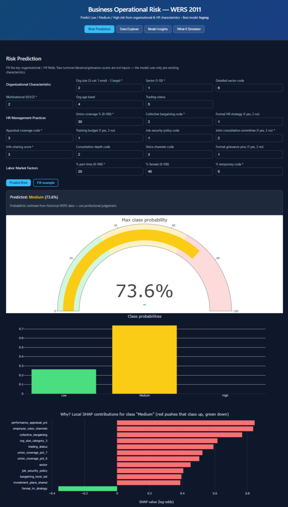
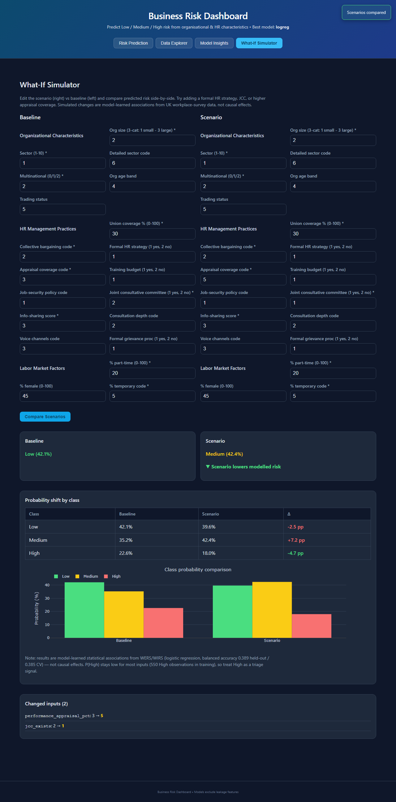

*live local explanation per prediction** — exact linear SHAP computed
  server-side for the exact input, aggregated back to the original features.

---

## Architecture & design decisions

```
WERS .tab ──► 01_build_dataset ──► merged CSV ──► 03 features ──► 04 train ──► Pipeline(.pkl)
                  │                                              │            │
                  └── turnover band (target)                    │            ▼
                                                                │      Flask REST API
                        05 evaluate ──► metrics/CM/ROC           │       ├── /api/predict  (+ live SHAP)
                        06 SHAP      ──► global importance       ▼       ├── /api/whatif
                                       local fallback JSON   metadata   └── /api/insights, /api/features, /api/data/*
```

- **Train/serve parity.** Each model is a single scikit-learn `Pipeline`
  (`prep` → `clf`): one-hot encoding, median/`MISSING` imputation and
  classification travel together, so the API can never score data differently
  from how it was trained.
- **Leakage is guarded twice** — excluded in `04_model_training.py` and
  asserted by system test ST3 against `model_metadata.json`.
- **Fail-safe explainability.** Local SHAP (`contribution_j = coef_j ·
  (x_j − E[x_j])`, background expectation cached from the real data) is
  computed per request but never gates it: if explanation fails, the
  prediction response is returned without it (regression-tested).
- **Strict, structured API.** Pydantic schemas enforce types/ranges; every
  error uses a machine-readable code (`MISSING_FIELD`, `OUT_OF_RANGE`, …)
  with HTTP status, `X-Request-ID` tracing and a per-IP rate limiter.
- **What-if integrity.** Both blocks pass through the *same* validator and
  model as `/api/predict`; validation runs client- and server-side, and
  failures are tagged `baseline`/`scenario` so comparisons are auditable.
- **Honest decision support.** The what-if UI shows deltas and an explicit
  "associations, not causal effects" disclaimer; the rare-class bound is
  disclosed rather than hidden.
- **Determinism.** `random_state = 42` end-to-end — every committed number
  and figure is reproducible from the committed code.

---

## Packages used

Exact versions from the executed environment (Table 4.1 of the dissertation);
`requirements.txt` carries the compatible minimum ranges.

| Package | Verified version | Role in this project |
|---|---|---|
| Python | 3.13.3 | runtime |
| pandas | 3.0.1 | data wrangling, feature frames, CSV I/O |
| numpy | 2.4.2 | numerical arrays, SHAP maths |
| scipy | ≥ 1.10 | statistical tests (Bartlett, KMO) |
| statsmodels | ≥ 0.14 | factor analysis (EDA) |
| scikit-learn | 1.8.0 | models, preprocessing pipeline, metrics, MLP |
| imbalanced-learn | ≥ 0.11 | SMOTE / SMOTE-ENN resampling variants |
| XGBoost | 3.2.0 | gradient-boosting model |
| LightGBM | 4.6.0 | gradient-boosting model |
| SHAP | 0.51.0 | global + local model explainability |
| matplotlib | 3.10.8 | static dissertation figures |
| seaborn | ≥ 0.12 | EDA plots |
| joblib | ≥ 1.3 | model serialisation (`.pkl` pipelines) |
| Flask | 3.0.0 | web backend / REST API |
| Flask-Cors | 6.0.2 | cross-origin support |
| pydantic | 2.13.5 | strict request validation & error protocol |
| tqdm | ≥ 4.65 | progress bars in long scripts |
| pytest | 9.0.2 | test suite (32 tests) |
| Plotly.js | 2.27.0 (CDN) | interactive dashboard charts (gauge, SHAP, what-if) |

---

## Project structure

```
project-risk-dashboard/
├── README.md                  # this file
├── EVIDENCE_INTEGRATION_SUMMARY.md        # corrections log (thesis-facing numbers)
├── EVIDENCE_INTEGRATION_CHAPTERS_1-3_CORRECTED.md  # ch.1-3 evidence + insert points
├── RAW_DATA_SOURCE_REPORT.md  # raw WERS files, waves, merge rule, licence
├── LICENSE                    # MIT (code)
├── requirements.txt           # dependency ranges
│
├── data/
│   ├── wirsts10_july2014.tab/.csv   # raw WERS time-series main survey (NOT in git — UKDA EUL)
│   ├── wirsts25_july2014.tab/.csv   # raw WERS panel file            (NOT in git — UKDA EUL)
│   └── processed/
│       ├── wers_operational_risk_merged.csv   # analysis-ready dataset (14,448 × 53)
│       ├── wers_panel_features_engineered.csv # exploratory matrix
│       ├── dataset_metadata.json
│       └── processing_summary.txt
│
├── ml_pipeline/                 # numbered pipeline (run in order)
│   ├── 01_build_dataset.py                # merge waves, clean turnover, build target
│   ├── 02_exploratory_analysis.py    # EDA report
│   ├── 03_feature_exploration.py     # EDA of leakage-safe predictors (RQ1)
│   ├── 04_model_training.py          # 5 models + model_metadata.json
│   ├── 05_imbalance_tuning.py       # SMOTE / SMOTE-ENN / tuned / stacked
│   ├── 06_model_evaluation.py        # metrics, confusion matrices, ROC
│   ├── 07_shap_explanation.py        # global + local SHAP artefacts
│   ├── 08_factor_analysis.py         # HR-practice factor analysis
│   ├── efa_tools.py                  # shared EFA fit/transform utilities
│   └── research/
│       ├── thesis_outputs.py         # thesis figures + tables
│       └── system_tests.py           # ST1-ST19 evidence
│
├── models/
│   └── saved_models/                 # *.pkl produced locally (NOT in git)
│       └── model_metadata.json       # best model, 37 features, metrics
│
├── dashboard/
│   ├── app.py                        # Flask app + REST API
│   ├── validation.py                 # Pydantic schema & error codes
│   ├── templates/index.html          # single-page frontend
│   └── static/
│       ├── css/style.css
│       └── js/app.js                 # tabs, forms, Plotly charts, what-if
│
├── tests/
│   ├── conftest.py                   # fixtures (client, valid payload)
│   ├── test_api.py                   # endpoints, error codes, SHAP contract
│   ├── test_validation.py            # schema edge cases
│   └── test_predictor.py             # inference wrapper
│
└── notebooks/
    ├── 01_data_exploration.ipynb
    ├── 02_feature_analysis.ipynb
    └── 03_model_development.ipynb
```

---

## Installation

**Prerequisites:** Python 3.11+ (developed and verified on 3.13.3), pip, git.

```bash
pip install -r requirements.txt
git clone <your-fork-url>
cd project-risk-dashboard

python -m venv .venv
# Windows
.venv\Scripts\activate
# macOS/Linux
source .venv/bin/activate

pip install -r requirements.txt
```

**Data:** the raw WERS time-series files (waves 1980–2011) must be obtained
separately from the [UK Data Service](https://ukdataservice.ac.uk/) (Study 4511)
under its End User Licence, then placed in `data/`. If
`data/processed/` already contains `wers_operational_risk_merged.csv`, you can
skip straight to [Running](#running-the-project).

---

## Running the project

### Full pipeline (from raw data to dashboard)

```bash
python ml_pipeline/01_build_dataset.py             # merge waves + clean turnover band (target)
python ml_pipeline/02_exploratory_analysis.py      # EDA report
python ml_pipeline/03_feature_exploration.py       # EDA of leakage-safe predictors (RQ1)
python ml_pipeline/04_model_training.py            # train 5 models + metadata (5-fold CV)
python ml_pipeline/05_imbalance_tuning.py          # SMOTE / SMOTE-ENN / tuned / stacked
python ml_pipeline/06_model_evaluation.py          # metrics, CM, ROC
python ml_pipeline/07_shap_explanation.py          # global + local SHAP
python ml_pipeline/08_factor_analysis.py           # EFA (spec §3.7) — adds factor scores
python ml_pipeline/research/thesis_outputs.py      # thesis figures + tables
python ml_pipeline/research/system_tests.py        # ST1-ST19 evidence
```

### Launch the dashboard

```bash
python dashboard/app.py
# -> http://localhost:5000
```

Model binaries (`*.pkl`) are generated by step 04 and are not committed; a
fresh clone must run the pipeline (at minimum `01_build_dataset.py` and
`04_model_training.py`) before the dashboard will start.

---

## Dashboard & API

### Web UI (four tabs)

| Tab | What it does |
|---|---|
| **Risk Prediction** | 20-input form → gauge, class probabilities, and a **live local SHAP chart for the exact input** |
| **Data Explorer** | filter by sector/size, distribution charts, CSV export/upload |
| **Model Insights** | best-model card, balanced-accuracy comparison, confusion matrix, top-20 MDI + SHAP importance |
| **What-If Simulator** | baseline vs scenario side-by-side: per-class Δ table, grouped bar chart, changed-fields diff, direction verdict, causality disclaimer |

### REST API

| Endpoint | Method | Description |
|---|---|---|
| `/api/predict` (`/predict`) | POST | risk level + 3-class probabilities + live `local_explanation` |
| `/api/whatif` (`/simulate`) | POST | baseline vs scenario comparison (errors tagged `baseline`/`scenario`) |
| `/api/insights`, `/api/features` | GET | model metrics, confusion matrix, importance, SHAP tables |
| `/api/data/summary` (`/data`), `/api/data/export`, `/api/data/upload`, `/api/data/load-sample` | GET/POST | explorer backend |
| `/api/metadata` | GET | features, labels, best model |

Requests are validated with Pydantic and return a structured error protocol:

| Code | HTTP | Meaning |
|---|---|---|
| `MISSING_FIELD` | 400 | required field absent/null (all missing fields listed) |
| `INVALID_TYPE` | 400 | value cannot be coerced |
| `OUT_OF_RANGE` | 400 | outside the allowed domain |
| `MALFORMED_JSON` | 400 | body is not a JSON object |
| `MODEL_ERROR` | 422 | inference failed (incomplete vector) |
| `INTERNAL_ERROR` | 500 | unexpected failure |
| `RATE_LIMITED` | 429 | per-IP limit exceeded (`Retry-After` header) |
| `SERVICE_UNAVAILABLE` | 503 | model not loaded |

Ten fields are required; everything else is optional and safely imputed
(numeric → median, categorical → `"MISSING"`) inside the scikit-learn pipeline.
Every response carries an `X-Request-ID` for traceability.

### Example requests

```bash
curl -X POST http://localhost:5000/api/predict \
  -H "Content-Type: application/json" \
  -d '{"sector": 1, "org_size_category_3": 2, "multinational": 2,
       "union_coverage_pct": 30, "collective_bargaining": 2,
       "performance_appraisal_pct": 3, "jcc_exists": 2,
       "information_sharing_score": 3, "pct_part_time": 20, "pct_temporary": 5}'
```

```json
{
  "risk_level": "Medium",
  "probability": 0.7365,
  "probabilities": {"Low": 0.2635, "Medium": 0.7365, "High": 0.0},
  "local_explanation": {
    "model": "LogisticRegression",
    "class_explained": "Medium",
    "base_value": 2.30318,
    "output": 7.89901,
    "contributions": [
      {"feature": "performance_appraisal_pct", "shap": 0.84451, "value": "3"},
      {"feature": "collective_bargaining", "shap": 0.76788, "value": "2"}
    ]
  }
}
```

```bash
curl -X POST http://localhost:5000/api/whatif \
  -H "Content-Type: application/json" \
  -d '{"baseline": { ...10 required fields... },
       "scenario": { ...same fields, jcc_exists: 1, appraisal: 5... }}'
# -> {"baseline": {...}, "scenario": {...}} — same contract as /api/predict
```

### Screenshots

| Risk prediction + live local SHAP | What-if simulator |
|---|---|
|  |  |

---

## Python usage example

```python
from models.risk_predictor import OperationalRiskPredictor

predictor = OperationalRiskPredictor.load()   # loads models/saved_models/logreg.pkl

org = {
    "org_size_category_3": 2,
    "sector": 1,
    "union_coverage_pct": 30,
    "collective_bargaining": 2,
    "performance_appraisal_pct": 3,
    "jcc_exists": 2,
    "information_sharing_score": 3,
    "pct_part_time": 20,
    "pct_temporary": 5,
}

risk_level, probability = predictor.predict(org)
print(f"Predicted risk: {risk_level} ({probability:.1%})")
print(predictor.predict_proba_dict(org))     # {'Low': ..., 'Medium': ..., 'High': ...}

why = predictor.explain(org)                 # live local SHAP for this input
for c in why["contributions"][:5]:
    print(f"  {c['feature']:>28s}  shap={c['shap']:+.4f}  input={c['value']}")
```

---

## Testing

```bash
node_modules/.bin/tsc --noEmit
python -m pytest tests/ -q          # 32 tests (including factor-score inference)
```

The suite covers the predictor wrapper, the Pydantic validation contract
(all eight error codes, edge cases, imputation), every API endpoint and
alias, the rate limiter, the what-if block protocol, and the live local-SHAP
response contract (including fail-safety: a broken explainer must never break
a prediction).

---

## System verification

Beyond unit tests, a 19-point system-test plan (ST1–ST19) is executed against
the deployed configuration (`python ml_pipeline/research/system_tests.py`) —
**19/19 passing** as of the latest run:

| Group | Tests | Verifies |
|---|---|---|
| Data integrity | ST1–ST3 | dataset dimensions 14,448 × 53, turnover class counts (5,077/621/687), 14 leakage exclusions |
| Model | ST4–ST5 | best model loads (logreg, 37 features); probabilities sum to 1 |
| Validation contract | ST6–ST13 | all 400-level codes: missing/empty/type/range/extra/null/malformed |
| Resilience | ST14–ST16 | 422 model failure, 500 internal error, 429 rate limit + `Retry-After` |
| Integration | ST17–ST19 | endpoint aliases, what-if baseline/scenario, NaN-free strict JSON |

A browser-level Playwright run additionally verified: all forms auto-build
(20 inputs each), client-side validation blocks bad input with zero network
calls, the what-if delta chart/diff render, the local-SHAP chart draws 12
non-zero bars, and no JavaScript errors occur.

---

## Research outputs

Chapter-mapped dissertation artefacts (figures 4.1–4.4 and 5.1–5.7, tables
3.2/4.x/5.1–5.13, environment table, system-test report) live in
[`research/`](research/README.md) — its README is a full
chapter → artifact map with the executed numbers. Regenerate everything
deterministically with:

```bash
python ml_pipeline/research/thesis_outputs.py   # thesis figures + tables
python ml_pipeline/research/system_tests.py     # ST1-ST19 evidence
```

---

## Troubleshooting

| Symptom | Fix |
|---|---|
| `WARNING: model not trained yet` / dashboard starts but predicts fail | run `python ml_pipeline/01_build_dataset.py` then `python ml_pipeline/04_model_training.py` (the `.pkl` files are not committed) |
| `OSError: [Errno 98]` / address already in use | another process holds port 5000 — kill it or change the port in `dashboard/app.py` |
| Charts render empty / no gauge | the frontend loads Plotly.js from a CDN — check internet access, or self-host the bundle |
| `ModuleNotFoundError` in scripts | activate the environment installed via `pip install -r requirements.txt` |
| Numbers differ from this README | you are likely on different package versions — compare with the verified environment table above |

---

## Limitations & responsible use

1. **High-risk scarcity.** Of 6,385 modelled rows, 687 (10.76 %) are High-risk
   after turnover-band construction; Medium (621) is similarly scarce, so
   minority-class recall is noisy — treat High predictions as triage signals,
   not ground truth.
2. **Associations ≠ causation.** The what-if simulator shows how the fitted
   model responds to input changes — it does not prove that changing an HR
   practice will change real-world risk. The UI states this explicitly.
3. **Multi-wave cross-sectional data (1980–2011).** Relationships may drift
   between waves; retrain with newer WERS waves before any operational use.
4. **Survey weights excluded.** `weight` is not a model feature; use weighted
   descriptive statistics for population-level claims.
5. **Development server.** `dashboard/app.py` runs Flask's dev server — put a
   production WSGI server (gunicorn/uWSGI) in front of it for any real
   deployment.

---

## Contributing

Contributions are welcome:

1. Fork the repository and create a feature branch
   (`git checkout -b feature/my-feature`).
2. Follow **PEP 8**; add docstrings to new functions.
3. Add or extend tests in `tests/` — the suite must stay green
   (`python -m pytest tests/ -q`).
4. Open a pull request describing the change and its motivation.

Please keep contributions consistent with the project's scope (leakage-safe
operational-risk modelling + decision-support dashboard) and do not commit
WERS raw data or large model binaries (both are git-ignored for licence and
size reasons).

---

## License & data acknowledgement

- **Code:** released under the [MIT License](LICENSE).
- **Data:** the Workplace Employment Relations Survey time-series (waves
  1980–2011) is provided by the **UK Data Service** (Study 4511) under its
  **End User Licence (Safeguarded data)**. The raw data files are excluded
  from this repository; you must register with the UK Data Service and accept
  the licence to obtain them. Do not redistribute the raw or processed survey
  data with derived repositories.
- WERS was funded by the UK Department for Business, Innovation and Skills and
  conducted by the Institute for Employment Studies, the National Institute of
  Economic and Social Research, and the Policy Studies Institute.

---

## Citation

If you use this work, please cite:

```bibtex
@mastersthesis{operational_risk_wers,
  title  = {Predictive Modeling of Business Operational Risk Levels
            and an Interactive Web Dashboard},
  author = {Your Name},
  school = {Your Institution},
  year   = {2026},
  note   = {WERS/WIRS 1990-2011, UK Data Archive Study 4511}
}
```

