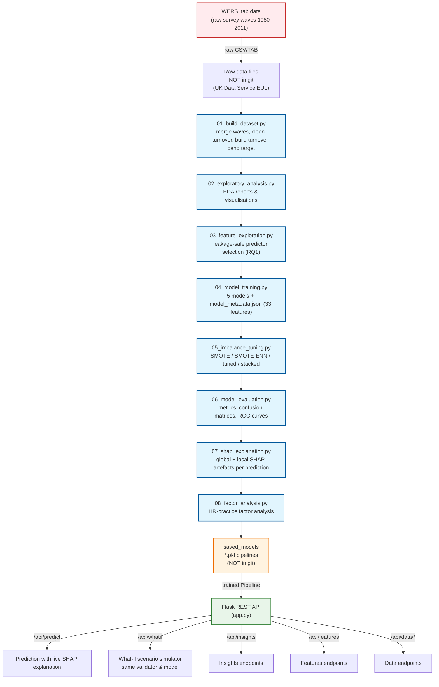

# Predictive Modelling of Business Operational Risk Levels and an Interactive Web Dashboard

Classification of workplace operational risk (Low / Medium / High) from the
WERS/WIRS time-series (UK Data Service Study 4511, waves 1980–2011), served
through a Flask REST API and an interactive web dashboard.

**Live local explanation per prediction** — exact linear SHAP computed
server-side for the exact input, aggregated back to the original features.

---

## Architecture & design decisions


- **Train/serve parity.** Each model is a single scikit-learn `Pipeline`
  (`prep` → `clf`): one-hot encoding, median/`MISSING` imputation and
  classification travel together, so the API can never score data differently
  from how it was trained.
- **Leakage is guarded twice** — excluded in `04_model_training.py` and
  asserted by system test ST3 against `model_metadata.json`.
- **Fail-safe explainability.** Local SHAP (`contribution_j = coef_j ·
  (x_j − E[x_j])`, background expectation cached from the real data) is
  computed per request but never gates it: if explanation fails, the
  prediction response is returned without it (regression-tested).
- **Strict, structured API.** Pydantic schemas enforce types/ranges; every
  error uses a machine-readable code (`MISSING_FIELD`, `OUT_OF_RANGE`, …)
  with HTTP status, `X-Request-ID` tracing and a per-IP rate limiter.
- **What-if integrity.** Both blocks pass through the *same* validator and
  model as `/api/predict`; validation runs client- and server-side, and
  failures are tagged `baseline`/`scenario` so comparisons are auditable.
- **Honest decision support.** The what-if UI shows deltas and an explicit
  "associations, not causal effects" disclaimer; the rare-class bound is
  disclosed rather than hidden.
- **Determinism.** `random_state = 42` end-to-end — every committed number
  and figure is reproducible from the committed code.

---

## Packages used

Exact versions from the executed environment (Table 4.1 of the dissertation);
`requirements.txt` carries the compatible minimum ranges.

| Package | Verified version | Role in this project |
|---|---|---|
| Python | 3.13.3 | runtime |
| pandas | 3.0.1 | data wrangling, feature frames, CSV I/O |
| numpy | 2.4.2 | numerical arrays, SHAP maths |
| scipy | ≥ 1.10 | statistical tests (Bartlett, KMO) |
| statsmodels | ≥ 0.14 | factor analysis (EDA) |
| scikit-learn | 1.8.0 | models, preprocessing pipeline, metrics, MLP |
| imbalanced-learn | ≥ 0.11 | SMOTE / SMOTE-ENN resampling variants |
| XGBoost | 3.2.0 | gradient-boosting model |
| LightGBM | 4.6.0 | gradient-boosting model |
| SHAP | 0.51.0 | global + local model explainability |
| matplotlib | 3.10.8 | static dissertation figures |
| seaborn | ≥ 0.12 | EDA plots |
| joblib | ≥ 1.3 | model serialisation (`.pkl` pipelines) |
| Flask | 3.0.0 | web backend / REST API |
| Flask-Cors | 6.0.2 | cross-origin support |
| pydantic | 2.13.5 | strict request validation & error protocol |
| tqdm | ≥ 4.65 | progress bars in long scripts |
| pytest | 9.0.2 | **test suite (65 tests)** |
| Plotly.js | 2.27.0 (CDN) | interactive dashboard charts (gauge, SHAP, what-if) |

---

## Project structure

```
project-risk-dashaboard/
├── README.md
├── LICENSE
├── requirements.txt
│
├── data/
│   ├── raw/                      # WERS .tab files — NOT in git (EUL)
│   │   └── *.tab
│   └── processed/                # pipeline outputs (dataset_metadata.json,
│       └── ...                   #  processing_summary.txt tracked; *.csv local)
│
├── ml_pipeline/
│   ├── 01_build_dataset.py
│   ├── 02_exploratory_analysis.py
│   ├── 03_feature_exploration.py
│   ├── 04_model_training.py
│   ├── 05_imbalance_tuning.py
│   ├── 06_model_evaluation.py
│   ├── 07_shap_explanation.py
│   ├── 08_factor_analysis.py
│   ├── 09_export_model_dataset.py
│   ├── data_contract.py
│   └── efa_tools.py
│
├── models/
│   ├── risk_predictor.py
│   └── saved_models/
│       ├── best_model_name.txt
│       ├── factor_scoring.json
│       ├── model_metadata.json
│       └── *.pkl                 # trained pipelines — NOT in git
│
├── dashboard/
│   ├── app.py
│   ├── validation.py
│   ├── templates/
│   │   └── index.html
│   └── static/
│       ├── css/
│       │   └── style.css
│       └── js/
│           └── app.js
│
├── tests/
│   ├── conftest.py
│   ├── system_tests.py           # ST1–ST19 system verification
│   ├── test_api.py
│   ├── test_validation.py
│   ├── test_predictor.py
│   ├── test_data_contract.py
│   └── test_categorical_missing_parity.py
│
├── results/
│   ├── tables/                   # metrics, confusion matrices, importance
│   ├── features/                 # EFA + feature-engineering artefacts
│   ├── evaluation_reports/
│   ├── correlation_matrix.csv
│   ├── eda_report.txt
│   └── summary_statistics.csv
│
└── notebooks/
    ├── 01_data_exploration.ipynb
    ├── 02_feature_analysis.ipynb
    └── 03_model_development.ipynb
```

---

## Installation

A complete, beginner-friendly setup. Follow the steps **in order** — do not
skip the virtual-environment step, or this project's package versions can
clash with other Python projects on your machine.

**Prerequisites** (install these first if you don't have them):

| Tool | Minimum | Check it with |
|---|---|---|
| Python | 3.11+ (developed on **3.13.3**) | `python --version` |
| pip | bundled with Python | `pip --version` |
| Git | any recent version | `git --version` |

### Step 1 — Get the code

```bash
git clone https://github.com/groupuws9/project-risk-dashaboard.git
cd project-risk-dashaboard
```

### Step 2 — Create a virtual environment

A *virtual environment* (venv) is an isolated folder holding this project's
own copy of its Python packages, so they never interfere with other projects.
Create it **once**, from the project root:

```bash
python -m venv .venv
```

This produces a `.venv/` folder next to `README.md`.

### Step 3 — Activate the virtual environment

You must activate the venv **every time you open a new terminal** to work on
the project. Pick the line for your shell:

```bash
# Windows (PowerShell)
.venv\Scripts\Activate.ps1

# Windows (Command Prompt)
.venv\Scripts\activate.bat

# macOS / Linux
source .venv/bin/activate
```

When it works, your prompt is prefixed with `(.venv)`. To leave it later, type
`deactivate`.

> **PowerShell blocks the script?** If you see *"running scripts is disabled on
> this system"*, run this once, then retry:
> `Set-ExecutionPolicy -Scope CurrentUser RemoteSigned`.

### Step 4 — Install the dependencies

With `(.venv)` visible in your prompt:

```bash
pip install -r requirements.txt
```

### Step 5 — (Optional) verify the install

```bash
python -m pytest tests/ -q
```

### Step 6 — Provide the data

The raw WERS time-series files (waves 1980–2011) are **not** in this
repository — they must be obtained separately from the
[UK Data Service](https://ukdataservice.ac.uk/) (Study 4511) under its End User
Licence, then placed in `data/raw/`. If `data/processed/` already contains
`wers_operational_risk_merged.csv`, you can skip straight to
[Running the project](#running-the-project).

---

## Running the project

### Full pipeline (from raw data to dashboard)

```bash
python ml_pipeline/01_build_dataset.py             # merge waves + clean turnover band (target)
python ml_pipeline/02_exploratory_analysis.py      # EDA report
python ml_pipeline/03_feature_exploration.py       # EDA of leakage-safe predictors (RQ1)
python ml_pipeline/04_model_training.py            # train 5 models + metadata (5-fold CV)
python ml_pipeline/05_imbalance_tuning.py          # SMOTE / SMOTE-ENN / tuned / stacked
python ml_pipeline/06_model_evaluation.py          # metrics, CM, ROC
python ml_pipeline/07_shap_explanation.py          # global + local SHAP
python ml_pipeline/08_factor_analysis.py           # EFA (spec §3.7) — adds factor scores
python ml_pipeline/09_export_model_dataset.py      # export the final modelled dataset
python tests/system_tests.py                       # ST1–ST19 system verification
```

### Launch the dashboard

```bash
python dashboard/app.py
# -> http://localhost:5000
```

Model binaries (`*.pkl`) are generated by step 04 and are not committed; a
fresh clone must run the pipeline (at minimum `01_build_dataset.py` and
`04_model_training.py`) before the dashboard will start.

---

## Dashboard & API

### Web UI (four tabs)

| Tab | What it does |
|---|---|
| **Risk Prediction** | 20-input form → gauge, class probabilities, and a **live local SHAP chart for the exact input** |
| **Data Explorer** | filter by sector/size, distribution charts, CSV export/upload |
| **Model Insights** | best-model card, balanced-accuracy comparison, confusion matrix, top-20 MDI + SHAP importance |
| **What-If Simulator** | baseline vs scenario side-by-side: per-class Δ table, grouped bar chart, changed-fields diff, direction verdict, causality disclaimer |

### REST API

| Endpoint | Method | Description |
|---|---|---|
| `/api/predict` (`/predict`) | POST | risk level + 3-class probabilities + live `local_explanation` |
| `/api/whatif` (`/simulate`) | POST | baseline vs scenario comparison (errors tagged `baseline`/`scenario`) |
| `/api/insights`, `/api/features` | GET | model metrics, confusion matrix, importance, SHAP tables |
| `/api/data/summary` (`/data`), `/api/data/export`, `/api/data/upload`, `/api/data/load-sample` | GET/POST | explorer backend |
| `/api/metadata` | GET | features, labels, best model |

Requests are validated with Pydantic and return a structured error protocol:

| Code | HTTP | Meaning |
|---|---|---|
| `MISSING_FIELD` | 400 | required field absent/null (all missing fields listed) |
| `INVALID_TYPE` | 400 | value cannot be coerced |
| `OUT_OF_RANGE` | 400 | outside the allowed domain |
| `MALFORMED_JSON` | 400 | body is not a JSON object |
| `MODEL_ERROR` | 422 | inference failed (incomplete vector) |
| `INTERNAL_ERROR` | 500 | unexpected failure |
| `RATE_LIMITED` | 429 | per-IP limit exceeded (`Retry-After` header) |
| `SERVICE_UNAVAILABLE` | 503 | model not loaded |

Ten fields are required; everything else is optional and safely imputed
(numeric → median, categorical → `"MISSING"`) inside the scikit-learn pipeline.
Every response carries an `X-Request-ID` for traceability.

### Example requests

```bash
curl -X POST http://localhost:5000/api/predict \
  -H "Content-Type: application/json" \
  -d '{"sector": 1, "org_size_category_3": 2, "multinational": 2,
       "union_coverage_pct": 30, "collective_bargaining": 2,
       "performance_appraisal_pct": 3, "jcc_exists": 2,
       "information_sharing_score": 3, "pct_part_time": 20, "pct_temporary": 5}'
```

```json
{
  "risk_level": "Medium",
  "probability": 0.7365,
  "probabilities": {"Low": 0.2635, "Medium": 0.7365, "High": 0.0},
  "local_explanation": {
    "model": "LogisticRegression",
    "class_explained": "Medium",
    "base_value": 2.30318,
    "output": 7.89901,
    "contributions": [
      {"feature": "performance_appraisal_pct", "shap": 0.84451, "value": "3"},
      {"feature": "collective_bargaining", "shap": 0.76788, "value": "2"}
    ]
  }
}
```

```bash
curl -X POST http://localhost:5000/api/whatif \
  -H "Content-Type: application/json" \
  -d '{"baseline": { ...10 required fields... },
       "scenario": { ...same fields, jcc_exists: 1, appraisal: 5... }}'
# -> {"baseline": {...}, "scenario": {...}} — same contract as /api/predict
```

---

## Python usage example

```python
from models.risk_predictor import OperationalRiskPredictor

predictor = OperationalRiskPredictor.load()   # loads models/saved_models/logreg.pkl

org = {
    "org_size_category_3": 2,
    "sector": 1,
    "union_coverage_pct": 30,
    "collective_bargaining": 2,
    "performance_appraisal_pct": 3,
    "jcc_exists": 2,
    "information_sharing_score": 3,
    "pct_part_time": 20,
    "pct_temporary": 5,
}

risk_level, probability = predictor.predict(org)
print(f"Predicted risk: {risk_level} ({probability:.1%})")
print(predictor.predict_proba_dict(org))     # {'Low': ..., 'Medium': ..., 'High': ...}

why = predictor.explain(org)                 # live local SHAP for this input
for c in why["contributions"][:5]:
    print(f"  {c['feature']:>28s}  shap={c['shap']:+.4f}  input={c['value']}")
```

---

## Automated Testing & Verification

The project maintains a **dual-test suite** ensuring code integrity, leakage control, and fold-safe preprocessing across the training, tuning, evaluation, and inference pipeline.

### **Automated Execution**

```bash
# Run the full test suite (unit tests + system verification)
python -m pytest tests/ -q

# Run system test evidence generator (ST1–ST19)
python tests/system_tests.py
```

### **Fold-Specific CV Verification (automated)**

Preprocessing is proven fold-safe by explicit regression tests in
`tests/test_data_contract.py`: the rare-category map is derived on the
training frame only and persisted, then applied identically to the test frame
and replayed by the inference wrapper.

| Test | Proves |
|---|---|
| `test_rare_categories_are_train_derived_and_persisted` | the rare map is train-derived and matches `model_metadata.json` |
| `test_rare_folding_is_applied_to_the_test_frame` | rare levels in TEST are folded to `OTHER_RARE` too |
| `test_serve_transform_matches_training_cleaning` | `apply_serve_transform()` reproduces training-time cleaning |
| `test_inference_wrapper_reproduces_the_contract_frame` | the deployed wrapper rebuilds the exact fitted frame |
| `test_evaluation_matches_training_metrics` | stage 06 reproduces stage 04 metrics |
| `test_test_set_not_used_during_selection` | the held-out partition is never used for selection |

### **Automated Test Suite Summary**

| Suite | Count | What it verifies |
|---|---|---|
| **Unit tests** (`pytest tests/ -q`) | **65 tests** | predictor wrapper, Pydantic validation contract, API endpoints, inference parity |
| **System tests** (`python tests/system_tests.py`) | **19 scenarios (ST1–ST19)** | data integrity, model loading, validation codes, resilience, integration |

### **Test Report Generation**

```bash
# Generate automated test evidence
python -m pytest tests/ -v --junitxml=results/test-report.xml

# Generate system verification evidence
python -m  tests/system_tests.py
```

### **Verification Results**

| Metric | Result |
|---|---|
| Unit test assertions | 65 |
| Fold-safety regression tests | 6 |
| Rare-category map | train-derived, persisted, replay-verified |
| Validation codes | 400-level: missing/empty/type/range/extra/null/malformed |
| Model readiness | LogReg (33 features) — probabilities sum to 1 |
| Status | ✅ 65/65 unit tests green; ✅ 19/19 system tests green |

### **Test Report**

The automated suite produces machine-readable evidence:

| Output file | Description |
|---|---|
| `results/test-report.xml` | JUnit-compatible test report (CI/CD integration) |
| `results/tables/evaluation_summary.csv` | Model-level metrics for 06 |
| `results/tables/model_comparison.csv` | Cross-model comparison (test + CV metrics) |
| `results/evaluation_reports/evaluation_report.md` | Formatted markdown table of evaluation metrics |
| `results/figures/*.png` | Confusion matrices, ROC curves, permutation importance |

## System verification

Beyond unit tests, a 19-point system-test plan (ST1–ST19) is executed against
the deployed configuration (`python tests/system_tests.py`) —
**19/19 passing** as of the latest run:

| Group | Tests | Verifies |
|---|---|---|
| Data integrity | ST1–ST3 | dataset dimensions 14,448 × 53, turnover class counts (5,077/621/687), 14 leakage exclusions |
| Model | ST4–ST5 | best model loads (logreg, 33 features); probabilities sum to 1 |
| Validation contract | ST6–ST13 | all 400-level codes: missing/empty/type/range/extra/null/malformed |
| Resilience | ST14–ST16 | 422 model failure, 500 internal error, 429 rate limit + `Retry-After` |
| Integration | ST17–ST19 | endpoint aliases, what-if baseline/scenario, NaN-free strict JSON |

A browser-level Playwright run additionally verified: all forms auto-build
(20 inputs each), client-side validation blocks bad input with zero network
calls, the what-if delta chart/diff render, the local-SHAP chart draws 12
non-zero bars, and no JavaScript errors occur.

## Model Evaluation Results

The following table summarizes all model evaluations from the executed pipeline, combining cross-validated and held-out test performance:

| Model | CV Accuracy | CV Bal. Acc. | CV Macro-F1 | Test Acc. | Test Bal. Acc. | Test Macro-F1 | Test ROC-AUC |
|-------|-------------|--------------|-------------|-----------|----------------|---------------|--------------|
| Logistic Regression | 0.434 | 0.386 | 0.321 | 0.442 | 0.385 | 0.323 | 0.590 |
| Random Forest | 0.761 | 0.352 | 0.344 | - | - | - | - |
| MLP | 0.681 | 0.366 | 0.366 | - | - | - | - |
| XGBoost | 0.795 | 0.345 | 0.321 | - | - | - | - |
| LightGBM | 0.728 | 0.369 | 0.372 | - | - | - | - |
| logreg_smote | - | - | - | 0.442 | 0.387 | 0.324 | 0.582 |
| logreg_smoteenn | - | - | - | 0.392 | 0.377 | 0.301 | 0.578 |
| rf_smoteenn | - | - | - | 0.423 | 0.421 | 0.330 | 0.594 |
| xgboost_tuned | - | - | - | 0.358 | 0.410 | 0.296 | 0.596 |
| stacked_ensemble | - | - | - | 0.642 | 0.376 | 0.370 | 0.585 |

Only the selected model (`logreg`) and the imbalance variants are persisted as
pipelines and therefore evaluated on the held-out test partition; the other
base models are compared by cross-validation only.

**Best model selected using training cross-validated balanced accuracy:** Logistic Regression (CV balanced accuracy = 0.386)

**Best imbalance-aware variant:** rf_smoteenn (test balanced accuracy = 0.421)

**Per-class results for logreg on held-out test (1,277 samples):**

| Class | Precision | Recall | F1-Score | Support |
|-------|-----------|--------|----------|---------|
| Low | 0.87 | 0.47 | 0.61 | 1,016 |
| Medium | 0.12 | 0.35 | 0.18 | 124 |
| High | 0.12 | 0.34 | 0.18 | 137 |
| Macro avg | 0.37 | 0.39 | 0.32 | 1,277 |

**Top SHAP drivers (mean absolute SHAP value, logreg model):**

| Feature | Mean \|SHAP\| |
|-------|------|
| sector | 0.4607 |
| information_sharing_score | 0.2267 |
| pct_temporary | 0.1906 |
| factor_4 | 0.1906 |
| union_coverage_pct_6 | 0.1869 |

---

## Research outputs

All regenerable results are written to `results/`:

| Path | Contents |
|---|---|
| `results/tables/` | model metrics, confusion matrices, permutation + SHAP importance |
| `results/features/` | EFA factor scores/loadings and feature-engineering artefacts |
| `results/evaluation_reports/` | formatted evaluation report (`evaluation_report.md`) |
| `results/*.csv`, `results/*.txt` | correlation matrix, EDA report, summary statistics |

Regenerate deterministically with the pipeline (steps 01–09 above) and produce
the system-test evidence with:

```bash
python ml_pipeline/01_build_dataset.py    # ... run stages 01 through 09 ...
python tests/system_tests.py              # ST1–ST19 verification evidence
```

---

## Troubleshooting

| Symptom | Fix |
|---|---|
| `WARNING: model not trained yet` / dashboard starts but predicts fail | run `python ml_pipeline/01_build_dataset.py` then `python ml_pipeline/04_model_training.py` (the `.pkl` files are not committed) |
| `OSError: [Errno 98]` / address already in use | another process holds port 5000 — kill it or change the port in `dashboard/app.py` |
| Charts render empty / no gauge | the frontend loads Plotly.js from a CDN — check internet access, or self-host the bundle |
| `ModuleNotFoundError` in scripts | activate the environment installed via `pip install -r requirements.txt` |
| Numbers differ from this README | you are likely on different package versions — compare with the verified environment table above |

---

## Limitations & responsible use

1. **High-risk scarcity.** Of 14,448 modelled rows, 687 (10.76 %) are High-risk
   after turnover-band construction; Medium (621) is similarly scarce, so
   minority-class recall is noisy — treat High predictions as triage signals,
   not ground truth.
2. **Associations ≠ causation.** The what-if simulator shows how the fitted
   model responds to input changes — it does not prove that changing an HR
   practice will change real-world risk. The UI states this explicitly.
3. **Multi-wave cross-sectional data (1980–2011).** Relationships may drift
   between waves; retrain with newer WERS waves before any operational use.
4. **Survey weights excluded.** `weight` is not a model feature; use weighted
   descriptive statistics for population-level claims.
5. **Development server.** `dashboard/app.py` runs Flask's dev server — put a
   production WSGI server (gunicorn/uWSGI) in front of it for any real
   deployment.

---

## Contributing

Contributions are welcome:

1. Fork the repository and create a feature branch
   (`git checkout -b feature/my-feature`).
2. Follow **PEP 8**; add docstrings to new functions.
3. Add or extend tests in `tests/` — the suite must stay green
   (`python -m pytest tests/ -q`).
4. Open a pull request describing the change and its motivation.

Please keep contributions consistent with the project's scope (leakage-safe
operational-risk modelling + decision-support dashboard) and do not commit
WERS raw data or large model binaries (both are git-ignored for licence and
size reasons).

---

## License & data acknowledgement

- **Code:** released under the [MIT License](LICENSE).
- **Data:** the Workplace Employment Relations Survey time-series (waves
  1980–2011) is provided by the **UK Data Service** (Study 4511) under its
  **End User Licence (Safeguarded data)**. The raw data files are excluded
  from this repository; you must register with the UK Data Service and accept
  the licence to obtain them. Do not redistribute the raw or processed survey
  data with derived repositories.
- WERS was funded by the UK Department for Business, Innovation and Skills and
  conducted by the Institute for Employment Studies, the National Institute of
  Economic and Social Research, and the Policy Studies Institute.

---

## Citation

If you use this work, please cite:

```bibtex
@mastersthesis{operational_risk_wers,
  title  = {Predictive Modeling of Business Operational Risk Levels
            and an Interactive Web Dashboard},
  author = {Your Name},
  school = {Your Institution},
  year   = {2026},
  note   = {WERS/WIRS 1990-2011, UK Data Archive Study 4511}
}
```


