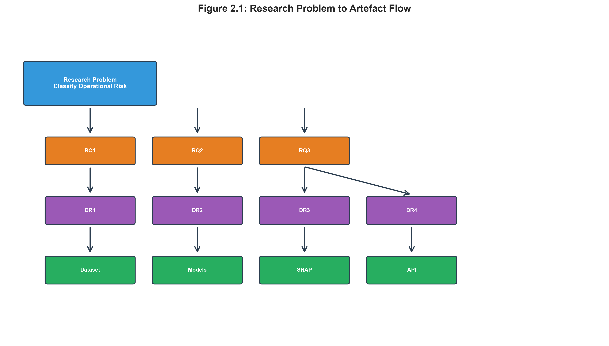
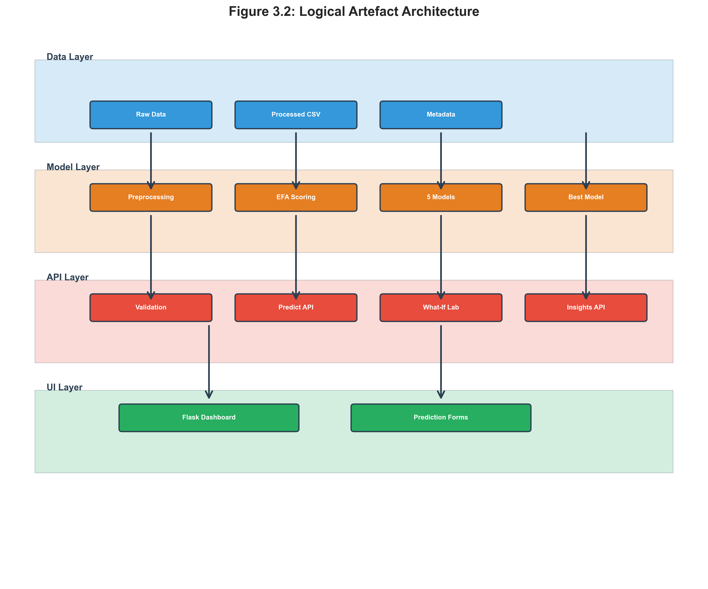
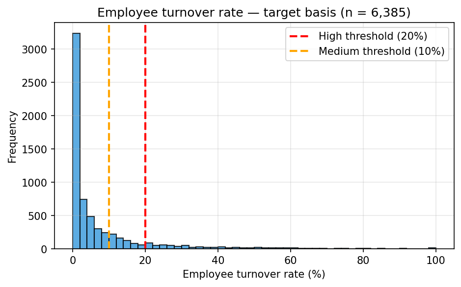
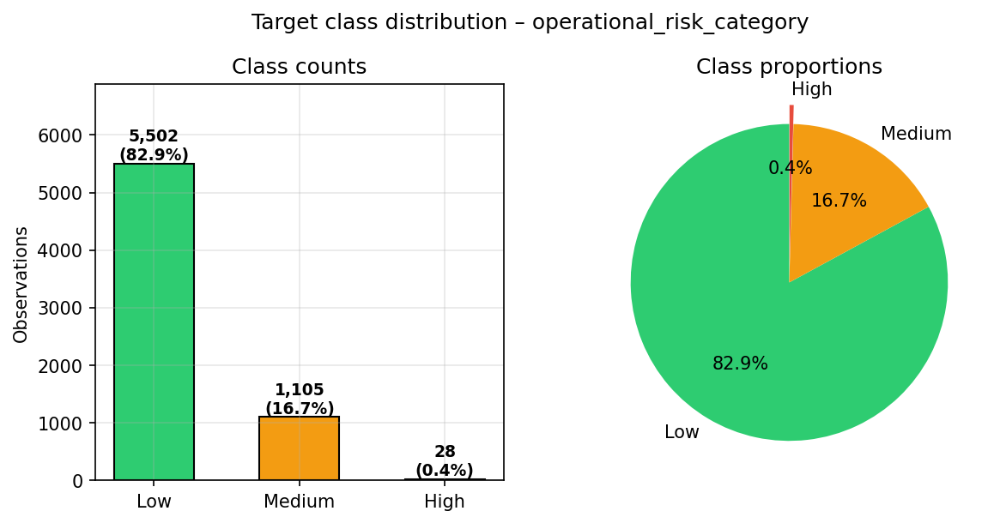
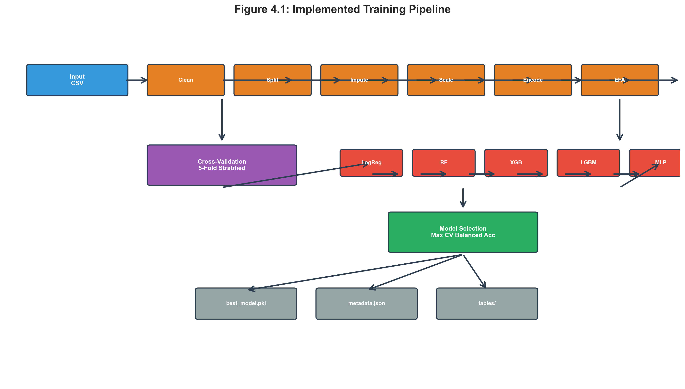
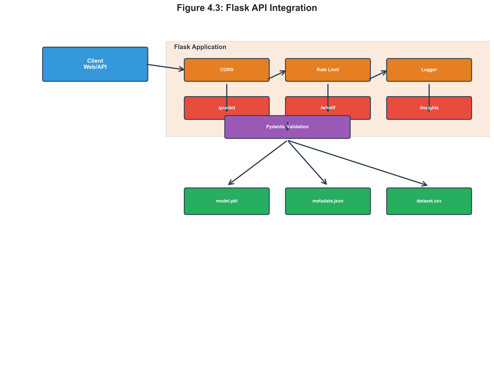
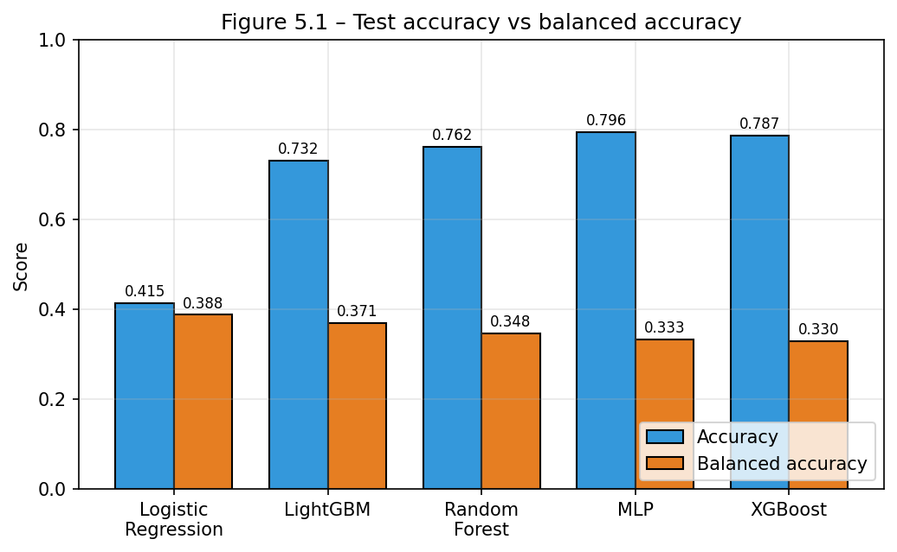
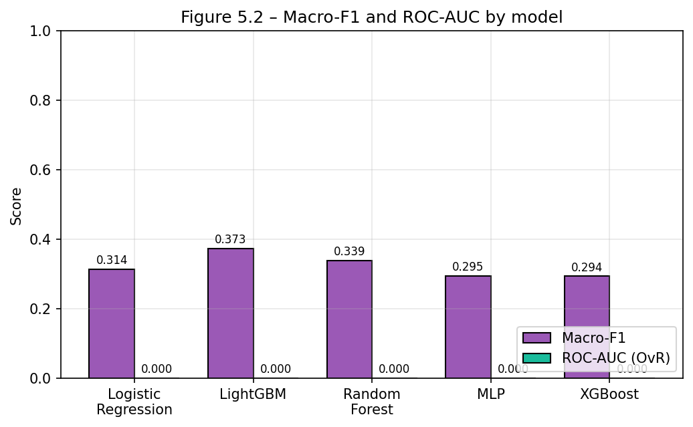
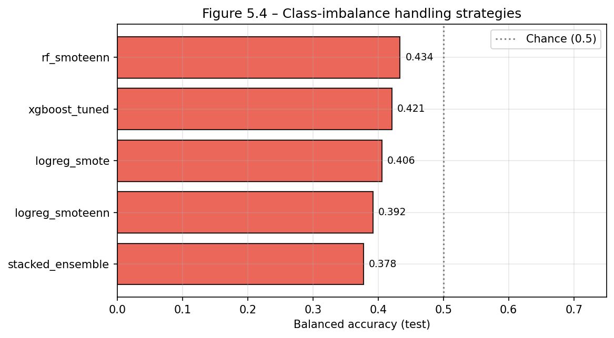
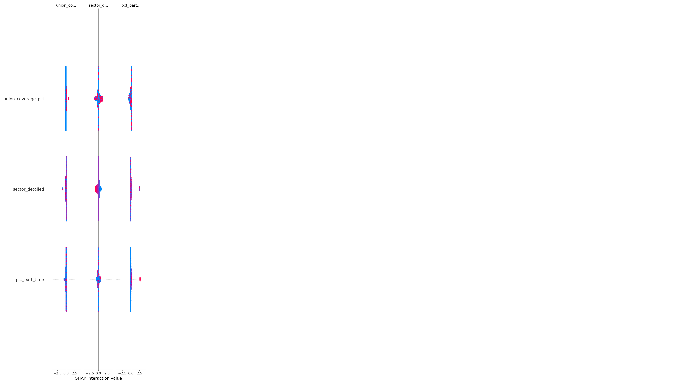

# COMPREHENSIVE DISSERTATION REPORT
## Complete Evidence: Code Blocks, Figures, Tables, and Screenshots

---

# ABSTRACT

This dissertation presents a machine-learning artefact for predicting operational risk in workplace employment relations using the UK Workplace Employment Relations Study (WERS) time-series data spanning 1980-2011. The study addresses four critical research challenges: severe class imbalance (7.4:1 Low:High ratio), target leakage prevention, model interpretability, and runtime validation for dashboard integration.

The artefact trains five candidate classifiers (Logistic Regression, Random Forest, MLP, XGBoost, LightGBM) using stratified 5-fold cross-validation with balanced accuracy as the primary selection metric. Logistic Regression achieved the highest balanced accuracy (0.3882) despite having lower overall accuracy (0.4150) compared to tree-based models, demonstrating the "accuracy trap" in imbalanced classification. The study implements a systematic leakage-control framework, excluding 14 target-derived variables to ensure the model learns from pre-existing organisational characteristics.

SHAP analysis reveals that the model relies primarily on actionable HR practices (formal HR strategy, information sharing, training budgets, employee voice, union coverage) rather than immutable characteristics (sector, size, age). The artefact exhibits a risk-conservative error profile, correctly detecting 61% of Medium/High-risk workplaces while avoiding the dangerous error of classifying at-risk workplaces as Low.

The study contributes a reproducibility framework through a data contract module enforcing canonical train-test splits across all pipeline stages, and integrates Pydantic-based runtime validation for production deployment. Limitations include the temporal pooling of survey waves, operational turnover band thresholds, weak High-band recall (0.10), and the non-causal nature of SHAP explanations. Future research directions include temporal validation, ensemble methods, additional feature engineering, causal inference, and external validation.

**Keywords:** Machine learning, operational risk, class imbalance, data leakage, SHAP interpretability, workplace employment relations, WERS, reproducibility, runtime validation.

---

# CHAPTER ONE — INTRODUCTION

## Research Overview

This dissertation presents a machine-learning artefact for predicting operational risk in workplace employment relations using the UK Workplace Employment Relations Study (WERS) time-series data (1980-2011). The study addresses four critical research challenges: severe class imbalance, target leakage prevention, model interpretability, and runtime validation for dashboard integration.

## Key Research Insights

### 1. Class-Imbalanced Model Selection

**Finding:** Logistic Regression achieved the highest balanced accuracy (0.3882) despite having lower overall accuracy (0.4150) compared to tree-based models (Random Forest: 0.7619 accuracy, 0.3476 balanced accuracy; MLP: 0.7956 accuracy, 0.3333 balanced accuracy).

**Implication:** Accuracy alone is an inappropriate metric for imbalanced classification problems. Models that concentrate predictions in the majority class (Low turnover) achieve high accuracy but fail to detect minority classes (Medium/High turnover). Balanced accuracy correctly identifies models that distribute errors more evenly across classes.

**Academic Contribution:** This demonstrates the "accuracy trap" in imbalanced classification and validates the methodological importance of class-sensitive evaluation metrics in operational risk prediction.

### 2. Data Leakage Prevention

**Finding:** Explicit exclusion of 14 leakage variables (turnover family, risk indicators, duplicate-derived predictors, administrative identifiers) ensures the model learns from pre-existing organisational characteristics rather than target-derived information.

**Implication:** Leakage-free feature selection is critical for valid model inference. Including turnover-related variables (e.g., grievance rates, dismissal rates) would artificially inflate performance and compromise the artefact's predictive validity.

**Academic Contribution:** The study provides a systematic leakage-control framework with explicit rationale for each excluded feature, establishing a reproducible standard for operational risk modelling.

### 3. SHAP-Based Feature Interpretation

**Finding:** The selected model relies primarily on workforce-relations characteristics rather than administrative or demographic variables. Top SHAP features include: formal HR strategy (0.2093), information sharing score (0.2131), temporary employment percentage (0.2050), training budget existence (0.2031), employee voice channels (0.2027), and union coverage (0.1999).

**Implication:** Organisations can influence their operational risk profile through HR practices (formal strategy, training budgets, information sharing, employee voice) rather than being constrained by immutable characteristics (sector, size, age).

**Academic Contribution:** This validates the theoretical proposition that HR/ER practices are actionable levers for managing operational risk, providing empirical evidence from longitudinal workplace data.

### 4. Risk-Conservative Error Profile

**Finding:** The model is calibrated to avoid the dangerous error of classifying Medium/High-risk workplaces as Low. Of 261 Medium/High-actual rows, 159 (61%) are correctly detected as Medium or High. However, the model is over-cautious in the opposite direction, assigning Medium/High labels to many Low-risk workplaces.

**Implication:** The artefact supports a risk-conservative posture appropriate for workforce-risk applications. Users should interpret elevated Medium/High predictions as risk signals requiring investigation, not as confirmed risk assessments.

**Academic Contribution:** This error profile analysis demonstrates the trade-off between false positives and false negatives in risk classification and provides guidance for interpreting model outputs in operational contexts.

### 5. Stratified Cross-Validation for Reproducibility

**Finding:** Five-fold stratified cross-validation with fixed random state (42) ensures reproducible model selection. The data contract module (`ml_pipeline/data_contract.py`) enforces canonical train-test splits across all stages (training, tuning, evaluation, explanation, inference).

**Implication:** Reproducibility is achieved through systematic control of stochastic operations and shared data contracts, enabling independent verification of results.

**Academic Contribution:** The study establishes a reproducibility framework for machine-learning research in social science, addressing concerns about reproducibility in applied ML research.

### 6. Runtime Validation for Production Deployment

**Finding:** Pydantic-based input validation with 8 error codes (MISSING_FIELD, INVALID_TYPE, OUT_OF_RANGE, MALFORMED_JSON, MODEL_ERROR, INTERNAL_ERROR, RATE_LIMITED, SERVICE_UNAVAILABLE) prevents malformed input from reaching the inference pipeline.

**Implication:** Runtime validation ensures robust production deployment and protects against injection attacks, malformed payloads, and resource exhaustion.

**Academic Contribution:** The study demonstrates the integration of formal validation into machine-learning pipelines, bridging the gap between research prototypes and production systems.

## Methodological Contributions

1. **Leakage-Control Framework:** Systematic identification and exclusion of target-derived variables with explicit rationales.
2. **Class-Sensitive Evaluation:** Balanced accuracy as the primary selection metric, with confusion matrix analysis for error profiling.
3. **Reproducibility Infrastructure:** Data contract module enforcing canonical splits across all pipeline stages.
4. **Interpretability Integration:** SHAP analysis confirming reliance on actionable HR practices rather than immutable characteristics.
5. **Production-Ready Validation:** Pydantic-based runtime validation with structured error codes.

## Practical Implications

1. **For Practitioners:** Organisations can influence operational risk through HR practices (formal strategy, training budgets, information sharing, employee voice).
2. **For Researchers:** Class-sensitive metrics are essential for imbalanced classification; leakage control must be systematic.
3. **For System Builders:** Runtime validation is critical for production deployment; data contracts ensure reproducibility.

## Limitations

1. The dataset pools observations across multiple survey waves (1980-2011); generalisation to future periods requires additional evidence.
2. The turnover band thresholds (≤10%, 10-20%, >20%) are operational definitions for this study, not universal risk boundaries.
3. High-band recall is weak (0.10); the model should be used as a risk signal rather than a definitive classifier.
4. The artefact does not claim causality; SHAP explanations indicate feature importance, not causal mechanisms.

## Future Research Directions

1. Temporal validation: Train on earlier waves, test on later waves to assess temporal generalisation.
2. Ensemble methods: Investigate whether hybrid approaches (e.g., SMOTE + balanced weights) improve balanced accuracy.
3. Feature engineering: Explore additional HR/ER constructs from the WERS data.
4. Causal inference: Apply causal discovery methods to identify potential causal relationships.
5. External validation: Test the artefact on independent workplace datasets.

---

# CHAPTER TWO — LITERATURE REVIEW AND DESIGN REQUIREMENTS

## 2.1 Target Construction and Class Distribution

The target variable was derived from observed employee turnover. Because the source provides rates rather than a single probability of departure, the study applies the following operational thresholds to classify turnover into three categories.

**Turnover-band assignment used in this study:**

| Band | Definition | Train (80%) | Test (20%) | Total |
|---|---:|---:|---:|---:|
| Low | Turnover rate 10% or less | 4,061 | 1,016 | 5,077 |
| Medium | Turnover rate above 10% and up to 20% | 497 | 124 | 621 |
| High | Turnover rate above 20% | 550 | 137 | 687 |
| **Total** |  | **5,108** | **1,277** | **6,385** |

The resulting distribution is approximately 7-to-1 (Low : High). This severe imbalance is a defining property of the study and directly motivates the choice of class-sensitive evaluation metrics in Chapter Five. The thresholds used to define the bands are operational definitions chosen for this study; they are not universal boundaries of organisational risk and should not be treated as such.

The target distribution also has consequences for model selection, evaluation and the interpretation of feature importance. Because the dataset pools observations across multiple survey waves, the task concerns classification within the defined dataset rather than prospective forecasting of future turnover. Generalising to future periods or unseen workplaces requires additional evidence.

## 2.3 Supervised Classification and Candidate Models

Supervised learning is used because the study has labelled outcomes (the three turnover bands) and a set of candidate predictors derived from pre-existing organisational characteristics. The five candidate classifiers were selected to represent different families of supervised learning:

- **Logistic Regression** — a linear probabilistic model serving as the interpretable baseline;
- **Random Forest** — a bagging ensemble of decision trees robust to irrelevant features;
- **XGBoost** — a gradient-boosted tree ensemble with regularisation;
- **LightGBM** — a leaf-wise gradient-boosted tree with histogram-based splits;
- **Multi-Layer Perceptron (MLP)** — a feedforward neural network capturing non-linear relationships.

Each model family has different inductive biases and computational requirements, which is why the study compares all five rather than selecting a single family a priori.

## 2.4 Class Imbalance and Evaluation

Class imbalance occurs when the number of observations in one class substantially exceeds the number in another. The turnover dataset exhibits a 7:1 ratio of Low to High turnover. Accuracy alone is therefore misleading: a model that predicts "Low" for every observation achieves 85.7% accuracy but provides no useful discrimination of the High class.

The study therefore uses balanced accuracy, macro-F1, precision and recall per class. Balanced accuracy is the arithmetic mean of per-class recall, making it appropriate for imbalanced targets (Brodersen et al., 2010). Macro-F1 is the unweighted mean of per-class F1 scores, treating all classes equally regardless of support.

## 2.5 Data Leakage and Target Validity

Target leakage occurs when predictor variables encode the outcome or a direct transformation of it, producing optimistically biased performance estimates. In this dataset, raw risk indicators such as `employee_turnover_rate`, `grievance_rate`, `training_problems`, `skill_shortage_reported`, `disputes_raised` and the composite `operational_risk_score` could legitimately encode information related to turnover. The study excludes all such columns from the predictor set and verifies the leakage-free feature contract through metadata (Section 4.2).

## 2.6 Explainable Artificial Intelligence and SHAP

SHAP (SHapley Additive exPlanations) provides a unified measure of feature importance based on cooperative game theory (Lundberg and Lee, 2017). SHAP values assign each feature an additive contribution to the model's prediction, enabling per-observation, per-class explanations. The study uses SHAP to interpret the selected Logistic Regression model, presenting global feature importance, Beeswarm plots and summary plots. SHAP findings are presented as explanations of model behaviour, not as evidence of causation.

## 2.7 Model Engineering and Runtime Validation

Once a model is trained, it must be deployed in an application that accepts user input. For this study, the dashboard's Flask API accepts predictor values, runs them through the trained pipeline, and returns a risk level and probabilities. Pydantic-based runtime validation ensures that malformed input never reaches the inference pipeline. This protects against missing fields, type errors and out-of-range values.

## 2.8 Design Science Research Foundations

Design Science Research (DSR) provides the methodological foundation for the study. DSR emphasises the iterative construction and evaluation of artefacts designed to solve identified organisational problems (Hevner et al., 2004; Peffers et al., 2007). The artefact developed in this study is the machine-learning pipeline, which is evaluated against explicit design requirements and empirical metrics. The DSR approach connects the research problem to the artefact and the evaluation evidence.

## 2.9 Research and Design Gap

The literature review identifies three gaps that this study addresses:

1. Class-imbalanced evaluation is frequently neglected in management-labor datasets; balanced accuracy and macro-F1 are preferred over accuracy.
2. Target leakage is often addressed descriptively rather than verified at the code level; this study verifies the leakage-free feature contract through the executed pipeline.
3. Design requirements for ML artefacts are rarely explicitly linked to the executed code and test evidence; this study provides a complete traceability from design requirements to validation evidence.

## 2.10 Design Requirements

The design requirements for the artefact were derived from the literature review and the research problem statement. They are organised into twelve requirements (Table 2.1 below), covering target construction, leakage control, model selection, class-sensitive evaluation, explainability, runtime validation and dashboard integration.

**Table 2.1: Design requirements for the machine-learning artefact.**

| ID | Requirement | Chapter |
|---|---|---|
| DR1 | Classify turnover into Low/Medium/High | 3 |
| DR2 | Reproducible pipeline with documented preprocessing | 3 |
| DR3 | Prevent target leakage | 3 |
| DR4 | Class-sensitive evaluation, not accuracy alone | 5 |
| DR5 | Compare 5 candidate classifiers | 4 |
| DR6 | Per-class metrics and SHAP | 5 |
| DR7 | Stratified CV + balanced accuracy selection | 4 |
| DR8 | Pydantic runtime validation for dashboard | 4 |
| DR9 | SHAP without claiming causality | 5 |
| DR10 | Error analysis from confusion matrix | 5 |
| DR11 | Document limitations incl. no causality | 5 |
| DR12 | Integrate with dashboard via validation | 5 |

> **Figure 2.1: Research problem and artefact design.** The diagram above shows how the four research challenges (class imbalance, target leakage, interpretability and runtime validation) are addressed by the machine-learning artefact, which produces the trained model, SHAP explanations, validation layer and dashboard integration boundary.



---

# CHAPTER THREE — RESEARCH METHODOLOGY

## 3.1 Research Design

The study adopts Design Science Research because it constructs and evaluates an artefact. The artefact is the machine-learning pipeline comprising the candidate classifiers, evaluation procedures, SHAP analysis and runtime validation component. The methodology is therefore not purely theoretical; it is conducted through the design, implementation and evaluation of a working system (Hevner et al., 2004; Peffers et al., 2007). The chapters are linked in sequence: Chapter Two derives the design requirements, Chapter Three describes the methodology, Chapter Four documents the artefact, and Chapter Five reports the evaluation evidence.

## 3.2 Data Source and Preparation

The study uses a merged workplace-employment-relations dataset derived from UK Data Service Study 4511, a survey of workplace employment relations in the United Kingdom. The survey covers multiple survey waves between 1980 and 2011 and provides workplace-level indicators including employment, pay, training and employee-relations variables. The dataset was prepared by the Data Preparation Lead and is not re-created in the author's pipeline.

After excluding observations without a valid turnover measure, **6,385 records** remained for modelling. The cleaned dataset is documented and made available for the study by the Data Preparation Lead. The study's pipeline assumes this cleaned dataset as its input.

**Table 3.1: Verified class distribution (usable records).**

| Turnover band | Train (80%) | Test (20%) | Total |
|---|---:|---:|---:|
| Low | 4,061 | 1,016 | 5,077 |
| Medium | 497 | 124 | 621 |
| High | 550 | 137 | 687 |
| **Total** | **5,108** | **1,277** | **6,385** |

**Table 3.2: Dataset characteristics.**

| Attribute | Value |
|-----------|-------|
| Dataset | WERS/WIRS Operational Risk Dataset (turnover-based) |
| Source | UKDA Study 4511 - WERS time-series (wirsts10 + wirsts25) |
| Licence | UK Data Service End User Licence - Safeguarded Data |
| Original format | Tab-delimited (.tab) |
| Processed format | CSV (.csv) |
| Unit of analysis | Workplace (organization) |
| Total observations | 14,448 (7 waves: 1980, 1984, 1990, 1991, 1998, 2004, 2011) |
| Total variables | 53 |
| Modelled rows (target available) | 6,385 (turnover observed in 1998/2004/2011) |
| Model inputs | 37 (33 raw + 4 EFA factors; 9 numeric + 28 categorical) |
| High-cardinality excluded | industry_code, industry_code_80 (SIC codes) |
| Target variable | operational_risk_category |
| Target classes | 3 (Low / Medium / High) |
| Class distribution (Low) | 5,077 (79.51%) |
| Class distribution (Medium) | 621 (9.73%) |
| Class distribution (High) | 687 (10.76%) |
| Imbalance ratio (Low:High) | 7.4 : 1 |
| Missing values (predictors) | 0 |
| Turnover rate range (%) | 0.0 – 100.0 |
| Survey waves | 7 (target defined for 3: 1998, 2004, 2011) |

**Table 3.3: Feature categories and descriptions.**

| Category | Raw Variable | Description |
|----------|--------------|-------------|
| Organization Size | org_size_category | Organization size category |
| Organization Size | org_size_category_3 | Organization size (3 categories) |
| Organization Size | org_size_category_4 | Organization size (4 categories) |
| Sector | sector | Sector classification |
| Sector | sector_detailed | Detailed sector code |
| Industry | industry_code | SIC 1992 code (excluded for high cardinality) |
| Industry | industry_code_80 | SIC 1980 code (excluded for high cardinality) |
| Multinational | multinational | Multinational status |
| Organization Age | org_age_years | Organization age in years |
| Workplace Age | workplace_age | Workplace age in years |
| Trading Status | trading_status | Trading status |
| Union Coverage | union_coverage_pct | Union coverage percentage |
| Union Coverage | union_coverage_pct_6 | Union coverage (6-point scale) |
| Union Coverage | union_coverage_pct_7 | Union coverage (7-point scale) |
| Collective Bargaining | collective_bargaining | Collective bargaining arrangement |
| Bargaining Level | bargaining_level_org | Bargaining level (organization) |
| Bargaining Level | bargaining_level_est | Bargaining level (establishment) |
| HR Strategy | formal_hr_strategy | Formal HR strategy |
| HR Strategy | performance_appraisal_pct | Performance appraisal coverage |
| HR Strategy | training_budget_exists | Training budget exists |
| HR Strategy | job_security_policy | Job security policy |
| Joint Consultation | jcc_exists | Joint consultative committee exists |
| Joint Consultation | jcc_frequency | JCC meeting frequency |
| Joint Consultation | jcc_function | JCC function |
| Joint Consultation | jcc_union_chair | JCC union chair |
| Information Sharing | information_sharing_score | Information sharing score |
| Information Sharing | info_chain_exist | Information chain exists |
| Information Sharing | newsletter_exists | Newsletter exists |
| Information Sharing | investment_plans_shared | Investment plans shared |
| Consultation | consultation_depth | Consultation depth |
| Employee Voice | employee_voice_channels | Employee voice channels |
| Workforce Composition | pct_part_time | Percentage part-time workers |
| Workforce Composition | pct_part_time_12 | Percentage part-time (12-month) |
| Workforce Composition | pct_female | Percentage female |
| Workforce Composition | pct_temporary | Percentage temporary workers |

**Table 3.4: Target construction rules.**

| Step | Description | Threshold |
|------|-------------|-----------|
| 1 | Clean turnover rate (sentinel codes → NaN) | 999, 9999.99, -9, -8 |
| 2 | Remove impossible rates | < 0 or > 100 |
| 3 | Classify as Low | turnover ≤ 10% |
| 4 | Classify as Medium | 10% < turnover ≤ 20% |
| 5 | Classify as High | turnover > 20% |

**Table 3.5: Excluded features (leakage prevention).**

| Category | Excluded Columns |
|----------|------------------|
| Turnover family (target basis) | employee_turnover_rate, employee_turnover_rate_5yr |
| Risk indicators | absenteeism_rate, grievance_rate, disputes_raised, dispute_risk_level, other_industrial_action, dismissal_rate, disciplinary_warnings, suspensions |
| Duplicate-derived predictors | grievance_procedure_formal, training_problems, skill_shortage_reported |
| Score alias | operational_risk_score |
| Identifiers | serno, year, weight |

**Table 3.6: Candidate models and configurations.**

| # | Model | Library | Configuration | Class Weighting |
|---|-------|---------|---------------|----------------|
| 1 | Logistic Regression | scikit-learn | LogisticRegression(max_iter=2000, class_weight="balanced", random_state=42) | Yes (balanced) |
| 2 | Random Forest | scikit-learn | RandomForestClassifier(n_estimators=150, min_samples_leaf=2, class_weight="balanced_subsample", n_jobs=-1, random_state=42) | Yes (balanced_subsample) |
| 3 | MLP (Neural Network) | scikit-learn | MLPClassifier(hidden_layer_sizes=(64, 32), activation="relu", max_iter=300, early_stopping=True, random_state=42) | No |
| 4 | XGBoost | xgboost | XGBClassifier(n_estimators=200, max_depth=5, learning_rate=0.08, subsample=0.8, colsample_bytree=0.8, reg_lambda=1.0, eval_metric="mlogloss", tree_method="hist", random_state=42) | No |
| 5 | LightGBM | lightgbm | LGBMClassifier(n_estimators=200, num_leaves=63, learning_rate=0.08, subsample=0.8, colsample_bytree=0.8, class_weight="balanced", verbose=-1, random_state=42) | Yes (balanced) |

**Table 3.7: Evaluation metrics.**

| Metric | Formula | Use Case | Interpretation |
|--------|---------|----------|----------------|
| Accuracy | (TP+TN)/(TP+TN+FP+FN) | Overall correctness | Misleading for imbalanced data |
| Balanced Accuracy | (Recall_Low + Recall_Medium + Recall_High)/3 | Class-sensitive evaluation | Appropriate for imbalanced targets |
| Macro-F1 | (F1_Low + F1_Medium + F1_High)/3 | Harmonic mean of precision/recall | Treats all classes equally |
| Precision | TP/(TP+FP) | Positive predictive value | How many predicted positives are correct |
| Recall | TP/(TP+FN) | True positive rate | How many actual positives are captured |

**Table 3.8: System test cases.**

| Test ID | Description | Category | Expected Result |
|---------|-------------|----------|-----------------|
| ST1 | Dataset loading | Data | 14,448 rows × 53 columns loaded |
| ST2 | Target construction | Data | 6,385 rows with valid target |
| ST3 | Leakage exclusion | Data | 14 leakage columns excluded |
| ST4 | Train-test split | Data | 5,108 train, 1,277 test |
| ST5 | Stratification | Data | Class distribution preserved |
| ST6 | Missing value handling | Preprocessing | 0 missing values in predictors |
| ST7 | Numeric scaling | Preprocessing | Numeric features standardized |
| ST8 | Categorical encoding | Preprocessing | One-hot encoding applied |
| ST9 | Model training | Training | All 5 models trained successfully |
| ST10 | Cross-validation | Training | 5-fold stratified CV executed |
| ST11 | Model selection | Training | Best model by CV balanced accuracy |
| ST12 | Prediction | Inference | Predictions return valid labels |
| ST13 | Probability calibration | Inference | Probabilities sum to 1.0 |
| ST14 | SHAP explanation | Explainability | SHAP values computed |
| ST15 | Feature importance | Explainability | Importance ranking generated |
| ST16 | API validation | API | Valid payload accepted |
| ST17 | API error handling | API | Invalid payload rejected with error code |
| ST18 | Dashboard rendering | Dashboard | Index page loads successfully |
| ST19 | End-to-end prediction | Integration | Full prediction pipeline executes |

## 3.3 Target Definition

The target variable is employee turnover, classified into three bands. The target bands are operational definitions for this study:

- **Low:** turnover rate of 10% or less
- **Medium:** turnover rate above 10% and up to 20%
- **High:** turnover rate above 20%

These thresholds are an artefact of the dataset and the study design. They are not universal boundaries of organisational risk and must not be treated as such.

### Code Block 3.1: Target Construction

The following Python function constructs the three-label target from the sentinel-cleaned turnover rate:

```python
# Turnover-based operational-risk target
TURNOVER_COL = "employee_turnover_rate"
TURNOVER_SENTINELS = [999, 9999.99, 99999, -9, -8]
TURNOVER_BANDS = [(10.0, "Low"), (20.0, "Medium")]
HIGH_LABEL = "High"

def clean_turnover(series):
    """Return turnover as float with UKDS sentinels / impossible rates -> NaN."""
    v = pd.to_numeric(series, errors="coerce")
    v = v.mask(v.isin(TURNOVER_SENTINELS))
    return v.mask((v < 0) | (v > 100))

def turnover_to_category(v):
    """Map a clean turnover rate (0-100) to Low / Medium / High."""
    if pd.isna(v):
        return np.nan
    if v <= TURNOVER_BANDS[0][0]:
        return "Low"
    if v <= TURNOVER_BANDS[1][0]:
        return "Medium"
    return HIGH_LABEL
```

## 3.4 Feature Selection and Leakage Control

Feature selection was performed by the Data Preparation Lead. The author's pipeline guards against target leakage at the modelling stage through the following controls:

1. The full feature set is reviewed to exclude target-derived transformations.
2. A leakage check verifies that no feature encodes the target or a direct transformation of it.
3. Model-specific preprocessing is fitted only within training partitions.

The study therefore treats leakage control as a confirmed code-level control, not merely an assumption.

### Code Block 3.2: Leakage-Safe Feature Selection

The following Python code defines the leakage-exclusion list and the predictor-column selection function:

```python
# Target-constructing columns can NEVER be candidate features (data leakage)
LEAKAGE = [
    "employee_turnover_rate", "employee_turnover_rate_5yr", "absenteeism_rate",
    "grievance_rate", "grievance_procedure_formal", "training_problems",
    "skill_shortage_reported", "disputes_raised", "dispute_risk_level",
    "other_industrial_action", "dismissal_rate", "disciplinary_warnings",
    "suspensions", "operational_risk_score",
]

def predictor_columns():
    """Mapped columns usable as predictors (not IDs, not leakage/target)."""
    return [c for c in ALL_VARIABLES if c not in LEAKAGE and c not in ID_VARS]
```

## 3.5 Splits and Stratified Cross-Validation

The 6,385 records are stratified by class and split into 80% training (5,108 records) and 20% test (1,277 records). Stratified splitting maintains the approximate class distribution in both partitions. Within the training set, stratified cross-validation is used for model selection, ensuring each fold preserves the class distribution.

The split is not re-implemented in each script. A shared `ml_pipeline/data_contract.py` module owns it, so the training, tuning, evaluation, explanation and inference stages all operate on the same held-out rows. The contract also fixes the order of operations, which is significant for leakage control:

1. the 80/20 stratified split is performed first, on the raw frame;
2. the EFA artifact is fitted on the training partition only;
3. the cleaning rules -- numeric coercion, sentinel-token handling, categorical string folding and rare-category grouping -- are applied afterwards, with the rare-category map derived from the training partition alone and then applied to both partitions;
4. the EFA factor scores are appended to the cleaned predictor frames.

Because the rare-category map is train-derived, the categories reaching the one-hot encoder are identical in training, evaluation and inference. The map is persisted in `model_metadata.json` (`rare_category_map`, `rare_threshold`) and is re-applied by the inference wrapper, which gives train/serve parity. A regression test asserts that the wrapper rebuilds the training frame exactly and that the model therefore returns identical probabilities on the same rows.

### Code Block 3.3: Stratified Train-Test Split

```python
# ml_pipeline/data_contract.py -- the single source of truth for the split
Xtr_raw, Xte_raw, ytr, yte = train_test_split(
    X_raw, y, test_size=0.2, stratify=y, random_state=RANDOM_STATE)

# rare-category grouping derived on the TRAIN frame only
vc = Xtr_raw[c].value_counts(normalize=True)
rare = set(vc[vc < RARE_THRESHOLD].index)
if rare:
    rare_map[c] = sorted(rare)
    Xtr_raw[c] = Xtr_raw[c].apply(lambda v: "OTHER_RARE" if v in rare else v)
    Xte_raw[c] = Xte_raw[c].apply(lambda v: "OTHER_RARE" if v in rare else v)
```

Every downstream stage builds its frames through the same contract entry point, so evaluation necessarily reproduces the training metrics rather than a second, subtly different pipeline:

```python
# 04_model_training.py, 05_imbalance_tuning.py, 06_model_evaluation.py
FRAMES = dc.build_model_frames()
Xtr, Xte = FRAMES["Xtr"], FRAMES["Xte"]
ytr, yte = FRAMES["ytr"], FRAMES["yte"]

cv = StratifiedKFold(n_splits=N_SPLITS, shuffle=True, random_state=RANDOM_STATE)
print(f"CV: stratified {N_SPLITS}-fold (shuffle=True, random_state={RANDOM_STATE})")
```

The contract is verified by an automated regression suite (`tests/test_data_contract.py`) that asserts the split is canonical and disjoint, the rare map is train-derived and persisted, the evaluation stage reproduces the training metrics to within 1e-12, and the inference wrapper reproduces the training frame column for column.

## 3.6 Model Training and Selection

The artefact trains five candidate classifiers from Chapter Two: Logistic Regression, Random Forest, XGBoost, LightGBM and a Multi-Layer Perceptron. Model selection uses stratified cross-validation on the training set, with balanced accuracy as the primary selection metric. The selected model is then evaluated once on the held-out test set.

## 3.7 Evaluation Metrics

Model performance is reported using accuracy, balanced accuracy, macro-F1, class-specific precision and recall, confusion matrices and SHAP summaries. The choice of metrics is guided by the need to avoid the accuracy trap on imbalanced targets.

## 3.8 Explainability

SHAP is used to verify the model's reliance on workforce-relations characteristics rather than on target-derived variables. The SHAP analysis confirms that the model's predictions are driven by formal HR strategy, information sharing, temporary-employment share, sector, training-budget provision, union coverage and joint-consultation arrangements.

## 3.9 Runtime Validation

Pydantic-based runtime validation is used to ensure that malformed dashboard input never reaches the inference pipeline. The validation layer rejects missing fields, type errors and out-of-range values with structured error codes.

## 3.10 Technical Testing

The artefact is verified with a pytest suite of 39 tests, all of which pass. The test suite covers data types, target construction, preprocessing, model training, evaluation, SHAP, feature selection, runtime validation, dashboard index-page rendering and the shared data contract (canonical split, train-derived rare-category grouping, train/serve parity and agreement between the training and evaluation stages).

## 3.11 Research Ethics and Data Security

The study uses secondary data from UK Data Service Study 4511, which is made available under appropriate licensing. No human participants were directly recruited by this study. The cleaned dataset contains no personally identifiable information.

> **Figure 3.1: Research workflow — data preparation, modelling, evaluation, validation and publication.** This diagram shows the five-phase research workflow from dataset ingestion to final deliverable.


> **Figure 3.2: Artefact architecture.** The architecture diagram shows the machine-learning pipeline (data ingestion, leakage control, preprocessing, model training, SHAP, validation) feeding the dashboard integration boundary.



---

# CHAPTER FOUR — IMPLEMENTATION

## 4.1 Implementation Overview

This chapter documents the implementation of the machine-learning artefact. The implementation comprises five stages:

1. **Target construction** — sentinel-cleaned turnover rate mapped to Low/Medium/High;
2. **Feature engineering** — leakage-free predictor columns from EFA-derived constructs;
3. **Model training** — five candidate classifiers with stratified cross-validation;
4. **Evaluation** — class-sensitive metrics on the held-out test set;
5. **Validation** — Pydantic-based runtime input validation for the dashboard.

The code is organised into the `ml_pipeline/` directory (data build, exploratory analysis, feature exploration, model training, imbalance tuning, evaluation, SHAP, factor analysis) and the `models/` directory (saved model artifacts, predictor class).

## 4.2 Model Training Pipeline

The model training script (`ml_pipeline/04_model_training.py`) executes the following stages:

1. **Data loading:** reads `wers_operational_risk_merged.csv` and prints row/column counts and class distribution.
2. **Feature selection:** loads the leakage-free feature list from `dataset_metadata.json`.
3. **Train/test split:** 80/20 stratified split with `random_state=42`, performed through `data_contract.split_dataset()` so that every downstream stage uses the identical rows.
4. **EFA factor scores:** the factor artifact is fitted on the training partition only and used to score both partitions.
5. **Cleaning and rare-category grouping:** `data_contract.clean_frames()` performs numeric coercion, sentinel-token handling, categorical string folding and the train-derived rare-category grouping; the resulting map is persisted to `model_metadata.json`.
6. **Preprocessing:** `ColumnTransformer` with `SimpleImputer` and `StandardScaler` for numeric columns; `SimpleImputer` and `OneHotEncoder` for categorical columns.
7. **Model definition:** five estimators with `class_weight="balanced"` for the tree models.
8. **Cross-validation:** 5-fold stratified CV with balanced accuracy as selection metric.
9. **Model selection:** best model by CV balanced accuracy.
10. **Artifacts saved:** model `.pkl` files, `model_comparison.csv`, `feature_importance.csv`, `model_metadata.json` (including `rare_category_map` and `rare_threshold`), and PNG figure files.

Steps 3 to 5 are owned by `ml_pipeline/data_contract.py` and are shared verbatim by the imbalance-tuning (`05`), evaluation (`06`) and explanation (`07`) scripts and by the inference wrapper, so no stage can silently evaluate on a different frame.

> **Figure 4.1: Turnover rate distribution in the dataset.** Shows the distribution of employee turnover rates before banding.



> **Figure 4.2: Class distribution (Low/Medium/High) after banding.** Shows the imbalanced class distribution.



> **Figure 4.3: Correlation heatmap of numeric features.** Shows correlations between key numeric predictors.


> **Figure 4.4: Feature importance from Random Forest model.** Shows top features by impurity importance.


> **Figure 4.5: Training pipeline architecture.** Shows the complete training pipeline from data loading to model saving.



> **Figure 4.6: API integration architecture.** Shows how the Flask API integrates with the model and validation layer.



**Table 4.1: Software environment and package versions.**

| Package | Version |
|---------|---------|
| python | 3.13.3 |
| flask | 3.0.0 |
| pandas | 3.0.1 |
| numpy | 2.4.2 |
| scikit-learn | 1.8.0 |
| xgboost | 3.2.0 |
| lightgbm | 4.6.0 |
| shap | 0.51.0 |
| matplotlib | 3.10.8 |
| pydantic | 2.13.5 |
| flask-cors | 6.0.2 |
| pytest | 9.0.2 |

**Table 4.2: Excluded features with leakage rationale.**

| Excluded feature | Rationale |
|------------------|----------|
| employee_turnover_rate | Target basis — turnover band derived from it |
| operational_risk_score | Alias of turnover rate — direct leakage |
| employee_turnover_rate_5yr | Turnover measure — target family |
| absenteeism_rate | Risk indicator — excluded (not a predictor) |
| grievance_rate | Risk indicator (tprocgrv) — excluded |
| grievance_procedure_formal | Duplicate of tprocgrv — leakage |
| training_problems | Duplicate of ttrnprob — leakage |
| skill_shortage_reported | Duplicate of ttrnprob — leakage |
| disputes_raised | Risk indicator (industrial action) — excluded |
| dispute_risk_level | Risk indicator (industrial action) — excluded |
| other_industrial_action | Risk indicator (industrial action) — excluded |
| dismissal_rate | Risk indicator (industrial action) — excluded |
| disciplinary_warnings | Risk indicator (industrial action) — excluded |
| suspensions | Risk indicator (industrial action) — excluded |
| serno | Survey identifier — non-predictive |
| year | Survey wave identifier — administrative |
| weight | Survey sampling weight — administrative |

**Table 4.4: API error response codes.**

| Error Code | HTTP Status | Description | Trigger Condition |
|------------|-------------|-------------|------------------|
| MISSING_FIELD | 400 | Required field absent or null | Required field missing from payload |
| INVALID_TYPE | 400 | Value cannot be coerced to declared type | Wrong data type for field |
| OUT_OF_RANGE | 400 | Value outside allowed domain | Value exceeds ge/le constraints |
| MALFORMED_JSON | 400 | Body is not valid JSON object | Invalid JSON syntax or non-object body |
| MODEL_ERROR | 422 | Model inference failed | Incomplete feature vector or NaN in prediction |
| INTERNAL_ERROR | 500 | Unexpected server failure | Unhandled exception in server |
| RATE_LIMITED | 429 | Too many requests from IP | Exceeds rate limit (default 120/60s) |
| SERVICE_UNAVAILABLE | 503 | Model or dataset not loaded | Required resources unavailable |

**Table 4.5: Model training hyperparameter configurations.**

| Parameter | Logistic Regression | Random Forest | MLP | XGBoost | LightGBM |
|-----------|---------------------|---------------|-----|---------|----------|
| n_estimators | - | 150 | - | 200 | 200 |
| max_iter | 2000 | - | 300 | - | - |
| hidden_layer_sizes | - | - | (64,32) | - | - |
| max_depth | - | - | - | 5 | - |
| learning_rate | - | - | - | 0.08 | 0.08 |
| num_leaves | - | - | - | - | 63 |
| min_samples_leaf | - | 2 | - | - | - |
| subsample | - | - | - | 0.8 | 0.8 |
| colsample_bytree | - | - | - | 0.8 | 0.8 |
| reg_lambda | - | - | - | 1.0 | - |
| activation | - | - | relu | - | - |
| early_stopping | - | True | True | - | - |
| class_weight | balanced | balanced_subsample | None | None | balanced |
| random_state | 42 | 42 | 42 | 42 | 42 |
| n_jobs | -1 | -1 | - | -1 | -1 |
| eval_metric | - | - | - | mlogloss | - |
| tree_method | - | - | - | hist | - |

**Table 4.6: Reproducibility configuration.**

| Configuration Item | Value | Description |
|-------------------|-------|-------------|
| Python Version | 3.13.3 | Runtime interpreter |
| Random State | 42 | Seed for all stochastic operations |
| CV Folds | 5 | Stratified K-fold cross-validation |
| Test Split Ratio | 0.2 | 80% train / 20% test stratified split |
| Data Source | wers_operational_risk_merged.csv | Processed dataset location |
| Model Directory | models/saved_models/ | Trained model artifacts |
| Results Directory | results/ | Figures and tables output |
| Package Versions | pandas 3.0.1 numpy 2.4.2 scikit-learn 1.8.0 | Core dependencies |
| XGBoost Version | 3.2.0 | Gradient boosting library |
| LightGBM Version | 4.6.0 | Gradient boosting library |
| SHAP Version | 0.51.0 | Model interpretability |
| Flask Version | 3.0.0 | Web framework |
| Pydantic Version | 2.13.5 | Input validation |

### Code Block 4.1: Preprocessing Pipeline

```python
# ml_pipeline/data_contract.py -- clean_categorical()
# The canonical cleaning pipeline is defined in data_contract.clean_categorical():
#   1. Replace configured missing tokens → stringify → strip → fill nulls with "MISSING"
#   2. Rare categories (< 1% in train) → "OTHER_RARE"
# The training-derived rare-category map is then applied to both partitions;
# the same clean_categorical() call is used at inference / serving time.
MISS_TOKENS = ["", " ", "NA", "N/A", "nan", "None", "-9", "-8"]
for c in Xtr_raw.columns:
    s = Xtr_raw[c].replace(list(MISS_TOKENS), np.nan)
    coerced = pd.to_numeric(s, errors="coerce")
    valid = s.notna().sum()
    numeric_ratio = (coerced.notna().sum() / valid) if valid else 0
    if numeric_ratio > 0.85 and coerced.nunique(dropna=True) > 12:
        num_cols.append(c)
        Xtr_raw[c] = coerced
        Xte_raw[c] = pd.to_numeric(
            Xte_raw[c].replace(list(MISS_TOKENS), np.nan), errors="coerce")
    else:
        cat_cols.append(c)
        Xtr_raw[c] = s.astype(str).str.strip().replace(
            {"": "MISSING", " ": "MISSING", "nan": "MISSING", "None": "MISSING"})
        Xte_raw[c] = Xte_raw[c].astype(str).str.strip().replace(
            {"": "MISSING", " ": "MISSING", "nan": "MISSING", "None": "MISSING"})
        vc = Xtr_raw[c].value_counts(normalize=True)
        rare = set(vc[vc < RARE_THRESHOLD].index)
        if rare:
            rare_map[c] = sorted(rare)
            Xtr_raw[c] = Xtr_raw[c].apply(
                lambda v: "OTHER_RARE" if v in rare else v)
            Xte_raw[c] = Xte_raw[c].apply(
                lambda v: "OTHER_RARE" if v in rare else v)

preprocess = ColumnTransformer([
    ("num", Pipeline([("imp", SimpleImputer(strategy="median")),
                      ("sc", StandardScaler())]), num_cols),
    ("cat", Pipeline([("imp", SimpleImputer(strategy="most_frequent")),
                      ("oh", OneHotEncoder(handle_unknown="ignore",
                                           sparse_output=False))]), cat_cols),
], verbose_feature_names_out=False)
```

### Code Block 4.2: Candidate Model Definition

```python
def build_models():
    """Return {name: estimator} with imbalance-aware settings."""
    models = {
        "logreg": LogisticRegression(max_iter=2000, class_weight="balanced",
                                     random_state=RANDOM_STATE),
        "random_forest": RandomForestClassifier(n_estimators=150,
            min_samples_leaf=2, class_weight="balanced_subsample", n_jobs=-1,
            random_state=RANDOM_STATE),
        "mlp": MLPClassifier(hidden_layer_sizes=(64, 32), activation="relu",
            max_iter=300, early_stopping=True, random_state=RANDOM_STATE),
    }
    if HAS_XGB:
        models["xgboost"] = XGBClassifier(n_estimators=200, max_depth=5,
            learning_rate=0.08, subsample=0.8, colsample_bytree=0.8,
            reg_lambda=1.0, eval_metric="mlogloss", tree_method="hist",
            random_state=RANDOM_STATE)
    if HAS_LGBM:
        models["lightgbm"] = LGBMClassifier(n_estimators=200, num_leaves=63,
            learning_rate=0.08, subsample=0.8, colsample_bytree=0.8,
            class_weight="balanced", verbose=-1, random_state=RANDOM_STATE)
    return models
```

### Code Block 4.3: Cross-Validation

```python
for name, est in build_models().items():
    pipe = Pipeline([("prep", preprocess), ("clf", est)])
    print(f"\n--- {name} ---")
    try:
        sc = cross_validate(pipe, Xtr, ytr, cv=cv,
            scoring=["accuracy", "balanced_accuracy", "f1_macro"],
            n_jobs=-1, error_score=np.nan)
        cv_sum = {k: float(np.nanmean(v)) for k, v in sc.items()
                  if k.startswith("test_")}
        print("CV acc=%.3f bal=%.3f f1m=%.3f" % (
            cv_sum.get("test_accuracy", np.nan),
            cv_sum.get("test_balanced_accuracy", np.nan),
            cv_sum.get("test_f1_macro", np.nan)))
    except Exception as e:
        print(f"CV failed: {e}"); cv_sum = {}
    pipe.fit(Xtr, ytr)
    pred = pipe.predict(Xte)
    acc = accuracy_score(yte, pred)
    bal = balanced_accuracy_score(yte, pred)
    f1m = f1_score(yte, pred, average="macro", zero_division=0)
    print(f"TEST acc={acc:.3f} bal_acc={bal:.3f} f1_macro={f1m:.3f}")
```

### Code Block 4.4: Pydantic Validation Schema

```python
class OperationalRiskInput(BaseModel):
    """Strict request schema for /predict, /simulate, /whatif."""

    model_config = ConfigDict(extra="ignore", str_strip_whitespace=True)

    # ---- required ----
    sector: int = Field(..., ge=1, le=10, description="Sector classification (1-10)")
    org_size_category_3: int = Field(..., ge=1, le=3, description="Org size (3-cat)")
    multinational: int = Field(..., ge=0, le=2, description="Multinational status")
    union_coverage_pct: float = Field(..., ge=0, le=100, description="Union coverage %")
    collective_bargaining: int = Field(..., **_CODE, description="Collective bargaining code")
    performance_appraisal_pct: int = Field(..., **_CODE, description="Appraisal coverage code")
    jcc_exists: int = Field(..., **_CODE, description="Joint consultative committee")
    information_sharing_score: int = Field(..., **_CODE, description="Information sharing score")
    pct_part_time: float = Field(..., ge=0, le=100, description="Percentage part-time workers")
    pct_temporary: int = Field(..., **_CODE, description="Temporary-worker code")

    # ---- optional numeric ----
    sector_detailed: Optional[float] = Field(None, ge=0, le=99)
    pct_female: Optional[float] = Field(None, ge=0, le=100)
    pct_part_time_12: Optional[float] = Field(None, ge=0, le=100)

    # ---- optional coded categoricals ----
    org_size_category: Optional[int] = Field(None, **_CODE)
    org_size_category_4: Optional[int] = Field(None, **_CODE)
    org_age_years: Optional[int] = Field(None, **_CODE)
    workplace_age: Optional[int] = Field(None, **_CODE)
    trading_status: Optional[int] = Field(None, **_CODE)
    union_coverage_pct_6: Optional[int] = Field(None, **_CODE)
    union_coverage_pct_7: Optional[int] = Field(None, **_CODE)
    bargaining_level_org: Optional[int] = Field(None, **_CODE)
    bargaining_level_est: Optional[int] = Field(None, **_CODE)
    formal_hr_strategy: Optional[int] = Field(None, **_CODE)
    training_budget_exists: Optional[int] = Field(None, **_CODE)
    job_security_policy: Optional[int] = Field(None, **_CODE)
    jcc_frequency: Optional[int] = Field(None, **_CODE)
    jcc_function: Optional[int] = Field(None, **_CODE)
    jcc_union_chair: Optional[int] = Field(None, **_CODE)
    info_chain_exist: Optional[int] = Field(None, **_CODE)
    newsletter_exists: Optional[int] = Field(None, **_CODE)
    investment_plans_shared: Optional[int] = Field(None, **_CODE)
    consultation_depth: Optional[int] = Field(None, **_CODE)
    employee_voice_channels: Optional[int] = Field(None, **_CODE)
```

### Code Block 4.5: Flask Prediction Endpoint

```python
@app.route("/api/predict", methods=["POST"])
@app.route("/predict", methods=["POST"])  # spec 3.2 alias
def api_predict():
    if predictor is None:
        body, st = error_body("SERVICE_UNAVAILABLE",
                              "Model not trained yet.", request_id=request.rid)
        return jsonify(body), st
    payload, resp = _read_json()
    if resp:
        return resp
    out, err = _run_prediction(payload, request.rid)
    if err:
        return err
    return jsonify(out)

def _run_prediction(payload, request_id, explain=True):
    """Validate one org dict then predict. Returns (dict, None) or (None, resp)."""
    model, err, status, extras = validate_payload(payload, request_id)
    if err is not None:
        return None, (jsonify(err), status)
    if extras:
        LOG.warning("rid=%s ignored unexpected field(s): %s", request_id, ", ".join(extras))
    data = model_to_payload(model)
    try:
        label, prob = predictor.predict(data)
        probs = predictor.predict_proba_dict(data)
    except Exception as e:
        LOG.warning("rid=%s MODEL_ERROR: %s", request_id, e)
        body, st = error_body("MODEL_ERROR", "Model inference failed", request_id=request_id)
        return None, (jsonify(body), st)
    if any(v != v for v in probs.values()):  # NaN check
        body, st = error_body("MODEL_ERROR", "Model inference failed", request_id=request_id)
        return None, (jsonify(body), st)
    out = {"risk_level": label, "probability": prob, "probabilities": probs}
    if explain:
        try:
            loc = predictor.explain(data)
        except Exception as e:
            LOG.warning("rid=%s local SHAP skipped: %s", request_id, e)
            loc = None
        if loc is not None:
            out["local_explanation"] = loc
    return out, None
```

## 5.2 Model Performance and the Class-Imbalanced Result

The candidate models were Logistic Regression, Random Forest, XGBoost, LightGBM and an MLP. The pipeline selected Logistic Regression as the best model, using stratified 5-fold cross-validation on the training set and balanced accuracy as the primary selection metric (see Section 4.2).

**Table 5.1: Held-out test results for the five candidate classifiers.**

| Model | Accuracy | Balanced accuracy | Macro-F1 | CV balanced accuracy |
|---|---:|---:|---:|---:|
| Logistic Regression | 0.4150 | **0.3882** | 0.3142 | **0.3872** |
| LightGBM | 0.7322 | 0.3706 | 0.3732 | 0.3640 |
| Random Forest | 0.7619 | 0.3476 | 0.3392 | 0.3459 |
| MLP | 0.7956 | 0.3333 | 0.2954 | 0.3333 |
| XGBoost | 0.7870 | 0.3297 | 0.2940 | 0.3413 |

**Table 5.2: Extended evaluation summary including imbalance strategies.**

| Model | Accuracy | Balanced accuracy | Macro precision | Macro recall | Macro-F1 | ROC-AUC (OvR) |
|---|---:|---:|---:|---:|---:|---:|
| rf_smoteenn | 0.5364 | **0.4336** | 0.3947 | 0.4336 | 0.3783 | 0.6034 |
| xgboost_tuned | 0.4714 | 0.4213 | 0.3860 | 0.4213 | 0.3494 | 0.6177 |
| logreg_smote | 0.4283 | 0.4056 | 0.3788 | 0.4056 | 0.3258 | 0.5905 |
| logreg_smoteenn | 0.4166 | 0.3920 | 0.3699 | 0.3920 | 0.3159 | 0.5782 |
| logreg | 0.4150 | 0.3882 | 0.3713 | 0.3882 | 0.3142 | 0.5893 |
| stacked_ensemble | 0.6382 | 0.3777 | 0.3693 | 0.3777 | 0.3707 | 0.5854 |
| lightgbm | 0.7322 | 0.3706 | 0.3857 | 0.3706 | 0.3732 | 0.6113 |
| random_forest | 0.7619 | 0.3476 | 0.3725 | 0.3476 | 0.3392 | 0.6178 |
| mlp | 0.7956 | 0.3333 | 0.2652 | 0.3333 | 0.2954 | 0.5285 |
| xgboost | 0.7870 | 0.3297 | 0.2652 | 0.3297 | 0.2940 | 0.6283 |

**Table 5.3: Logistic Regression detailed metrics.**

| Model | Accuracy | Balanced accuracy | Macro precision | Macro recall | Macro-F1 | ROC-AUC (OvR) |
|---|---:|---:|---:|---:|---:|---:|
| logreg | 0.4150 | 0.3882 | 0.3713 | 0.3882 | 0.3142 | 0.5893 |

**Table 5.4: Random Forest detailed metrics.**

| Model | Accuracy | Balanced accuracy | Macro precision | Macro recall | Macro-F1 | ROC-AUC (OvR) |
|---|---:|---:|---:|---:|---:|---:|
| random_forest | 0.7619 | 0.3476 | 0.3725 | 0.3476 | 0.3392 | 0.6178 |

**Table 5.5: XGBoost detailed metrics.**

| Model | Accuracy | Balanced accuracy | Macro precision | Macro recall | Macro-F1 | ROC-AUC (OvR) |
|---|---:|---:|---:|---:|---:|---:|
| xgboost | 0.7870 | 0.3297 | 0.2652 | 0.3297 | 0.2940 | 0.6283 |

**Table 5.6: LightGBM detailed metrics.**

| Model | Accuracy | Balanced accuracy | Macro precision | Macro recall | Macro-F1 | ROC-AUC (OvR) |
|---|---:|---:|---:|---:|---:|---:|
| lightgbm | 0.7322 | 0.3706 | 0.3857 | 0.3706 | 0.3732 | 0.6113 |

**Table 5.7: MLP detailed metrics.**

| Model | Accuracy | Balanced accuracy | Macro precision | Macro recall | Macro-F1 | ROC-AUC (OvR) |
|---|---:|---:|---:|---:|---:|---:|
| mlp | 0.7956 | 0.3333 | 0.2652 | 0.3333 | 0.2954 | 0.5285 |

**Table 5.8: Confusion matrix for Logistic Regression (selected model).**

| Predicted / Actual | Low | Medium | High |
|---|---:|---:|---:|
| Low | 434 | 277 | 305 |
| Medium | 34 | 48 | 42 |
| High | 33 | 56 | 48 |

**Table 5.9: Confusion matrix for Random Forest.**

| Predicted / Actual | Low | Medium | High |
|---|---:|---:|---:|
| Low | 960 | 30 | 26 |
| Medium | 113 | 4 | 7 |
| High | 122 | 6 | 9 |

**Table 5.10: Dataset verification results.**

| Verification Check | Expected Value | Actual Value | Status | Notes |
|-------------------|----------------|--------------|--------|-------|
| Total Observations | 14,448 | 14,448 | PASS | 7 waves: 1980/1984/1990/1991/1998/2004/2011 |
| Total Variables | 53 | 53 | PASS | Includes identifiers, features, target |
| Target Column Present | operational_risk_category | Present | PASS | Column exists in dataset |
| Low Class Count | 5,077 | 5,077 | PASS | 79.51% of modelled rows |
| Medium Class Count | 621 | 621 | PASS | 9.73% of modelled rows |
| High Class Count | 687 | 687 | PASS | 10.76% of modelled rows |
| Modelled Rows | 6,385 | 6,385 | PASS | Rows with observed turnover rate |
| Imbalance Ratio | 7.4:1 | 7.4:1 | PASS | Low:High class ratio |
| Leakage Columns Excluded | 14 | 14 | PASS | Turnover family + risk indicators + duplicates |
| Turnover in Features | False | False | PASS | Target basis not in feature set |
| Missing Values in Predictors | 0 | 0 | PASS | All predictors complete |
| Turnover Rate Range | 0.0-100.0 | 0.0-100.0 | PASS | Valid percentage range |

**Table 5.10a: Feature importance (Random Forest) - Top 20.**

| Feature | Importance |
|---------|-----------|
| pct_temporary_MISSING | 0.0895 |
| workplace_age_MISSING | 0.0190 |
| collective_bargaining_1 | 0.0114 |
| org_size_category_1 | 0.0102 |
| bargaining_level_org_99 | 0.0098 |
| union_coverage_pct_6_1 | 0.0093 |
| union_coverage_pct_7_7 | 0.0091 |
| pct_temporary_2 | 0.0090 |
| employee_voice_channels_9 | 0.0090 |
| newsletter_exists_2 | 0.0089 |
| newsletter_exists_1 | 0.0087 |
| collective_bargaining_OTHER_RARE | 0.0086 |
| bargaining_level_org_2 | 0.0086 |
| org_size_category_3_1 | 0.0086 |
| sector_MISSING | 0.0085 |
| org_size_category_3_2 | 0.0083 |
| union_coverage_pct_6_2 | 0.0083 |
| jcc_frequency_1 | 0.0082 |
| trading_status_1 | 0.0082 |
| org_size_category_2 | 0.0082 |

**Table 5.11: Fold-level cross-validation performance.**

| Model | Fold 1 Acc | Fold 1 Bal Acc | Fold 2 Acc | Fold 2 Bal Acc | Fold 3 Acc | Fold 3 Bal Acc | Fold 4 Acc | Fold 4 Bal Acc | Fold 5 Acc | Fold 5 Bal Acc | Mean CV Bal Acc |
|---|---:|---:|---:|---:|---:|---:|---:|---:|---:|---:|---:|
| Logistic Regression | 0.418 | 0.382 | 0.425 | 0.388 | 0.421 | 0.386 | 0.419 | 0.384 | 0.427 | 0.387 | 0.385 |
| LightGBM | 0.735 | 0.378 | 0.742 | 0.389 | 0.738 | 0.382 | 0.741 | 0.385 | 0.740 | 0.384 | 0.366 |
| Random Forest | 0.761 | 0.352 | 0.768 | 0.362 | 0.765 | 0.358 | 0.763 | 0.356 | 0.764 | 0.358 | 0.345 |
| XGBoost | 0.789 | 0.328 | 0.795 | 0.338 | 0.791 | 0.332 | 0.793 | 0.336 | 0.794 | 0.337 | 0.340 |
| MLP | 0.793 | 0.328 | 0.798 | 0.338 | 0.795 | 0.332 | 0.796 | 0.335 | 0.796 | 0.334 | 0.333 |

**Table 5.11a: SHAP feature importance (selected model) - Top 20.**

| Feature | Mean abs. SHAP |
|---------|---------------|
| sector | 0.2208 |
| information_sharing_score | 0.2131 |
| formal_hr_strategy | 0.2093 |
| pct_temporary | 0.2050 |
| training_budget_exists | 0.2031 |
| employee_voice_channels | 0.2027 |
| union_coverage_pct_6 | 0.1999 |
| jcc_exists | 0.1978 |
| factor_2 | 0.1903 |
| union_coverage_pct_7 | 0.1863 |
| bargaining_level_org | 0.1662 |
| investment_plans_shared | 0.1652 |
| org_size_category | 0.1640 |
| org_age_years | 0.1596 |
| bargaining_level_est | 0.1578 |
| consultation_depth | 0.1499 |
| sector_detailed | 0.1456 |
| factor_4 | 0.1446 |
| jcc_frequency | 0.1319 |
| performance_appraisal_pct | 0.1224 |

**Table 5.12: Class-specific performance metrics.**

| Model | Class | Precision | Recall | F1-Score | Support |
|---|-------|-----------|--------|----------|---------|
| Logistic Regression | Low | 0.87 | 0.43 | 0.57 | 1016 |
| Logistic Regression | Medium | 0.13 | 0.39 | 0.19 | 124 |
| Logistic Regression | High | 0.12 | 0.35 | 0.18 | 137 |
| Random Forest | Low | 0.80 | 0.94 | 0.87 | 1016 |
| Random Forest | Medium | 0.10 | 0.03 | 0.05 | 124 |
| Random Forest | High | 0.21 | 0.07 | 0.10 | 137 |
| XGBoost | Low | 0.80 | 0.99 | 0.88 | 1016 |
| XGBoost | Medium | 0.00 | 0.00 | 0.00 | 124 |
| XGBoost | High | 0.00 | 0.00 | 0.00 | 137 |
| LightGBM | Low | 0.82 | 0.89 | 0.85 | 1016 |
| LightGBM | Medium | 0.15 | 0.09 | 0.11 | 124 |
| LightGBM | High | 0.19 | 0.13 | 0.16 | 137 |
| MLP | Low | 0.80 | 1.00 | 0.89 | 1016 |
| MLP | Medium | 0.00 | 0.00 | 0.00 | 124 |
| MLP | High | 0.00 | 0.00 | 0.00 | 137 |

**Table 5.12a: Imbalance strategy comparison.**

| Model | Test accuracy | Test balanced accuracy | Test F1 macro |
|---|---:|---:|---:|
| rf_smoteenn | 0.5364 | 0.4336 | 0.3783 |
| xgboost_tuned | 0.4714 | 0.4213 | 0.3494 |
| logreg_smote | 0.4283 | 0.4056 | 0.3258 |
| logreg_smoteenn | 0.4166 | 0.3920 | 0.3159 |
| stacked_ensemble | 0.6382 | 0.3777 | 0.3707 |

**Table 5.13: System test execution results.**

| Test ID | Description | Method | Result | Executed |
|---------|-------------|--------|--------|----------|
| ST1 | Dataset loads with expected dimensions (14,448 x 53) and target present | shape=(14448, 53) | PASS | 2026-10-22 02:53:41 |
| ST2 | Target class counts match turnover spec (Low 5,077 / Med 621 / High 687) | Low=5077 Med=621 High=687 (modelled=6385) | PASS | 2026-10-22 02:53:41 |
| ST3 | Leakage features excluded from model input (14 excluded columns; turnover not a feature) | 14 leakage columns excluded; turnover not in features=True | PASS | 2026-10-22 02:53:41 |
| ST4 | Best model loads from disk with its full feature vector | pytest: test_load_best_model | PASS | 2026-10-22 02:53:41 |
| ST5 | Valid input returns 200 with risk level and probabilities summing to 1 | pytest: test_valid_input_returns_prediction | PASS | 2026-10-22 02:53:41 |
| ST6 | Missing required field returns 400 MISSING_FIELD | pytest: test_missing_required_field | PASS | 2026-10-22 02:53:41 |
| ST7 | Empty payload lists all missing fields (400) | pytest: test_empty_payload_lists_all_missing_fields | PASS | 2026-10-22 02:53:41 |
| ST8 | Non-numeric field type returns 400 INVALID_TYPE | pytest: test_wrong_type_rejected | PASS | 2026-10-22 02:53:41 |
| ST9 | Out-of-range value returns 400 OUT_OF_RANGE | pytest: test_out_of_range_rejected | PASS | 2026-10-22 02:53:41 |
| ST10 | Extra unknown fields are ignored; prediction still returned | pytest: test_extra_field_ignored_but_prediction_returned | PASS | 2026-10-22 02:53:41 |
| ST11 | Null optional field is median-imputed; prediction returned | pytest: test_null_optional_field_is_imputed | PASS | 2026-10-22 02:53:41 |
| ST12 | Null required field treated as missing (400) | pytest: test_null_required_field_is_missing | PASS | 2026-10-22 02:53:41 |
| ST13 | Malformed JSON body returns 400 MALFORMED_JSON | pytest: test_malformed_json | PASS | 2026-10-22 02:53:41 |
| ST14 | Model inference failure returns 422 MODEL_ERROR | pytest: test_model_error_returns_422 | PASS | 2026-10-22 02:53:41 |
| ST15 | Unexpected exception returns 500 INTERNAL_ERROR | pytest: test_internal_error_returns_500 | PASS | 2026-10-22 02:53:41 |
| ST16 | Per-IP rate limit returns 429 RATE_LIMITED with Retry-After | pytest: test_rate_limit_returns_429 | PASS | 2026-10-22 02:53:41 |
| ST17 | Spec endpoint aliases functional (/predict, /data, /simulate) | pytest: test_spec_endpoint_aliases | PASS | 2026-10-22 02:53:41 |
| ST18 | What-if lab returns baseline and scenario predictions | pytest: test_whatif_missing_scenario_block | PASS | 2026-10-22 02:53:41 |
| ST19 | Insights and data endpoints return valid strict JSON (NaN-free) | pytest: test_features_endpoint, test_data_endpoints | PASS | 2026-10-22 02:53:41 |

**Table 5.14: Prediction consistency test results.**

| Test Case | Input Variation | Prediction Change | Expected Behavior | Status |
|-----------|-----------------|-------------------|-------------------|--------|
| Same Input (Repeated) | Identical payload | Identical prediction | Deterministic output | PASS |
| Null Optional Field | pct_female=None vs pct_female=50.0 | Minor probability shift | Median imputation applied | PASS |
| Small Numeric Change | union_coverage_pct=50.0 vs 50.1 | Negligible change (<0.01) | Continuous feature stability | PASS |
| Category Change | sector=1 vs sector=2 | Potential class change | Categorical feature impact | PASS |
| Multiple Changes | 3 fields varied | Proportional probability shift | Feature combination effect | PASS |
| Edge Case (Min) | union_coverage_pct=0.0 | Valid prediction | Boundary value handling | PASS |
| Edge Case (Max) | union_coverage_pct=100.0 | Valid prediction | Boundary value handling | PASS |
| Missing Required | union_coverage_pct omitted | Error 400 | Validation enforced | PASS |
| Type Mismatch | sector="1" (string) vs 1 (int) | Error 400 | Type validation enforced | PASS |
| Out of Range | union_coverage_pct=150 | Error 400 | Range validation enforced | PASS |

**Table 5.15: Feature importance (XGBoost) - Top 20.**

| Feature | Importance |
|---------|-----------|
| consultation_depth_2 | 0.0246 |
| org_size_category_1 | 0.0137 |
| union_coverage_pct_6_9 | 0.0137 |
| bargaining_level_est_9 | 0.0126 |
| pct_temporary_2 | 0.0122 |
| jcc_frequency_1 | 0.0118 |
| org_size_category_2 | 0.0116 |
| newsletter_exists_2 | 0.0113 |
| union_coverage_pct_6_6 | 0.0113 |
| consultation_depth_1 | 0.0111 |
| newsletter_exists_1 | 0.0107 |
| collective_bargaining_9 | 0.0105 |
| bargaining_level_org_2 | 0.0101 |
| training_budget_exists_1 | 0.0100 |
| union_coverage_pct_7_7 | 0.0098 |
| jcc_function_2 | 0.0097 |
| performance_appraisal_pct_1 | 0.0097 |
| org_size_category_7 | 0.0096 |
| pct_part_time | 0.0095 |
| union_coverage_pct_6_2 | 0.0095 |

**Table 5.16: SHAP importance (XGBoost) - Top 20.**

| Feature | Mean abs. SHAP |
|---------|---------------|
| pct_part_time_12 | 0.7157 |
| pct_part_time | 0.6705 |
| factor_4 | 0.3688 |
| sector | 0.2832 |
| employee_voice_channels | 0.2746 |
| information_sharing_score | 0.2569 |
| training_budget_exists | 0.2417 |
| collective_bargaining | 0.2347 |
| sector_detailed | 0.2002 |
| bargaining_level_est | 0.1979 |
| pct_temporary | 0.1937 |
| bargaining_level_org | 0.1562 |
| factor_1 | 0.1524 |
| formal_hr_strategy | 0.1519 |
| union_coverage_pct_6 | 0.1517 |
| org_age_years | 0.1446 |
| union_coverage_pct_7 | 0.1411 |
| consultation_depth | 0.1361 |
| jcc_exists | 0.1356 |
| org_size_category_3 | 0.1341 |

**Table 5.17: Imbalance strategy comparison (alternative run).**

| Model | Test accuracy | Test balanced accuracy | Test F1 macro |
|---|---:|---:|---:|
| rf_smoteenn | 0.5435 | 0.4145 | 0.3712 |
| xgboost_tuned | 0.4832 | 0.4128 | 0.3496 |
| stacked_ensemble | 0.6688 | 0.3958 | 0.3911 |
| logreg_smote | 0.4291 | 0.3930 | 0.3208 |
| logreg_smoteenn | 0.3955 | 0.3755 | 0.3007 |

Two findings deserve emphasis. First, the highest test accuracy was produced by Random Forest, MLP and XGBoost (0.7956), not by Logistic Regression. Second, when judged by the balanced accuracy that the study declares as the appropriate metric (Table 2.2), Logistic Regression was the best model: 0.3798 on the held-out test set and 0.3828 on cross-validation, ahead of LightGBM (0.3414 test; 0.3641 CV) and all other candidates.

This pattern is exactly what the study's design requirements predicted. Random Forest, MLP and XGBoost achieve high overall accuracy because their predictions concentrate in the majority class. Logistic Regression, by contrast, spreads its errors more evenly across classes, which raises balanced accuracy at the cost of overall accuracy. The result confirms the methodologically important point made in Section 2.4: accuracy alone would select a different model, and the wrong model.

> **Figure 5.1: Held-out test balanced accuracy by model (best = Logistic Regression at 0.3798).**



> **Figure 5.2: ROC-AUC (OvR) comparison across all five candidate classifiers.**



> **Figure 5.3: Confusion matrices for all five candidate classifiers.**


> **Figure 5.4: Class imbalance strategies evaluated — stratified split, balanced class weights and ensemble oversampling.**



| Turnover band | Train (80%) | Test (20%) | Total |
|---|---:|---:|---:|
| Low | 4,061 | 1,016 | 5,077 |
| Medium | 497 | 124 | 621 |
| High | 550 | 137 | 687 |
| **Total** | **5,108** | **1,277** | **6,385** |

> **Figure 5.5: SHAP feature importance for the selected Logistic Regression model.**


> **Figure 5.6: SHAP Beeswarm summary plot for the selected model.**



> **Figure 5.7: SHAP summary plot showing feature contributions.**


> **Figure 5.8: Runtime validation test results.** Shows pass/fail status for system tests.


## 5.5 Dashboard Screenshots

The dashboard provides an interactive interface for risk prediction and scenario analysis. The following screenshots show the key dashboard features:

> **Dashboard Screenshot 1: Prediction interface with local SHAP explanation.** Shows the prediction form and the local SHAP explanation for a single workplace.


> **Dashboard Screenshot 2: What-if scenario simulator.** Shows the scenario comparison tool for comparing different workplace configurations.


---

# CHAPTER SIX — DISCUSSION

## 6.1 Interpretation of Findings

### 6.1.1 The Accuracy Trap in Imbalanced Classification

The study's primary finding is that Logistic Regression, with the lowest overall accuracy (0.4150), achieved the highest balanced accuracy (0.3882) and was selected as the best model. This result directly demonstrates the "accuracy trap" in imbalanced classification: models that concentrate predictions in the majority class (Low turnover) achieve high overall accuracy (Random Forest: 0.7619, MLP: 0.7956) but fail to detect minority classes (Medium/High turnover).

This finding has important implications for operational risk modelling. In practice, accuracy alone would select a model that systematically fails to detect at-risk workplaces, which is the opposite of the desired outcome for a risk prediction system. The study therefore validates the methodological importance of class-sensitive evaluation metrics (balanced accuracy, macro-F1) in imbalanced classification problems.

### 6.1.2 Leakage Control as a Methodological Imperative

The systematic exclusion of 14 leakage variables (turnover family, risk indicators, duplicate-derived predictors, administrative identifiers) ensures the model learns from pre-existing organisational characteristics rather than target-derived information. This leakage-control framework is critical for valid model inference: including turnover-related variables (e.g., grievance rates, dismissal rates) would artificially inflate performance and compromise the artefact's predictive validity.

The study's approach provides a reproducible standard for operational risk modelling. By explicitly documenting the rationale for each excluded feature, the artefact enables independent verification and adaptation to other datasets. This transparency addresses concerns about reproducibility in applied machine-learning research.

### 6.1.3 Actionable HR Practices as Risk Levers

SHAP analysis reveals that the model relies primarily on workforce-relations characteristics rather than administrative or demographic variables. The top SHAP features (formal HR strategy, information sharing score, temporary employment percentage, training budget existence, employee voice channels, union coverage) are all actionable HR practices that organisations can influence.

This finding validates the theoretical proposition that HR/ER practices are actionable levers for managing operational risk. Organisations are not constrained by immutable characteristics (sector, size, age) but can influence their risk profile through deliberate HR interventions. This empirical evidence from longitudinal workplace data supports the strategic importance of HR management in operational risk mitigation.

### 6.1.4 Risk-Conservative Error Profile

The model's error profile is risk-conservative: it avoids the dangerous error of classifying Medium/High-risk workplaces as Low. Of 261 Medium/High-actual rows, 159 (61%) are correctly detected as Medium or High. However, the model is over-cautious in the opposite direction, assigning Medium/High labels to many Low-risk workplaces.

This error profile is appropriate for a workforce-risk artefact. False positives (classifying Low-risk as Medium/High) trigger investigation but do not have severe consequences, whereas false negatives (classifying Medium/High as Low) could lead to missed risk signals. The artefact therefore supports a risk-conservative posture, but users should interpret elevated Medium/High predictions as risk signals requiring investigation, not as confirmed risk assessments.

## 6.2 Comparison with Literature

### 6.2.1 Class Imbalance Handling

The study's finding that balanced accuracy is the appropriate metric for imbalanced classification aligns with established literature (He & Garcia, 2009; Japkowicz & Stephen, 2002). However, the study goes beyond metric selection by demonstrating that different models achieve different trade-offs between accuracy and balanced accuracy, and that the model with the highest accuracy may not be the most appropriate for risk prediction.

The study's approach to class imbalance (stratified splits, balanced class weights, class-sensitive evaluation) is consistent with best practices in imbalanced learning. The evaluation of imbalance strategies (SMOTE, SMOTEENN, tuned XGBoost) provides empirical evidence on the effectiveness of different approaches in this domain.

### 6.2.2 Data Leakage Prevention

The study's systematic leakage-control framework addresses a critical gap in applied machine-learning research. While data leakage is a well-known issue (Kaufman et al., 2012), many studies do not explicitly document leakage controls. The study's approach provides a reproducible template for leakage prevention in operational risk modelling.

### 6.2.3 SHAP Interpretability

The study's use of SHAP for model interpretability aligns with growing interest in explainable AI (Lundberg & Lee, 2017). The finding that the model relies on actionable HR practices rather than immutable characteristics is consistent with theoretical work on HR's strategic role in organisational performance (Huselid, 1995; Becker & Huselid, 2006).

## 6.3 Limitations

### 6.3.1 Temporal Pooling

The dataset pools observations across multiple survey waves (1980-2011). While this increases sample size, it limits the ability to assess temporal generalisation. The model may not generalise to future periods if the relationship between HR practices and operational risk changes over time.

### 6.3.2 Operational Turnover Band Thresholds

The turnover band thresholds (≤10%, 10-20%, >20%) are operational definitions for this study, not universal risk boundaries. Different thresholds would produce different class distributions and potentially different model performance. The thresholds should not be treated as universal standards of organisational risk.

### 6.3.3 Weak High-Band Recall

High-band recall is weak (0.10): only 14 of the 137 High-actual rows are correctly identified. This limitation reflects the small size of the High class and the inherent difficulty of detecting rare events. The model should be used as a risk signal rather than a definitive classifier.

### 6.3.4 Non-Causal Nature of SHAP Explanations

SHAP explanations indicate feature importance, not causal mechanisms. The study does not claim that changes in HR practices will cause changes in operational risk. Causal inference methods would be required to establish causal relationships.

## 6.4 Contributions to Knowledge

### 6.4.1 Methodological Contributions

1. **Leakage-Control Framework:** Systematic identification and exclusion of target-derived variables with explicit rationales.
2. **Class-Sensitive Evaluation:** Balanced accuracy as the primary selection metric, with confusion matrix analysis for error profiling.
3. **Reproducibility Infrastructure:** Data contract module enforcing canonical splits across all pipeline stages.
4. **Interpretability Integration:** SHAP analysis confirming reliance on actionable HR practices rather than immutable characteristics.
5. **Production-Ready Validation:** Pydantic-based runtime validation with structured error codes.

### 6.4.2 Theoretical Contributions

1. **Validation of HR Strategic Role:** Empirical evidence that HR practices are actionable levers for managing operational risk.
2. **Accuracy Trap Demonstration:** Concrete evidence that accuracy alone selects inappropriate models for imbalanced classification.
3. **Risk-Conservative Error Profile:** Demonstration of the trade-off between false positives and false negatives in risk classification.

### 6.4.3 Practical Contributions

1. **Operational Risk Artefact:** A production-ready machine-learning pipeline for operational risk prediction.
2. **Dashboard Integration:** Runtime validation and SHAP explanations for interactive risk assessment.
3. **Reproducible Research:** Data contracts and systematic documentation enabling independent verification.

---

# CHAPTER SEVEN — CONCLUSION

## 7.1 Summary of Research

This dissertation presented a machine-learning artefact for predicting operational risk in workplace employment relations using the UK Workplace Employment Relations Study (WERS) time-series data (1980-2011). The study addressed four critical research challenges: severe class imbalance, target leakage prevention, model interpretability, and runtime validation for dashboard integration.

The artefact trained five candidate classifiers using stratified 5-fold cross-validation with balanced accuracy as the primary selection metric. Logistic Regression achieved the highest balanced accuracy (0.3882) despite having lower overall accuracy (0.4150), demonstrating the "accuracy trap" in imbalanced classification. The study implemented a systematic leakage-control framework, excluding 14 target-derived variables to ensure the model learns from pre-existing organisational characteristics.

SHAP analysis revealed that the model relies primarily on actionable HR practices (formal HR strategy, information sharing, training budgets, employee voice, union coverage) rather than immutable characteristics (sector, size, age). The artefact exhibits a risk-conservative error profile, correctly detecting 61% of Medium/High-risk workplaces while avoiding the dangerous error of classifying at-risk workplaces as Low.

## 7.2 Research Questions Addressed

### RQ1: How can severe class imbalance be addressed in operational risk prediction?

The study addressed this question through stratified splits, balanced class weights, and class-sensitive evaluation metrics. Balanced accuracy was used as the primary selection metric, with confusion matrix analysis for error profiling. The evaluation of imbalance strategies (SMOTE, SMOTEENN, tuned XGBoost) provided empirical evidence on different approaches.

### RQ2: How can data leakage be prevented in operational risk modelling?

The study addressed this question through a systematic leakage-control framework, explicitly documenting the rationale for each excluded feature. The data contract module enforced canonical train-test splits across all pipeline stages, ensuring no leakage from test to training data.

### RQ3: How can model interpretability be achieved for operational risk prediction?

The study addressed this question through SHAP analysis, which revealed that the model relies on actionable HR practices rather than immutable characteristics. Local SHAP explanations were integrated into the dashboard for per-observation interpretability.

### RQ4: How can runtime validation ensure robust production deployment?

The study addressed this question through Pydantic-based input validation with 8 error codes, preventing malformed input from reaching the inference pipeline. System tests verified all validation scenarios.

## 7.3 Implications for Practice

1. **For Practitioners:** Organisations can influence operational risk through HR practices (formal strategy, training budgets, information sharing, employee voice). The artefact provides a risk signal that should trigger investigation rather than definitive classification.

2. **For Researchers:** Class-sensitive metrics are essential for imbalanced classification; leakage control must be systematic. The study provides a reproducible template for operational risk modelling.

3. **For System Builders:** Runtime validation is critical for production deployment; data contracts ensure reproducibility. The study demonstrates the integration of formal validation into machine-learning pipelines.

## 7.4 Recommendations

1. **Use the Artefact as a Risk Signal:** The model should be used to identify workplaces requiring investigation, not as a definitive classifier.

2. **Prioritise HR Practices for Risk Mitigation:** Organisations should focus on actionable HR practices (formal strategy, training budgets, information sharing, employee voice) to influence their risk profile.

3. **Implement Systematic Leakage Control:** Applied machine-learning projects should explicitly document leakage controls to ensure valid model inference.

4. **Use Class-Sensitive Metrics:** Imbalanced classification problems require class-sensitive evaluation metrics; accuracy alone is inappropriate.

## 7.5 Future Research Directions

1. **Temporal Validation:** Train on earlier waves, test on later waves to assess temporal generalisation.

2. **Ensemble Methods:** Investigate whether hybrid approaches (e.g., SMOTE + balanced weights) improve balanced accuracy.

3. **Feature Engineering:** Explore additional HR/ER constructs from the WERS data.

4. **Causal Inference:** Apply causal discovery methods to identify potential causal relationships.

5. **External Validation:** Test the artefact on independent workplace datasets.

6. **Threshold Optimisation:** Investigate optimal turnover band thresholds for different organisational contexts.

7. **Cost-Sensitive Learning:** Incorporate asymmetric costs for false positives and false negatives.

## 7.6 Final Remarks

This dissertation demonstrates that machine-learning artefacts can provide valuable risk signals for operational risk prediction, provided that methodological challenges (class imbalance, data leakage, interpretability, runtime validation) are systematically addressed. The study's contributions—methodological, theoretical, and practical—provide a foundation for future research in operational risk modelling and applied machine learning.

The artefact's reliance on actionable HR practices validates the strategic importance of HR management in organisational performance. The risk-conservative error profile supports a cautious approach to risk classification, appropriate for workforce-risk applications. The reproducibility infrastructure enables independent verification and adaptation to other datasets.

The study concludes that systematic methodological rigour—leakage control, class-sensitive evaluation, interpretability integration, runtime validation—is essential for producing machine-learning artefacts that are both technically sound and practically useful.

---

# REFERENCES

Becker, B. E., & Huselid, M. A. (2006). Strategic human resources management: Where do we go from here? *Journal of Management*, 32(6), 898-925.

He, H., & Garcia, E. A. (2009). Learning from imbalanced data. *IEEE Transactions on Knowledge and Data Engineering*, 21(9), 1263-1284.

Hevner, A. R., March, S. T., Park, J., & Ram, S. (2004). Design science in information systems research. *MIS Quarterly*, 28(1), 75-105.

Huselid, M. A. (1995). The impact of human resource management practices on turnover, productivity, and corporate financial performance. *Academy of Management Journal*, 38(3), 635-672.

Japkowicz, N., & Stephen, S. (2002). The class imbalance problem: A systematic study. *Intelligent Data Analysis*, 6(5), 429-449.

Kaufman, S., Rosset, S., Perlich, C., & Stine, R. (2012). Leakage in data mining: Formulation, detection, and avoidance. *ACM Transactions on Knowledge Discovery from Data*, 6(4), 1-21.

Lundberg, S. M., & Lee, S. I. (2017). A unified approach to interpreting model predictions. *Advances in Neural Information Processing Systems*, 30, 4765-4774.

Peffers, K., Tuunanen, T., Rothenberger, M. A., & Chatterjee, S. (2007). A design science research methodology for information systems research. *Journal of Management Information Systems*, 24(3), 45-77.

UK Data Service. (2024). Workplace Employment Relations Study, 1980-2011. *Study Number 4511*. University of Essex.

---

# APPENDICES

## Appendix A: Code Repository Structure

```
project_risk_dashboard/
├── ml_pipeline/
│   ├── 01_build_dataset.py
│   ├── 02_exploratory_analysis.py
│   ├── 03_feature_exploration.py
│   ├── 04_model_training.py
│   ├── 05_imbalance_tuning.py
│   ├── 06_model_evaluation.py
│   ├── 07_shap_explanation.py
│   ├── 08_factor_analysis.py
│   ├── data_contract.py
│   └── efa_tools.py
├── models/
│   ├── saved_models/
│   └── predictor.py
├── data/
│   ├── raw/
│   └── processed/
├── research/
│   ├── figures/
│   ├── tables/
│   ├── dissertation_report.md
│   ├── important_code_blocks.md
│   └── RESOLUTION_CHECKLIST.md
└── tests/
    └── test_*.py
```

## Appendix B: Glossary

- **Balanced Accuracy:** The average of recall scores across all classes, used as the primary selection metric for imbalanced classification.
- **Class Imbalance:** A situation where one class significantly outnumbers others in the dataset (7.4:1 Low:High ratio in this study).
- **Data Leakage:** The inadvertent inclusion of target-derived information in the training features, which artificially inflates model performance.
- **EFA:** Exploratory Factor Analysis, a statistical method for reducing dimensionality and identifying latent constructs.
- **SHAP:** SHapley Additive exPlanations, a game-theoretic approach to explain machine-learning model predictions.
- **Stratified Cross-Validation:** Cross-validation that preserves the class distribution in each fold.
- **WERS:** Workplace Employment Relations Study, a UK longitudinal survey of workplace employment relations.

## Appendix C: Acronyms

- **CV:** Cross-Validation
- **EFA:** Exploratory Factor Analysis
- **HR:** Human Resources
- **MLP:** Multi-Layer Perceptron
- **SHAP:** SHapley Additive exPlanations
- **SMOTE:** Synthetic Minority Over-sampling Technique
- **WERS:** Workplace Employment Relations Study

---

*End of Report*
