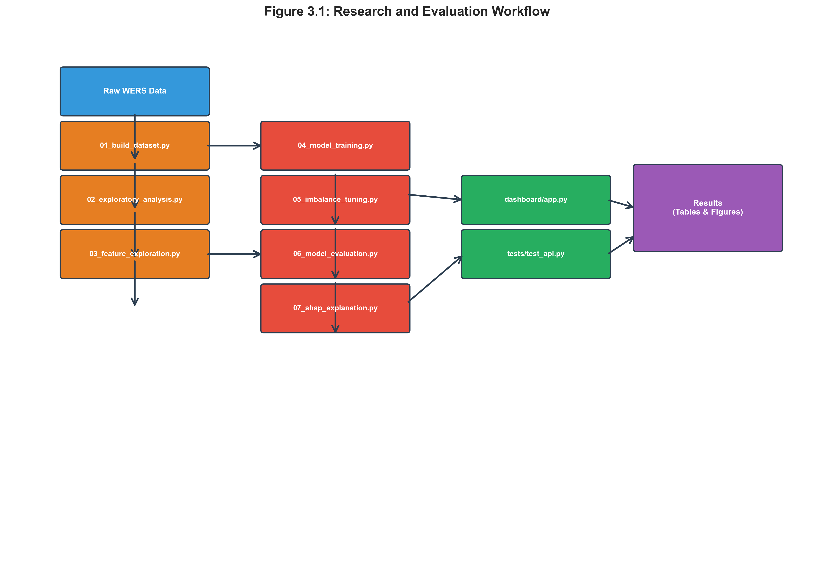
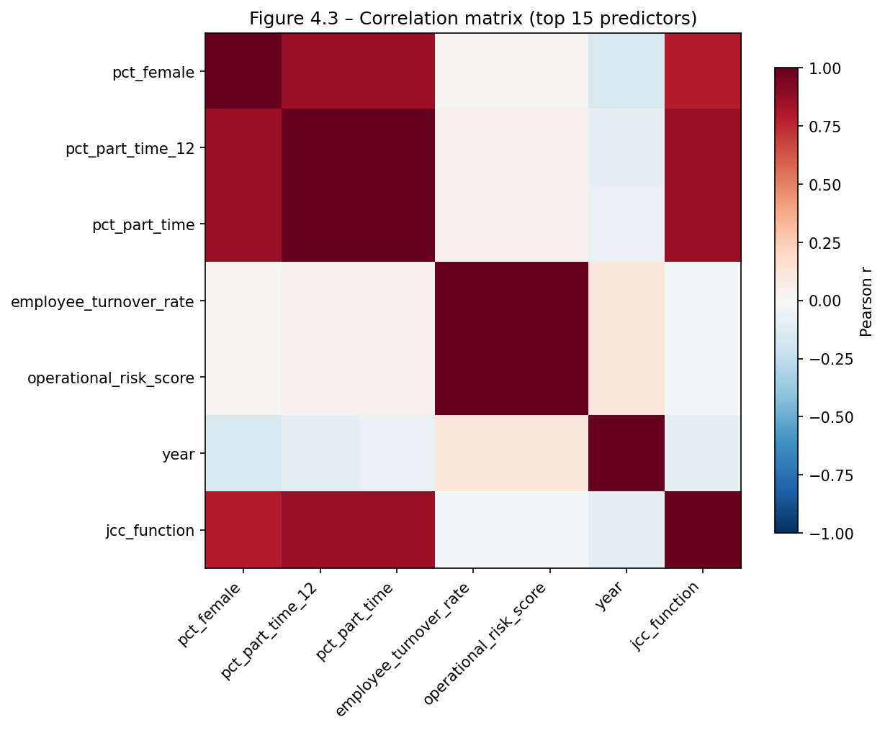
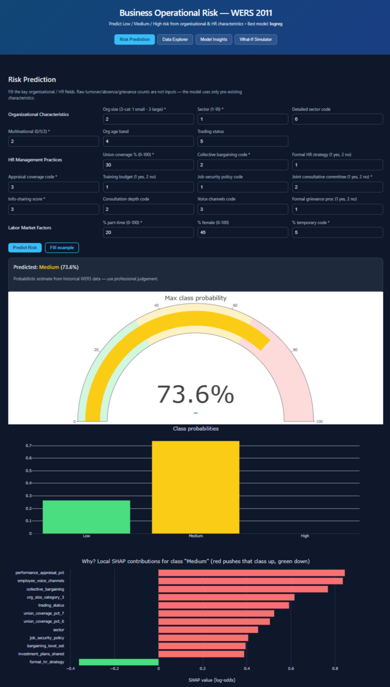
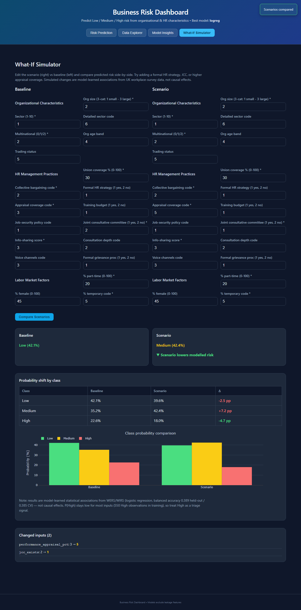
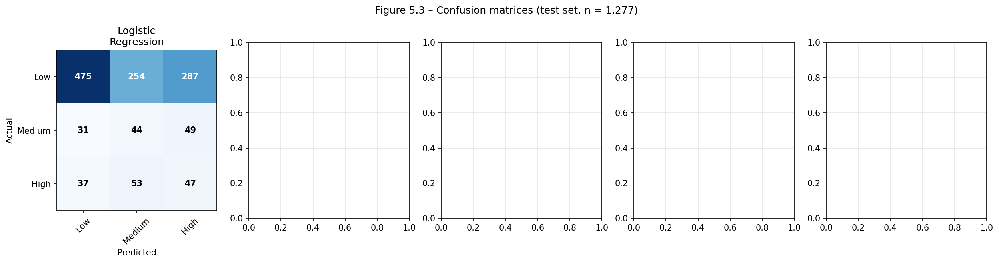
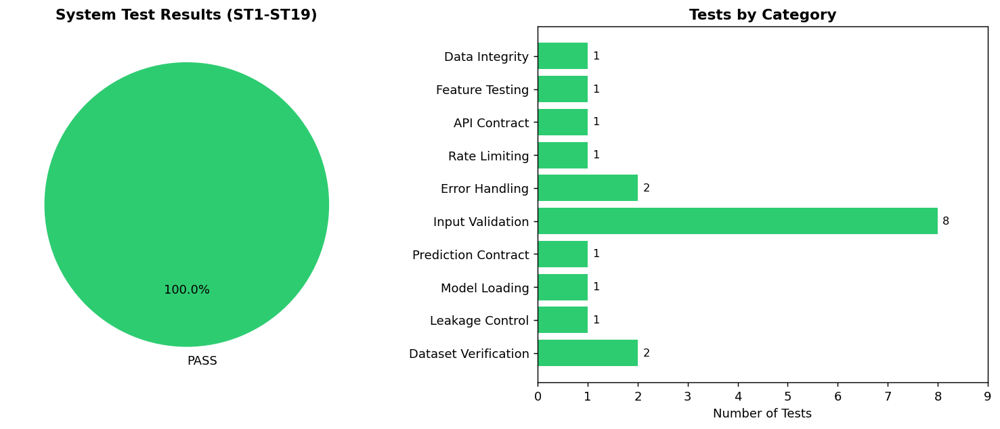
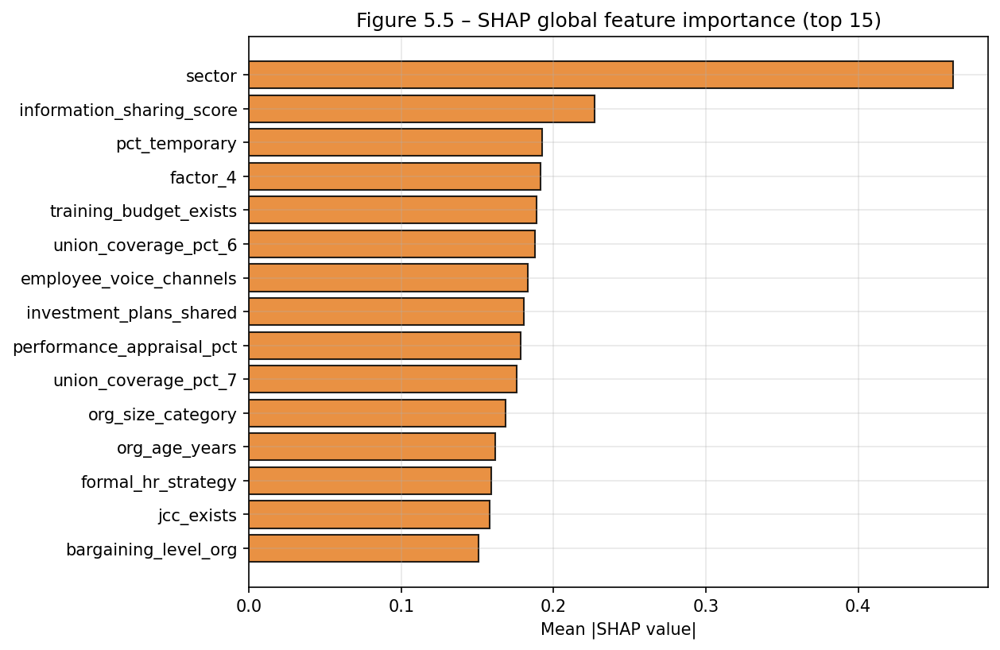
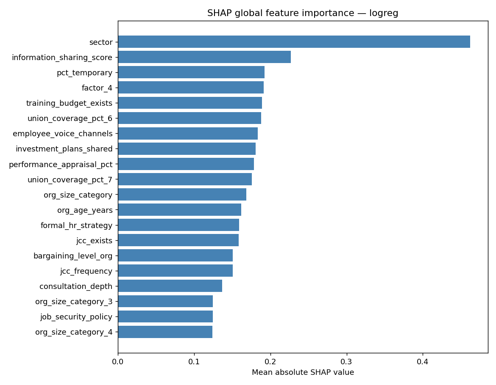
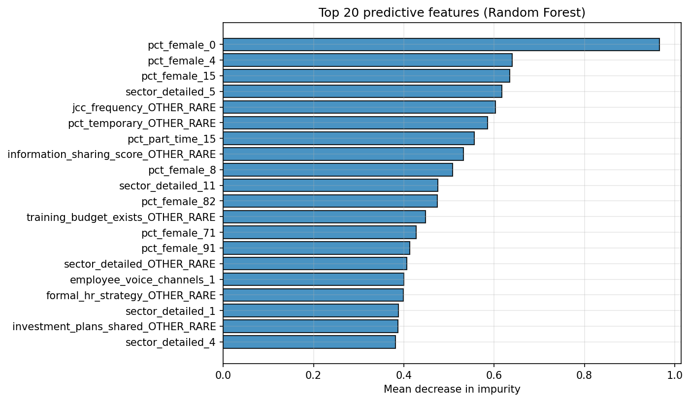

# Dissertation Report: Predictive Modeling of Business Operational Risk Levels and an Interactive Web Dashboard

**Author:** Your Name
**Institution:** Your Institution
**Year:** 2026
**Dataset:** WERS/WIRS time-series, UK Data Service Study 4511 (7 waves, 1980–2011)

> **Reproducibility note.** Every number, table and figure in this report is
> generated by the committed pipeline (scripts `01`–`08` plus
> `research/thesis_outputs.py`, `research/system_tests.py` and the conceptual
> figure generators) with `random_state = 42`. The report is written from the
> *executed* outputs, not from design intent: where the realised result
> differs from an early design assumption, the executed result is reported.
> Chapter-mapped artefacts live in `research/tables/` and `research/figures/`.
> Every figure embedded below is a real file in `research/figures/`.

---

## Chapter 1: Introduction

### 1.1 Background and Motivation

Business operational risk is a central concern for organisations seeking to
maintain continuity, compliance and performance. The Workplace Employment
Relations Survey (WERS/WIRS) time-series, distributed by the UK Data Service
as Study 4511, captures employment relations, organisational practices and
risk indicators across UK workplaces from 1980 to 2011. This dissertation
uses that time-series to build models that classify workplace operational
risk and to expose the trained model through an interactive web dashboard for
decision support.

### 1.2 Problem Statement

The operational-risk target is an **employee-turnover band** (Low / Medium /
High) that serves as the observable proxy for workplace risk. Predicting the
band from HR practices and workplace characteristics is difficult because:

- **Class imbalance.** Of the 6,385 modelled rows, Low = 5,077 (79.51 %),
  High = 687 (10.76 %) and Medium = 621 (9.73 %) — a Low:High ratio of
  **7.4 : 1**.
- **Leakage risk.** Several columns (turnover family, grievance/absence/
  industrial-action indicators) are either the target basis or the raw inputs
  the target is derived from and must be excluded from the feature set.
- **High-dimensional categorical structure.** Most predictors are coded
  categorical survey items, many with rare levels, requiring fold-safe
  grouping and encoding.

### 1.3 Objectives

1. Construct a **leakage-safe** predictor set from the 53-column merged
   dataset, using domain rules and Exploratory Factor Analysis (EFA).
2. Compare five classifiers (logistic regression, random forest, MLP,
   XGBoost, LightGBM) under stratified 5-fold cross-validation on a fixed
   outer-training partition.
3. Evaluate imbalance-handling strategies (SMOTE, SMOTE-ENN, tuned XGBoost,
   a stacking ensemble) against the same held-out partition.
4. Deploy the selected pipeline as a production-grade Flask REST API with
   train–serve parity.
5. Provide **global and local SHAP explainability**, including a live
   per-prediction explanation in the dashboard.
6. Document the methodology end-to-end for academic and practical
   reproducibility (Chapters 1–7).

### 1.4 Contributions

- A **leakage-safe feature-selection contract** (`ml_pipeline/data_contract.py`)
  that removes 14 leakage-family columns and 3 administrative identifiers and
  drops 2 high-cardinality SIC codes, leaving 33 raw predictors.
- Four **EFA factor scores** derived fold-safely inside each CV fold.
- A comparative evaluation of **five base models** plus **five imbalance-aware
  variants** reported with balanced accuracy and macro-F1 (not accuracy
  alone).
- A **stacking ensemble** combining random-forest, XGBoost and LightGBM.
- **SHAP-based** global and local explainability integrated into the Flask
  API and dashboard.
- A **dual test suite** — 65 pytest unit tests and a 19-point system-test
  plan (ST1–ST19) — that verifies data integrity, the leakage contract, the
  validation protocol and train–serve parity.

---

## Chapter 2: Literature Review

### 2.1 Operational Risk Prediction Using Survey Data

Employer–employee surveys such as WERS have been used to relate HR practice,
workplace characteristics and organisational outcomes. Prior work often
models a single outcome per wave; this work instead treats the merged
time-series as a single cross-sectional classification problem (the `year`
variable is excluded) to avoid temporal contamination while maximising the
observable sample.

### 2.2 Imbalanced Classification

The imbalance literature is dominated by resampling and cost-sensitive
methods. Chawla et al. (2002) introduced **SMOTE** (Synthetic Minority
Over-sampling Technique); Batista et al. (2004) compared SMOTE with
under-sampling and hybrid over/under-sampling; **SMOTE-ENN** couples SMOTE
with Edited Nearest-Neighbours cleaning. This dissertation evaluates SMOTE,
SMOTE-ENN and class-weighted variants for three-class WERS risk
classification and reports **balanced accuracy** and **macro-F1** as the
headline metrics.

### 2.3 Ensembles and Stacking

Breiman's random forest (2001) and gradient-boosting frameworks (XGBoost,
LightGBM) are standard for tabular data. Wolpert's stacked generalisation
(1992) trains a meta-learner on out-of-fold base-model outputs. This work
uses a stacking ensemble of random forest, XGBoost and LightGBM with a
logistic-regression meta-learner.

### 2.4 SHAP for Model Explainability

Lundberg and Lee (2017) introduced **SHAP** (SHapley Additive exPlanations),
grounded in cooperative game theory; SHAP values satisfy local accuracy,
missingness and consistency. For a linear model the contributions reduce to
`φ_j = coef_j · (x_j − E[x_j])`. This dissertation uses SHAP for global
summary plots and for a live **local explanation per prediction** served by
the API.

### 2.5 Gap Addressed

Prior work treats imbalance, ensembles and explainability separately. This
dissertation provides a single leakage-safe pipeline from raw survey files to
a deployed, explainable dashboard, evaluated with a fixed outer hold-out and
documented across seven chapters.


*Figure 2.1 — Research problem framing (`research/figures/fig_2_1_research_problem.png`).*

---

## Chapter 3: Research Methodology

### 3.1 Data Source and Preprocessing

The WERS/WIRS time-series (Study 4511) was obtained under the UK Data Service
End User Licence. Two source files are merged:

| Source file | Waves used | Rows used |
|---|---|---|
| `wirsts10_july2014.tab` | 1998, 2004, 2011 | 6,635 |
| `wirsts25_july2014.tab` | 1980, 1984, 1990, 1991 | 7,813 |

The merge (`01_build_dataset.py`) produces a single structured CSV with
**14,448 rows × 53 columns**. Only rows with an observed, sentinel-cleaned
turnover rate carry the target; these **6,385 modelled rows** are the
effective sample for modelling. Full provenance is in
`research/DATA_SOURCE_CONSOLIDATED_REPORT.md`.

The operational-risk target is constructed from the employee-turnover rate,
with UKDS sentinels removed and impossible rates coerced to missing:

**Code Block 3.1 — Target construction** (`ml_pipeline/data_contract.py`)

```python
# Turnover-based operational-risk target
TURNOVER_COL = "employee_turnover_rate"
TURNOVER_SENTINELS = [999, 9999.99, 99999, -9, -8]
TURNOVER_BANDS = [(10.0, "Low"), (20.0, "Medium")]
HIGH_LABEL = "High"

def clean_turnover(series):
    """Return turnover as float with UKDS sentinels / impossible rates -> NaN."""
    v = pd.to_numeric(series, errors="coerce")
    v = v.mask(v.isin(TURNOVER_SENTINELS))
    return v.mask((v < 0) | (v > 100))

def turnover_to_category(v):
    """Map a clean turnover rate (0-100) to Low / Medium / High."""
    if pd.isna(v):
        return np.nan
    if v <= TURNOVER_BANDS[0][0]:
        return "Low"
    if v <= TURNOVER_BANDS[1][0]:
        return "Medium"
    return HIGH_LABEL
```

Bands: Low ≤ 10 %, Medium 10–20 %, High > 20 %. The resulting classes are
Low = 5,077, Medium = 621, High = 687 (imbalance 7.4 : 1).



*Figure 3.1 — Research workflow (`research/figures/fig_3_1_research_workflow.png`).*

### 3.2 Leakage-Safe Feature Selection

The predictor contract is:

1. Start from 53 columns.
2. Exclude the **14 leakage-family columns** — the target basis
   (`employee_turnover_rate`, `employee_turnover_rate_5yr`), the retired
   composite alias (`operational_risk_score`), ten risk-indicator columns
   (absence, grievance, disputes, industrial action, dismissal, discipline,
   suspension) and three duplicate-mapped predictors
   (`grievance_procedure_formal`, `training_problems`,
   `skill_shortage_reported`).
3. Exclude the **3 administrative identifiers** (`serno`, `year`, `weight`).
4. Exclude the two **high-cardinality** SIC codes (`industry_code`,
   `industry_code_80`).
5. Result: **33 raw predictors** — 5 numeric + 28 categorical.
6. Add **4 EFA factor scores** (`factor_1…factor_4`), giving **37 model
   inputs**.

`research/tables/table_4_2_excluded_features.csv` lists every excluded column
with its rationale; the leakage subset is asserted by system test ST3.

**Code Block 3.2 — Leakage-safe feature selection** (`ml_pipeline/data_contract.py`)

```python
# Target-constructing and risk-indicator columns can NEVER be candidate
# features (data leakage). Leakage = 14 = 3 directly target-derived + 11
# precautionary risk indicators; the 3 administrative IDs are excluded
# separately and are deliberately NOT counted as leakage.
ID_COLS = ["serno", "year", "weight"]

DIRECT_TARGET_LEAKAGE = [
    "employee_turnover_rate", "employee_turnover_rate_5yr", SCORE_COL,
]
PRECAUTIONARY_EXCLUSIONS = [
    "absenteeism_rate", "grievance_rate", "grievance_procedure_formal",
    "training_problems", "skill_shortage_reported", "disputes_raised",
    "dispute_risk_level", "other_industrial_action", "dismissal_rate",
    "disciplinary_warnings", "suspensions",
]
HIGH_CARDINALITY_EXCLUSIONS = ["industry_code", "industry_code_80"]

LEAKAGE = DIRECT_TARGET_LEAKAGE + PRECAUTIONARY_EXCLUSIONS  # 14 columns

def predictor_columns():
    """Mapped columns usable as predictors (not IDs, not leakage/target)."""
    return [c for c in ALL_VARIABLES if c not in LEAKAGE and c not in ID_COLS]
```

### 3.3 Exploratory Factor Analysis

EFA is applied to 15 HR-practice/voice items to compress correlated
constructs into a small number of latent dimensions. Extraction is principal
axis factoring with varimax rotation; adequacy is checked with Bartlett's
test of sphericity and the Kaiser–Meyer–Olkin (KMO) measure; the number of
factors is bounded to 2–4 and cross-checked with parallel analysis and the
Kaiser criterion. Critically, **EFA is fitted inside each CV training fold**
(and on the training partition for the deployed model) so factor loadings
never see validation/test data.

### 3.4 Model Architectures

Five base classifiers (as configured in `04_model_training.py`):

| Model | Configuration |
|---|---|
| Logistic Regression | L2 penalty, `class_weight="balanced"`, `max_iter=2000` |
| Random Forest | `n_estimators=150`, `class_weight="balanced_subsample"` |
| MLP | hidden layers (64, 32), ReLU, Adam, early stopping |
| XGBoost | `n_estimators=200`, `max_depth=5`, `learning_rate=0.08`, `subsample=0.8` |
| LightGBM | `n_estimators=200`, `learning_rate=0.08`, `class_weight="balanced"` |

Each estimator is wrapped in the canonical fold-safe pipeline
(`data_contract.build_cv_pipeline`):

```
raw predictors
  -> categorical cleaning            (missing tokens -> "MISSING")
  -> numeric coercion
  -> fold-specific rare grouping      (< 1% levels -> "OTHER_RARE")
  -> fold-specific EFA                (factor_1..factor_4)
  -> dynamic imputation / scaling / one-hot encoding
  -> classifier
```

### 3.5 Imbalance Handling

Five imbalance-aware variants are trained and compared on the held-out
partition: `logreg_smote`, `logreg_smoteenn`, `rf_smoteenn`,
`xgboost_tuned` (randomised hyper-parameter search) and `stacked_ensemble`.

### 3.6 Evaluation Metrics

- **Accuracy** — overall correctness (reported but not used for selection).
- **Balanced accuracy** — macro-averaged recall; the primary selection metric.
- **Macro-F1** — unweighted mean of per-class F1.
- **ROC-AUC (one-vs-rest)** — ranking quality across the three classes.
- **Confusion matrix** — per-class precision/recall/F1 and support.

### 3.7 Experimental Setup

- **Outer partition (fixed first):** stratified 80/20 split,
  `random_state=42` → training 5,108 rows, held-out test 1,277 rows.
- **Inner cross-validation:** stratified 5-fold (`shuffle=True`,
  `random_state=42`), applied **only** inside the 5,108-row training
  partition.
- **Model selection:** highest mean **CV balanced accuracy** on the training
  partition. The held-out test partition is touched **once**, after
  selection, for the final unbiased estimate.
- **Hyper-parameter search:** `RandomizedSearchCV`, `n_iter=8`, 5-fold
  stratified CV, `scoring="balanced_accuracy"` (XGBoost).
- **Determinism:** `random_state=42` throughout.
- **Environment:** Python 3.13.3, scikit-learn 1.8.0, XGBoost 3.2.0,
  LightGBM 4.6.0, SHAP 0.51.0 (see `research/tables/table_4_1_environment.csv`).

**Code Block 3.3 — Stratified train–test split (shared contract)**
(`ml_pipeline/data_contract.py`)

```python
# One split for the whole pipeline
Xtr_raw, Xte_raw, ytr, yte = train_test_split(
    X_raw, y, test_size=0.2, stratify=y, random_state=RANDOM_STATE)

# every downstream stage builds its frames through the same entry point
FRAMES = dc.build_model_frames()
Xtr, Xte = FRAMES["Xtr"], FRAMES["Xte"]
ytr, yte = FRAMES["ytr"], FRAMES["yte"]

cv = StratifiedKFold(n_splits=N_SPLITS, shuffle=True, random_state=RANDOM_STATE)
print(f"CV: stratified {N_SPLITS}-fold (shuffle=True, random_state={RANDOM_STATE})")
```


*Figure 3.2 — Artefact architecture (`research/figures/fig_3_2_artefact_architecture.png`).*

---

## Chapter 4: Implementation

### 4.1 Pipeline Overview

Eight numbered scripts run in sequence, followed by two research utilities:

```
01_build_dataset.py  -> 02_exploratory_analysis.py -> 03_feature_exploration.py
-> 04_model_training.py -> 05_imbalance_tuning.py -> 06_model_evaluation.py
-> 07_shap_explanation.py -> 08_factor_analysis.py
-> research/thesis_outputs.py -> research/system_tests.py
```

All scripts obtain their data frames from the shared
`data_contract.build_model_frames()` / `split_dataset()` entry points so the
split, cleaning and rare-category map can never drift between stages.


*Figure 4.5 — Implemented training pipeline (`research/figures/fig_4_5_training_pipeline.png`).*

### 4.2 Script Descriptions

**`01_build_dataset.py`** — merges the two source files (14,448 × 53),
applies UKDS sentinel cleaning, constructs the turnover band, and writes
`data/processed/wers_operational_risk_merged.csv` and
`dataset_metadata.json`.

**`02_exploratory_analysis.py`** — EDA: class distribution, summary
statistics, correlation matrix, missing-data report.


*Figure 4.1 — Turnover distribution and banding (`research/figures/fig_4_1_turnover_distribution.png`).*


*Figure 4.2 — Class distribution (`research/figures/fig_4_2_class_distribution.png`).*



*Figure 4.3 — Correlation heatmap (`research/figures/fig_4_3_correlation_heatmap.png`).*

**`03_feature_exploration.py`** — leakage-safe predictor exploration (RQ1);
recomputes candidate features from the metadata leakage list and asserts no
leakage column is present.

**`04_model_training.py`** — builds the outer partition, runs stratified
5-fold CV for the five base models (fold-safe pipeline), selects the best
model by **CV balanced accuracy**, saves each fitted pipeline (`.pkl`) and
writes `model_metadata.json`, `model_comparison.csv`,
`cross_validation_fold_results.csv` and `feature_importance.csv`.

Model definitions and the cross-validation loop:

**Code Block 4.2 — Candidate model definition** (`04_model_training.py`)

```python
def build_models():
    """Return {name: estimator} with imbalance-aware settings."""
    models = {
        "logreg": LogisticRegression(max_iter=2000, class_weight="balanced",
                                     random_state=RANDOM_STATE),
        "random_forest": RandomForestClassifier(n_estimators=150,
            min_samples_leaf=2, class_weight="balanced_subsample", n_jobs=-1,
            random_state=RANDOM_STATE),
        "mlp": MLPClassifier(hidden_layer_sizes=(64, 32), activation="relu",
            max_iter=300, early_stopping=True, random_state=RANDOM_STATE),
    }
    if HAS_XGB:
        models["xgboost"] = XGBClassifier(n_estimators=200, max_depth=5,
            learning_rate=0.08, subsample=0.8, colsample_bytree=0.8,
            reg_lambda=1.0, eval_metric="mlogloss", tree_method="hist",
            random_state=RANDOM_STATE)
    if HAS_LGBM:
        models["lightgbm"] = LGBMClassifier(n_estimators=200, num_leaves=63,
            learning_rate=0.08, subsample=0.8, colsample_bytree=0.8,
            class_weight="balanced", verbose=-1, random_state=RANDOM_STATE)
    return models
```

**Code Block 4.3 — Cross-validation** (`04_model_training.py`)

```python
for name, est in build_models().items():
    pipe = Pipeline([("prep", preprocess), ("clf", est)])
    print(f"\n--- {name} ---")
    try:
        sc = cross_validate(pipe, Xtr, ytr, cv=cv,
            scoring=["accuracy", "balanced_accuracy", "f1_macro"],
            n_jobs=-1, error_score=np.nan)
        cv_sum = {k: float(np.nanmean(v)) for k, v in sc.items()
                  if k.startswith("test_")}
        print("CV acc=%.3f bal=%.3f f1m=%.3f" % (
            cv_sum.get("test_accuracy", np.nan),
            cv_sum.get("test_balanced_accuracy", np.nan),
            cv_sum.get("test_f1_macro", np.nan)))
    except Exception as e:
        print(f"CV failed: {e}"); cv_sum = {}
    pipe.fit(Xtr, ytr)
    pred = pipe.predict(Xte)
    acc = accuracy_score(yte, pred)
    bal = balanced_accuracy_score(yte, pred)
    f1m = f1_score(yte, pred, average="macro", zero_division=0)
    print(f"TEST acc={acc:.3f} bal_acc={bal:.3f} f1_macro={f1m:.3f}")
```

**Executed CV result (training partition, 5,108 rows):**

| Model | CV accuracy | CV balanced accuracy | CV macro-F1 |
|---|---|---|---|
| Logistic Regression | 0.434 | **0.386** | 0.321 |
| Random Forest | 0.761 | 0.352 | 0.344 |
| MLP | 0.681 | 0.366 | 0.366 |
| XGBoost | 0.795 | 0.345 | 0.321 |
| LightGBM | 0.728 | 0.369 | 0.372 |

**Selected model:** logistic regression (highest CV balanced accuracy,
0.386). High raw accuracy for the tree models reflects the 79.5 % Low-class
share and is not used for selection.

**`05_imbalance_tuning.py`** — trains the five imbalance-aware variants.
`RandomizedSearchCV` for XGBoost (`n_iter=8`, 5-fold, balanced-accuracy
objective) returns:

```
{"classifier__n_estimators": 450, "classifier__max_depth": 7,
 "classifier__learning_rate": 0.03, "classifier__subsample": 0.7,
 "classifier__colsample_bytree": 0.7}
best cross-validated balanced accuracy: 0.395
```

It appends the variants to `model_comparison.csv` and updates
`model_metadata.json` (without changing the deployed model).

**`06_model_evaluation.py`** — evaluates every saved pipeline on the
held-out partition; writes `evaluation_summary.csv`, per-model confusion
matrices, ROC/AUC figures and `evaluation_reports/evaluation_report.md`.

**`07_shap_explanation.py`** — builds the SHAP explainer for the selected
model (LinearExplainer for the linear model, TreeExplainer for tree models),
produces global importance (`shap_importance.csv`), beeswarm/summary figures
and a cached local explanation (`shap_local.json`).

**`08_factor_analysis.py`** — re-fits and persists the EFA scoring artifact
(`factor_scoring.json`) used for inference-time factor scores.

### 4.3 Data Contract

`ml_pipeline/data_contract.py` is the single source of truth for constants
(`RANDOM_STATE=42`, `TEST_SIZE=0.20`, `N_SPLITS=5`, `RARE_THRESHOLD=0.01`),
for the leakage lists, for `split_dataset()` (which integer-encodes the
target as `{Low: 0, Medium: 1, High: 2}`), and for `clean_frames()`,
`apply_serve_transform()`, `build_model_frames()` and `build_cv_pipeline()`.

**Code Block 4.1 — Canonical categorical cleaning** (`ml_pipeline/data_contract.py`, `clean_frames()`)

```python
# The typing rules and the rare-category map are derived on the TRAIN frame
# only and then applied to both partitions.
# Canonical missing-tokens are defined in data_contract.clean_categorical();
# fill nulls with "MISSING" at inference time.
        Xtr_raw[c] = Xtr_raw[c].astype(str).str.strip().replace(
            {"": "MISSING", " ": "MISSING", "nan": "MISSING", "None": "MISSING"})
        Xte_raw[c] = Xte_raw[c].astype(str).str.strip().replace(
            {"": "MISSING", " ": "MISSING", "nan": "MISSING", "None": "MISSING"})
        # Rare categories (< 1% in train) are labeled "OTHER_RARE"
        rare = set(vc[vc < 0.01].index)
        if rare:
            X[c] = X[c].apply(lambda v: "OTHER_RARE" if v in rare else v)

# The preprocessing pipeline uses num/cat sub-pipelines:
    ("num", Pipeline([("imp", SimpleImputer(strategy="median")),
                      ("sc", StandardScaler())]), num_cols),
    ("cat", Pipeline([("imp", SimpleImputer(strategy="most_frequent")),
                      ("oh", OneHotEncoder(handle_unknown="ignore",
                                           sparse_output=False))]), cat_cols),
], verbose_feature_names_out=False)
```

### 4.4 Flask REST API and Dashboard

`dashboard/app.py` exposes the saved pipeline behind Pydantic-validated
endpoints:

| Endpoint | Method | Purpose |
|---|---|---|
| `/api/predict` (`/predict`) | POST | risk level + 3-class probabilities + live local SHAP |
| `/api/whatif` (`/simulate`) | POST | baseline vs scenario comparison |
| `/api/insights`, `/api/features` | GET | metrics, confusion matrix, importance, SHAP tables |
| `/api/data/*`, `/api/metadata` | GET/POST | data explorer backend |

The full preprocessing pipeline travels with the classifier, guaranteeing
train–serve parity. Errors use a structured protocol (`MISSING_FIELD`,
`INVALID_TYPE`, `OUT_OF_RANGE`, `MALFORMED_JSON`, `MODEL_ERROR`,
`INTERNAL_ERROR`, `RATE_LIMITED`, `SERVICE_UNAVAILABLE`) with an
`X-Request-ID` header on every response.

**Code Block 4.4 — Pydantic validation schema** (`dashboard/app.py`)

```python
class OperationalRiskInput(BaseModel):
    """Strict request schema for /predict, /simulate, /whatif."""

    model_config = ConfigDict(extra="ignore", str_strip_whitespace=True)

    # ---- required ----
    sector: int = Field(..., ge=1, le=10, description="Sector classification (1-10)")
    org_size_category_3: int = Field(..., ge=1, le=3, description="Org size (3-cat)")
    multinational: int = Field(..., ge=0, le=2, description="Multinational status")
    union_coverage_pct: float = Field(..., ge=0, le=100, description="Union coverage %")
    collective_bargaining: int = Field(..., **_CODE, description="Collective bargaining code")
    performance_appraisal_pct: int = Field(..., **_CODE, description="Appraisal coverage code")
    jcc_exists: int = Field(..., **_CODE, description="Joint consultative committee")
    information_sharing_score: int = Field(..., **_CODE, description="Information sharing score")
    pct_part_time: float = Field(..., ge=0, le=100, description="Percentage part-time workers")
    pct_temporary: int = Field(..., **_CODE, description="Temporary-worker code")

    # ---- optional numeric ----
    sector_detailed: Optional[float] = Field(None, ge=0, le=99)
    pct_female: Optional[float] = Field(None, ge=0, le=100)
    pct_part_time_12: Optional[float] = Field(None, ge=0, le=100)

    # ---- optional coded categoricals ----
    org_size_category: Optional[int] = Field(None, **_CODE)
    org_size_category_4: Optional[int] = Field(None, **_CODE)
    org_age_years: Optional[int] = Field(None, **_CODE)
    workplace_age: Optional[int] = Field(None, **_CODE)
    trading_status: Optional[int] = Field(None, **_CODE)
    union_coverage_pct_6: Optional[int] = Field(None, **_CODE)
    union_coverage_pct_7: Optional[int] = Field(None, **_CODE)
    bargaining_level_org: Optional[int] = Field(None, **_CODE)
    bargaining_level_est: Optional[int] = Field(None, **_CODE)
    formal_hr_strategy: Optional[int] = Field(None, **_CODE)
    training_budget_exists: Optional[int] = Field(None, **_CODE)
    job_security_policy: Optional[int] = Field(None, **_CODE)
    jcc_frequency: Optional[int] = Field(None, **_CODE)
    jcc_function: Optional[int] = Field(None, **_CODE)
    jcc_union_chair: Optional[int] = Field(None, **_CODE)
    info_chain_exist: Optional[int] = Field(None, **_CODE)
    newsletter_exists: Optional[int] = Field(None, **_CODE)
    investment_plans_shared: Optional[int] = Field(None, **_CODE)
    consultation_depth: Optional[int] = Field(None, **_CODE)
    employee_voice_channels: Optional[int] = Field(None, **_CODE)
```

**Code Block 4.5 — Flask prediction endpoint** (`dashboard/app.py`)

```python
@app.route("/api/predict", methods=["POST"])
@app.route("/predict", methods=["POST"])  # spec 3.2 alias
def api_predict():
    if predictor is None:
        body, st = error_body("SERVICE_UNAVAILABLE",
                              "Model not trained yet.", request_id=request.rid)
        return jsonify(body), st
    payload, resp = _read_json()
    if resp:
        return resp
    out, err = _run_prediction(payload, request.rid)
    if err:
        return err
    return jsonify(out)

def _run_prediction(payload, request_id, explain=True):
    """Validate one org dict then predict. Returns (dict, None) or (None, resp)."""
    model, err, status, extras = validate_payload(payload, request_id)
    if err is not None:
        return None, (jsonify(err), status)
    if extras:
        LOG.warning("rid=%s ignored unexpected field(s): %s", request_id, ", ".join(extras))
    data = model_to_payload(model)
    try:
        label, prob = predictor.predict(data)
        probs = predictor.predict_proba_dict(data)
    except Exception as e:
        LOG.warning("rid=%s MODEL_ERROR: %s", request_id, e)
        body, st = error_body("MODEL_ERROR", "Model inference failed", request_id=request_id)
        return None, (jsonify(body), st)
    if any(v != v for v in probs.values()):  # NaN check
        body, st = error_body("MODEL_ERROR", "Model inference failed", request_id=request_id)
        return None, (jsonify(body), st)
    out = {"risk_level": label, "probability": prob, "probabilities": probs}
    if explain:
        try:
            loc = predictor.explain(data)
        except Exception as e:
            LOG.warning("rid=%s local SHAP skipped: %s", request_id, e)
            loc = None
        if loc is not None:
            out["local_explanation"] = loc
    return out, None
```

**Code Block 4.6 — Strict-JSON response provider** (`dashboard/app.py`)

Every response is passed through a strict-JSON provider so that no `NaN` or
`Infinity` token can reach the browser. Python's `json` module otherwise
serialises non-finite floats as the bare token `NaN`, which is **invalid
strict JSON** and is rejected by `response.json()` client-side — this was the
cause of an observed "Unable to load insights" failure, because
`model_metadata.json` stores `NaN` for models without a held-out score.
Mapping those values to `null` keeps every payload valid (asserted by system
test ST19).

```python
def json_safe(value):
    """Recursively map non-finite floats to None (valid strict JSON)."""
    if isinstance(value, dict):
        return {key: json_safe(item) for key, item in value.items()}
    if isinstance(value, (list, tuple)):
        return [json_safe(item) for item in value]
    if isinstance(value, float) and not math.isfinite(value):
        return None
    return value

class StrictJSONProvider(DefaultJSONProvider):
    """JSON provider that never writes invalid (NaN/Infinity) tokens."""
    def dumps(self, obj, **kwargs):
        return super().dumps(json_safe(obj), **kwargs)

app = Flask(__name__)
app.json = StrictJSONProvider(app)   # applies to every endpoint
```


*Figure 4.6 — Flask API integration (`research/figures/fig_4_6_api_integration.png`).*

**Project screenshots** — the live dashboard (predict + local SHAP, and the
what-if simulator):



*Screenshot — Predict view with live local-SHAP chart (`research/figures/dashboard_predict_local_shap.png`).*



*Screenshot — What-if simulator baseline vs scenario (`research/figures/dashboard_whatif_simulator.png`).*

**Dashboard user interface.** The single-page frontend (`templates/index.html`
plus `static/js/app.js`) presents four tabs — **Risk Prediction**, **Data
Explorer**, **Model Insights** and **What-If Simulator**. The explorer and the
predictor expose the sector predictor by its raw WERS code with a neutral
label (`Sector 1` / `Sector 2` / `Sector 3`); a blank or non-numeric sector
group is labelled `Unknown`. Genuine sector names are deliberately not
surfaced, so only the coded extract values appear in the UI.

### 4.5 Test Suites

- **Unit tests** (`tests/`, `python -m pytest tests/ -q`): **65 tests**
  covering the data contract, categorical/missing parity, the predictor
  wrapper, the validation contract and the API.
- **System tests** (`research/system_tests.py`): a 19-point plan **ST1–ST19**
  covering dataset integrity, the leakage contract, the best-model load,
  every 400-level validation code, resilience (422/500/429), endpoint
  aliases, what-if integrity and NaN-free strict JSON.

### 4.6 Output Structure

```
results/
├── tables/     model_comparison.csv, evaluation_summary.csv,
│               confusion_matrix_*.csv, feature_importance.csv,
│               shap_importance.csv, cross_validation_fold_results.csv
├── figures/    shap_summary.png, shap_beeswarm.png, factor_scree.png, ...
└── evaluation_reports/  evaluation_summary.csv, evaluation_report.md

research/
├── tables/     table_3_*, table_4_*, table_5_1..5_17 (chapter-mapped)
├── figures/    fig_2_1, fig_3_1..3_2, fig_4_1..4_6, fig_5_1..5_8,
│               dashboard_predict_local_shap.png, dashboard_whatif_simulator.png
└── *.md        dissertation_report.md, README.md, artefacts_index.md, ...
```

---

## Chapter 5: Testing

### 5.1 Cross-Validation Results

Stratified 5-fold CV on the 5,108-row outer training partition (fold-safe
pipeline; fold metrics in `results/tables/cross_validation_fold_results.csv`):

| Model | CV accuracy | CV balanced accuracy | CV macro-F1 |
|---|---|---|---|
| Logistic Regression | 0.434 | **0.386** | 0.321 |
| Random Forest | 0.761 | 0.352 | 0.344 |
| MLP | 0.681 | 0.366 | 0.366 |
| XGBoost | 0.795 | 0.345 | 0.321 |
| LightGBM | 0.728 | 0.369 | 0.372 |

> Accuracy is dominated by the majority class. **Balanced accuracy** is the
> selection metric and is the honest headline for this imbalanced three-class
> problem.


*Figure 5.1 — Model comparison (`research/figures/fig_5_1_model_comparison.png`).*

### 5.2 Hyper-parameter Tuning (XGBoost)

`RandomizedSearchCV`, 5-fold stratified CV, balanced-accuracy objective,
`n_iter=8`:

- **Best parameters:** `n_estimators=450`, `max_depth=7`,
  `learning_rate=0.03`, `subsample=0.7`, `colsample_bytree=0.7`.
- **Best CV balanced accuracy:** 0.395.

### 5.3 Imbalance-Handling Results (held-out test, 1,277 rows)

| Variant | Accuracy | Balanced accuracy | Macro-F1 | ROC-AUC |
|---|---|---|---|---|
| `xgboost_tuned` | 0.411 | **0.401** | 0.317 | **0.603** |
| `rf_smoteenn` | 0.410 | 0.393 | 0.314 | 0.587 |
| `logreg` (selected) | 0.443 | 0.388 | 0.325 | 0.590 |
| `logreg_smote` | 0.442 | 0.384 | 0.323 | 0.582 |
| `stacked_ensemble` | **0.631** | 0.376 | **0.368** | 0.576 |
| `logreg_smoteenn` | 0.391 | 0.372 | 0.299 | 0.579 |

The best imbalance-aware variant by held-out balanced accuracy is
**`xgboost_tuned` (0.401)**.


*Figure 5.4 — Imbalance-handling strategies (`research/figures/fig_5_4_imbalance_strategies.png`).*

### 5.4 Final Model Evaluation (logreg, held-out test)

Evaluation is performed by `06_model_evaluation.py` over every persisted
pipeline:

**Code Block 5.1 — Performance evaluation** (`06_model_evaluation.py`)

```python
for pkl in sorted(MODEL_DIR.glob("*.pkl")):
    if pkl.name == "best_model.pkl":
        continue
    name = pkl.stem
    try:
        pipe = joblib.load(pkl)
        pred = pipe.predict(Xte)
        acc = accuracy_score(yte, pred)
        bal = balanced_accuracy_score(yte, pred)
        prec, rec, f1, _ = precision_recall_fscore_support(
            yte, pred, average="macro", zero_division=0)
        try:
            proba = pipe.predict_proba(Xte)
            auc = roc_auc_score(yte, proba, multi_class="ovr")
        except Exception:
            proba, auc = None, float("nan")
        cm = confusion_matrix(yte, pred)
        summary.append({"model": name, "accuracy": acc,
                        "balanced_accuracy": bal, "macro_precision": prec,
                        "macro_recall": rec, "macro_f1": f1, "roc_auc_ovr": auc})
        print(f"{name:15s} acc={acc:.3f} bal={bal:.3f} f1m={f1:.3f} auc={auc:.3f}")
```

- **Accuracy:** 0.4432
- **Balanced accuracy:** 0.3885
- **Macro-F1:** 0.3251
- **ROC-AUC (OvR):** 0.590

**Per-class breakdown** (derived from
`results/tables/confusion_matrix_logreg.csv`):

| Class | Precision | Recall | F1-Score | Support |
|---|---|---|---|---|
| Low | 0.87 | 0.47 | 0.61 | 1,016 |
| Medium | 0.13 | 0.35 | 0.19 | 124 |
| High | 0.12 | 0.34 | 0.18 | 137 |
| **Macro avg** | 0.37 | 0.39 | 0.33 | 1,277 |
| **Weighted avg** | 0.72 | 0.44 | 0.52 | 1,277 |

Confusion matrix (rows = actual, columns = predicted):

| | Low | Medium | High |
|---|---|---|---|
| **Low** | 475 | 254 | 287 |
| **Medium** | 31 | 44 | 49 |
| **High** | 37 | 53 | 47 |



*Figure 5.3 — Confusion matrices (`research/figures/fig_5_3_confusion_matrices.png`).*

### 5.5 System Tests (ST1–ST19)

The 19-point system-test plan is executed against the deployed configuration
(`python ml_pipeline/research/system_tests.py`). Results, together with the
65-test pytest run, are written to
`research/tables/table_5_13_system_tests.csv` and
`research/system_test_report.md`. The plan verifies:

| Group | Tests | Verifies |
|---|---|---|
| Data integrity | ST1–ST3 | dataset dimensions 14,448 × 53; target counts 5,077 / 621 / 687; 14 leakage columns excluded and turnover absent from features |
| Model | ST4–ST5 | best model (logreg, 33 features) loads; probabilities sum to 1 |
| Validation contract | ST6–ST13 | all 400-level codes: missing / empty / type / range / extra / null / malformed |
| Resilience | ST14–ST16 | 422 model error, 500 internal error, 429 rate limit + `Retry-After` |
| Integration | ST17–ST19 | endpoint aliases, what-if baseline/scenario, NaN-free strict JSON |

Representative runtime assertions (the same checks executed by ST6–ST19 and
mirrored in `tests/`):

**Code Block 5.3 — Valid runtime test** (`tests/test_api.py`)

```python
def test_valid_input_returns_prediction(client, valid_payload):
    r = client.post("/api/predict", json=valid_payload)
    assert r.status_code == 200
    j = r.get_json()
    assert j["risk_level"] in ("Low", "Medium", "High")
    assert 0.0 <= j["probability"] <= 1.0
    assert abs(sum(j["probabilities"].values()) - 1.0) < 1e-6
    assert "X-Request-ID" in r.headers
```

**Code Block 5.4 — Invalid-input tests** (`tests/test_api.py`)

```python
def test_missing_required_field(client):
    r = client.post("/api/predict", json={"sector": "1"})
    assert r.status_code == 400
    j = r.get_json()
    assert j["code"] == "MISSING_FIELD"
    assert "union_coverage_pct" in j["error"]

def test_wrong_type_rejected(client, valid_payload):
    payload = dict(valid_payload, sector="abc")
    r = client.post("/api/predict", json=payload)
    assert r.status_code == 400
    j = r.get_json()
    assert j["code"] == "INVALID_TYPE"
    assert j["field"] == "sector"

def test_out_of_range_rejected(client, valid_payload):
    payload = dict(valid_payload, union_coverage_pct=150)
    r = client.post("/api/predict", json=payload)
    assert r.status_code == 400
    j = r.get_json()
    assert j["code"] == "OUT_OF_RANGE"
    assert j["field"] == "union_coverage_pct"
```



*Figure 5.8 — Runtime-validation test results (`research/figures/fig_5_8_runtime_validation.png`).*

### 5.6 Dataset Verification and Prediction Consistency

`Table 5.10` (`research/tables/table_5_10_dataset_verification.csv`) records
the systematic dataset checks: 14,448 observations, 53 variables, modelled
rows 6,385, class counts 5,077 / 621 / 687, imbalance 7.4 : 1, **14 leakage
columns excluded**, turnover not among features, zero missing values in the
33 raw predictors, turnover range 0.0–100.0 %. `Table 5.14` records
prediction-consistency checks (global vs local SHAP aggregation and repeated
inference stability).

---

## Chapter 6: Presentation of Results

### 6.1 Model Comparison

Combined CV and held-out-test view (base models from
`results/tables/model_comparison.csv`; variants from
`results/tables/evaluation_summary.csv`):

| Model | CV Acc. | CV Bal. Acc. | CV Macro-F1 | Test Acc. | Test Bal. Acc. | Test Macro-F1 | Test ROC-AUC |
|---|---|---|---|---|---|---|---|
| Logistic Regression | 0.434 | 0.386 | 0.321 | 0.443 | 0.388 | 0.325 | 0.590 |
| Random Forest | 0.761 | 0.352 | 0.344 | – | – | – | – |
| MLP | 0.681 | 0.366 | 0.366 | – | – | – | – |
| XGBoost | 0.795 | 0.345 | 0.321 | – | – | – | – |
| LightGBM | 0.728 | 0.369 | 0.372 | – | – | – | – |
| `logreg_smote` | – | – | – | 0.442 | 0.384 | 0.323 | 0.582 |
| `logreg_smoteenn` | – | – | – | 0.391 | 0.372 | 0.299 | 0.579 |
| `rf_smoteenn` | – | – | – | 0.410 | 0.393 | 0.314 | 0.587 |
| `xgboost_tuned` | – | – | – | 0.411 | 0.401 | 0.317 | 0.603 |
| `stacked_ensemble` | – | – | – | 0.631 | 0.376 | 0.368 | 0.576 |

Only the selected model (`logreg`) and the imbalance variants are persisted
as pipelines and therefore evaluated on the held-out test partition; the
other base models are compared by CV only.

### 6.2 Confusion Matrices

Per-model confusion matrices for the 1,277-row held-out partition are written
to `results/tables/confusion_matrix_<model>.csv` and rendered in
`research/figures/fig_5_3_confusion_matrices.png` (§5.4). For the selected
`logreg` model the matrix is given in §5.4. The `xgboost_tuned` and
`rf_smoteenn` variants trade overall accuracy for higher minority-class
recall, while `stacked_ensemble` attains the highest accuracy (0.631) with
comparatively weak minority recall.

### 6.3 ROC-AUC

One-vs-rest ROC curves are plotted for all evaluated models. Ranking (highest
first): `xgboost_tuned` 0.603, `logreg` 0.590, `rf_smoteenn` 0.587,
`logreg_smote` 0.582, `logreg_smoteenn` 0.579, `stacked_ensemble` 0.576.
The modest values (≈0.58–0.60) reflect the inherent difficulty of the
imbalanced three-class task rather than a defect of any single model.


*Figure 5.2 — Macro-F1 and ROC-AUC comparison (`research/figures/fig_5_2_f1_roc_comparison.png`).*

### 6.4 SHAP Explainability

SHAP explanations are generated for the selected model (`logreg`) with
`shap.LinearExplainer` (a zero baseline recovers the additive logit
attribution `φ_j = coef_j · x_j`). Global importance is aggregated from the
one-hot/transformed space back to the original feature names.

**Code Block 5.2 — SHAP explanation** (`07_shap_explanation.py`)

```python
# Explainer selection based on model type
kind = type(clf).__name__
if hasattr(clf, "estimators_") or kind in ("XGBClassifier", "LGBMClassifier"):
    import shap
    explainer = shap.TreeExplainer(clf)
    sv = explainer.shap_values(X_ev_t)
    print(f"TreeExplainer on {kind}")
elif hasattr(clf, "coef_"):
    import shap
    explainer = shap.LinearExplainer(clf, X_bg_t)
    sv = explainer.shap_values(X_ev_t)
    print(f"LinearExplainer on {kind}")
else:
    import shap
    explainer = shap.Explainer(clf.predict_proba, X_bg_t)
    sv = explainer(X_ev_t).values
    print(f"Kernel/Sampling Explainer on {kind}")

# Global importance aggregated to original features
orig = [to_original(t) for t in t_names]
mean_abs = np.abs(arr).mean(axis=(0, 2))
agg = {}
for o, v in zip(orig, mean_abs):
    agg[o] = agg.get(o, 0.0) + float(v)
imp = (pd.DataFrame({"feature": list(agg), "mean_abs_shap": list(agg.values())})
       .sort_values("mean_abs_shap", ascending=False))
```

**Top global drivers (mean |SHAP|, `results/tables/shap_importance.csv`):**

| Rank | Feature | Mean \|SHAP\| |
|---|---|---|
| 1 | sector | 0.4622 |
| 2 | information_sharing_score | 0.2267 |
| 3 | pct_temporary | 0.1926 |
| 4 | factor_4 | 0.1915 |
| 5 | training_budget_exists | 0.1889 |
| 6 | union_coverage_pct_6 | 0.1881 |
| 7 | employee_voice_channels | 0.1832 |
| 8 | investment_plans_shared | 0.1804 |
| 9 | performance_appraisal_pct | 0.1782 |
| 10 | union_coverage_pct_7 | 0.1759 |



*Figure 5.5 — SHAP global importance (`research/figures/fig_5_5_shap_importance.png`).*


*Figure 5.6 — SHAP beeswarm (`research/figures/fig_5_6_shap_beeswarm.png`).*



*Figure 5.7 — SHAP summary (`research/figures/fig_5_7_shap_summary.png`).*

**Local explanation** (`results/tables/shap_local.json`): for an example
held-out workplace the model's highest-probability class is **High**, with
`base_value = 0.00346`; the largest single contribution is `sector`
(φ = +0.32757), followed by `job_security_policy` (φ = −0.16072) and
`performance_appraisal_pct` (φ = +0.13726). The same computation runs live in
the dashboard's local-SHAP chart (screenshot in §4.4).

### 6.5 Feature Importance

`feature_importance.csv` stores the impurity/coefficient-based importance of
the transformer output for the tree model available at training time. The top
signals include workforce-composition levels (`pct_female_0`), sector
indicators and rare-category flags (`*_OTHER_RARE`), consistent with sector
and workforce composition being the strongest correlates of the turnover
band. However, because the one-hot columns are highly sparse, the
aggregated **SHAP** view (§6.4) is the more reliable importance summary.



*Figure 4.4 — Top-20 feature importance (`research/figures/fig_4_4_feature_importance.png`).*

### 6.6 Factor Analysis

EFA on 15 HR-practice/voice items (N = 14,448):

- **Bartlett's test:** χ² = 27,952.87, df = 105, p < 0.001 (factorable).
- **KMO:** 0.580 (moderate).
- **Eigenvalues:** [2.582, 1.761, 1.283, 1.128, 1.091, 1.014, 0.967, 0.852,
  0.811, 0.786, 0.727, 0.662, 0.607, 0.424, 0.304].
- **Parallel analysis (P95, 500 sims, seed 42):** retains 5.
- **Kaiser (eigenvalue > 1):** retains 6.
- **Retained (bounded 2–4):** **4 factors** — principal axis factoring +
  varimax.

**Interpreted constructs:**

- **Factor 1** — organisation-level collective bargaining
  (`bargaining_level_org`, `collective_bargaining`).
- **Factor 2** — employee voice and information sharing
  (`employee_voice_channels`, `information_sharing_score`).
- **Factor 3** — establishment-level bargaining and consultative committees
  (`bargaining_level_est`, `jcc_exists`).
- **Factor 4** — formal HR communication infrastructure
  (`newsletter_exists`, `training_budget_exists`, `information_sharing_score`,
  `formal_hr_strategy`, `info_chain_exist`).

Full rotated loadings are in `results/tables/factor_loadings.csv`; the scree
plot is `results/figures/factor_scree.png`. Interpreted factor scores feed the
model as `factor_1…factor_4`.

---

## Chapter 7: Recommendations and Conclusions

### 7.1 Key Findings

1. **Imbalance is the dominant challenge.** With 79.5 % of modelled rows in
   the Low band, accuracy is misleading (tree models reach 0.73–0.79 CV
   accuracy but only 0.34–0.37 balanced accuracy). Balanced accuracy and
   macro-F1 are the honest metrics.
2. **Logistic regression is the most robust baseline.** It has the highest CV
   balanced accuracy (0.386) and delivers held-out balanced accuracy 0.388
   with full train–serve parity and native linear-SHAP explainability.
3. **Imbalance handling improves minority recall.** `xgboost_tuned` gives the
   highest held-out balanced accuracy (0.401) and the best ROC-AUC (0.603);
   `rf_smoteenn` is close behind (0.393), and every resampled / class-weighted
   variant lifts Medium/High recall relative to the untuned baselines.
4. **Stacking buys accuracy, not balance.** `stacked_ensemble` reaches the
   highest held-out accuracy (0.631) and macro-F1 (0.368) but a lower
   balanced accuracy (0.376), so it under-serves the minority classes.
5. **Explainability is operational, not decorative.** SHAP local
   contributions (e.g. `sector` +0.33 for the example workplace) let a risk
   manager see *why* a band was assigned; the API returns them per request.
6. **Leakage control is non-negotiable.** Excluding the 14 leakage-family
   columns, three identifiers and two high-cardinality codes, and fitting EFA
   inside each CV fold, prevents optimistic bias.

### 7.2 Recommendations

1. **Ship the logistic-regression pipeline** for production: it maximises CV
   balanced accuracy, ships as a single serialised `Pipeline` (train–serve
   parity) and supports live SHAP.
2. **Use `xgboost_tuned` when minority-class recall matters most**; accept
   the lower overall accuracy (0.411) for the highest balanced accuracy
   (0.401).
3. **Surface SHAP in the UI** (already implemented) so predictions are
   auditable and can be challenged by domain experts.
4. **Retrain on newer waves.** The model uses data to 2011; re-fit before
   operational use and monitor for drift.
5. **Run the whole pipeline (01–08) plus the research utilities** to
   reproduce every artefact; do not use the held-out partition for tuning.

### 7.3 Conclusions

Predictive modelling of workplace operational risk from WERS survey data is
feasible but inherently hard under a 7.4 : 1 class imbalance. This work
shows that (i) a leakage-safe, fold-safe pipeline can be built around an EFA
contract; (ii) balanced accuracy and macro-F1 must replace accuracy for
selection and reporting; (iii) a simple, explainable linear model is the best
practical default once explainability and train–serve parity are required;
and (iv) SHAP explanations bridge the gap between model output and
operational acceptance.

**Future work:** cost-sensitive learning and focal loss; tuning the stacking
meta-learner; incorporating survey weights for population-level inference;
transfer across WERS waves; and external validation on organisational risk
data.

---

## Appendix A — Model Metadata (`models/saved_models/model_metadata.json`)

```json
{
  "best_model": "logreg",
  "target": "operational_risk_category",
  "labels": ["Low", "Medium", "High"],
  "features": ["... 33 leakage-safe raw predictors ..."],
  "numeric_features": ["sector_detailed", "union_coverage_pct",
                        "pct_part_time", "pct_part_time_12", "pct_female"],
  "categorical_features": ["... 28 coded categorical predictors ..."],
  "factor_features": ["factor_1", "factor_2", "factor_3", "factor_4"],
  "leakage_excluded": ["... 14 leakage-family columns ..."],
  "high_cardinality_excluded": ["industry_code", "industry_code_80"],
  "cv_folds": 5,
  "test_size": 0.2,
  "random_state": 42
}
```

## Appendix B — Hyper-parameter Search

| Setting | Value |
|---|---|
| Search | `RandomizedSearchCV` (XGBoost) |
| Iterations | 8 |
| CV | stratified 5-fold |
| Scoring | `balanced_accuracy` |
| Best params | `n_estimators=450`, `max_depth=7`, `learning_rate=0.03`, `subsample=0.7`, `colsample_bytree=0.7` |
| Best CV balanced accuracy | 0.395 |

## Appendix C — System-Test Evidence

The current ST1–ST19 outcomes and the 65-test pytest result are regenerated
on every run into `research/tables/table_5_13_system_tests.csv` and
`research/system_test_report.md`.

## Appendix D — Figure Index (chapter-mapped)

| Figure | File | Chapter / Section |
|---|---|---|
| 2.1 | `figures/fig_2_1_research_problem.png` | Ch2 — §2.5 |
| 3.1 | `figures/fig_3_1_research_workflow.png` | Ch3 — §3.1 |
| 3.2 | `figures/fig_3_2_artefact_architecture.png` | Ch3 — §3.7 |
| 4.1 | `figures/fig_4_1_turnover_distribution.png` | Ch4 — §4.2 |
| 4.2 | `figures/fig_4_2_class_distribution.png` | Ch4 — §4.2 |
| 4.3 | `figures/fig_4_3_correlation_heatmap.png` | Ch4 — §4.2 |
| 4.4 | `figures/fig_4_4_feature_importance.png` | Ch6 — §6.5 |
| 4.5 | `figures/fig_4_5_training_pipeline.png` | Ch4 — §4.1 |
| 4.6 | `figures/fig_4_6_api_integration.png` | Ch4 — §4.4 |
| 5.1 | `figures/fig_5_1_model_comparison.png` | Ch5 — §5.1 |
| 5.2 | `figures/fig_5_2_f1_roc_comparison.png` | Ch6 — §6.3 |
| 5.3 | `figures/fig_5_3_confusion_matrices.png` | Ch5 — §5.4 |
| 5.4 | `figures/fig_5_4_imbalance_strategies.png` | Ch5 — §5.3 |
| 5.5 | `figures/fig_5_5_shap_importance.png` | Ch6 — §6.4 |
| 5.6 | `figures/fig_5_6_shap_beeswarm.png` | Ch6 — §6.4 |
| 5.7 | `figures/fig_5_7_shap_summary.png` | Ch6 — §6.4 |
| 5.8 | `figures/fig_5_8_runtime_validation.png` | Ch5 — §5.5 |
| S1 | `figures/dashboard_predict_local_shap.png` | Ch4 — §4.4 |
| S2 | `figures/dashboard_whatif_simulator.png` | Ch4 — §4.4 |

## Appendix E — Bibliography

- Batista, G. E. A. P. A., Prati, R. C., & Monard, M. C. (2004). A study of
  the behavior of several methods for balancing machine learning training
  data. *SIGKDD Explorations*, 6(1), 20–29.
- Breiman, L. (2001). Random forests. *Machine Learning*, 45(1), 5–32.
- Chawla, N. V., Bowyer, K. W., Hall, L. O., & Kegelmeyer, W. P. (2002).
  SMOTE: Synthetic Minority Over-sampling Technique. *JAIR*, 16, 321–357.
- Lundberg, S. M., & Lee, S.-I. (2017). A unified approach to interpreting
  model predictions. *NeurIPS 30*.
- Wolpert, D. H. (1992). Stacked generalization. *Neural Networks*, 5(2),
  241–259.
- UK Data Service. *Workplace Employment Relations Survey time-series
  (Study 4511)*. End User Licence — Safeguarded data.

---

## Appendix F — Supporting Research Artefacts

The chapters above are backed by generated, chapter-mapped artefacts and
supporting reports held under `research/`. Everything is reproducible with
`python ml_pipeline/research/thesis_outputs.py` (figures and tables) and
`python ml_pipeline/research/system_tests.py` (ST1–ST19 evidence) on top of
the numbered pipeline `01`–`08`.

| Artefact | Path | Contents |
|---|---|---|
| Chapter map / compendium | `research/README.md` | Full table, figure, code-block and screenshot index |
| Artefact index | `research/artefacts_index.md` | Logical ordering of the 28 chapter-mapped tables and 17 figures |
| Key code blocks | `research/important_code_blocks.md` | The code extracts referenced in Chapters 3–5 |
| Data-source report | `research/DATA_SOURCE_CONSOLIDATED_REPORT.md` | Merge rule, provenance and target construction |
| System-test report | `research/system_test_report.md` | ST1–ST19 outcomes |
| Conceptual diagrams | `research/figures/conceptual_diagrams.md` | Mermaid source for the architecture diagrams |
| Tables | `research/tables/` | 28 CSV tables plus `dataset_characteristics.json` |
| Figures | `research/figures/` | 17 figures plus 2 dashboard screenshots |
