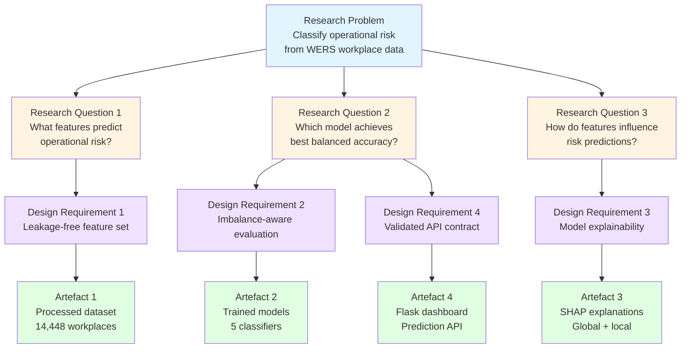
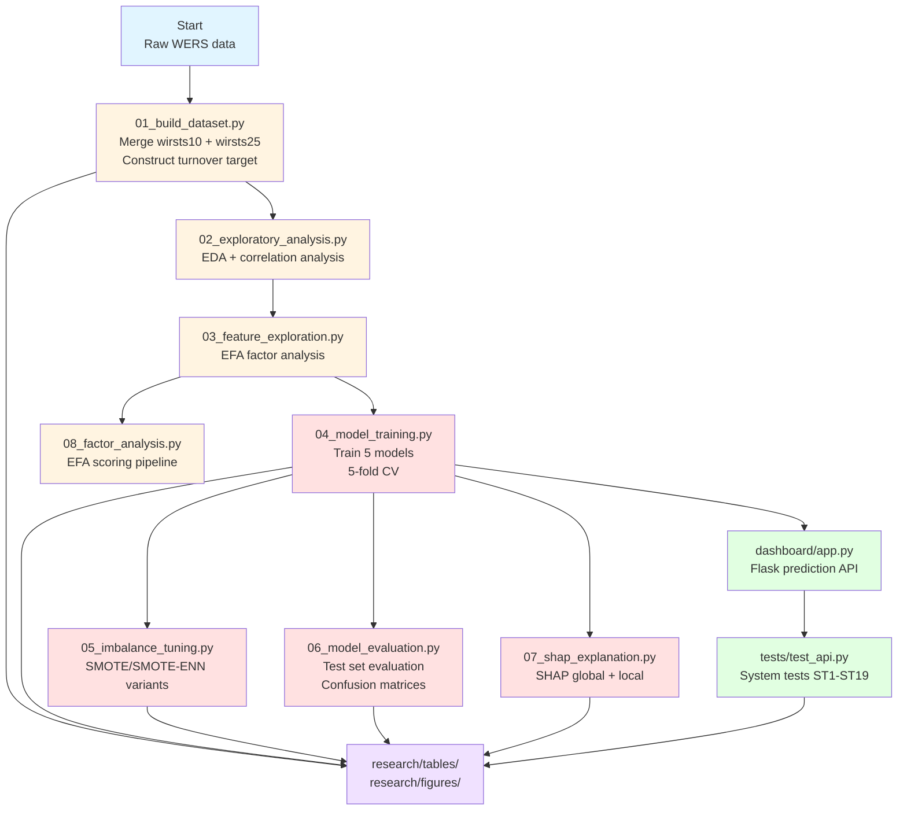
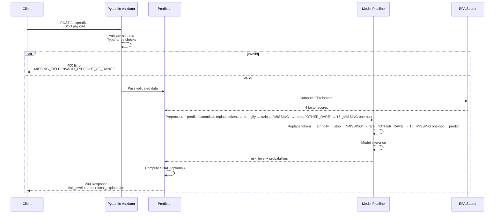

# Conceptual Diagrams (Mermaid)

## Figure 2.1: Relationship between the research problem, requirements and artefact



## Figure 3.1: Research and evaluation workflow



## Figure 3.2: Logical artefact architecture

```mermaid
graph TB
    subgraph DATA_LAYER[Data Layer]
        RAW[Raw WERS Data<br/>wirsts10.tab<br/>wirsts25.tab]
        PROC[Processed Dataset<br/>wers_operational_risk_merged.csv<br/>14,448 x 53]
        META[Metadata<br/>dataset_metadata.json<br/>model_metadata.json]
    end
    
    subgraph MODEL_LAYER[Model Layer]
        PIPE[Canonical Cleaning<br/>Missing-tokens → Stringify → Strip → "MISSING"<br/>+ Rare → "OTHER_RARE"<br/>16 _MISSING one-hot]
        EFA[EFA Scoring<br/>4 factor scores]
        MODELS[Trained Models<br/>logreg, rf, xgboost, lgbm, mlp]
        BEST[Best Model<br/>logreg.pkl]
    end
    
    subgraph API_LAYER[API Layer]
        VALID[Pydantic Validation<br/>OperationalRiskInput]
        PRED[Prediction Endpoint<br/>/api/predict]
        WHATIF[What-If Lab<br/>/api/whatif]
        INSIGHTS[Insights Endpoint<br/>/api/insights]
    end
    
    subgraph UI_LAYER[UI Layer]
        DASH[Flask Dashboard<br/>index.html]
        FORMS[Prediction Forms<br/>Risk Prediction<br/>What-If Simulator]
        CHARTS[Visualizations<br/>SHAP plots<br/>Feature importance]
    end
    
    RAW --> PROC
    PROC --> META
    PROC --> PIPE
    META --> PIPE
    PIPE --> EFA
    PIPE --> MODELS
    EFA --> MODELS
    MODELS --> BEST
    
    BEST --> PRED
    VALID --> PRED
    VALID --> WHATIF
    BEST --> WHATIF
    MODELS --> INSIGHTS
    META --> INSIGHTS
    
    PRED --> DASH
    WHATIF --> DASH
    INSIGHTS --> DASH
    DASH --> FORMS
    DASH --> CHARTS
    
    style DATA_LAYER fill:#e1f5ff
    style MODEL_LAYER fill:#fff4e1
    style API_LAYER fill:#ffe1e1
    style UI_LAYER fill:#e1ffe1
```

## Figure 4.1: Implemented training pipeline

```mermaid
graph LR
    subgraph INPUT[Input]
        CSV[wers_operational_risk_merged.csv]
    end
    
    subgraph PREPROCESS[Preprocessing]
        CLEAN[Sentinel Cleaning<br/>Missing codes → NaN]
        SPLIT[Stratified Split<br/>80/20 train/test]
        IMPUTE[Imputation<br/>Median (numeric)<br/>Mode (categorical)]
        SCALE[Scaling<br/>StandardScaler]
        ENCODE[Encoding<br/>OneHotEncoder]
        EFA[EFA Factors<br/>4 latent scores]
    end
    
    subgraph CV[Cross-Validation]
        SKFOLD[StratifiedKFold<br/>5-fold, shuffle=True]
        TRAIN[Train on 4 folds]
        VAL[Validate on 1 fold]
    end
    
    subgraph MODELS[Model Training]
        LR[Logistic Regression]
        RF[Random Forest]
        XGB[XGBoost]
        LGBM[LightGBM]
        MLP[MLP]
    end
    
    subgraph SELECTION[Model Selection]
        METRICS[Metrics<br/>Balanced Accuracy<br/>Macro-F1]
        SELECT[Select Best<br/>Max CV balanced acc]
    end
    
    subgraph OUTPUT[Output]
        PKL[best_model.pkl]
        META[model_metadata.json]
        TABLES[model_comparison.csv<br/>evaluation_summary.csv]
    end
    
    CSV --> CLEAN
    CLEAN --> SPLIT
    SPLIT --> IMPUTE
    IMPUTE --> SCALE
    IMPUTE --> ENCODE
    SCALE --> EFA
    ENCODE --> EFA
    EFA --> SKFOLD
    
    SKFOLD --> TRAIN
    TRAIN --> VAL
    VAL --> LR
    VAL --> RF
    VAL --> XGB
    VAL --> LGBM
    VAL --> MLP
    
    LR --> METRICS
    RF --> METRICS
    XGB --> METRICS
    LGBM --> METRICS
    MLP --> METRICS
    
    METRICS --> SELECT
    SELECT --> PKL
    SELECT --> META
    METRICS --> TABLES
    
    style INPUT fill:#e1f5ff
    style PREPROCESS fill:#fff4e1
    style CV fill:#f0e1ff
    style MODELS fill:#ffe1e1
    style SELECTION fill:#e1ffe1
    style OUTPUT fill:#f0e1ff
```

## Figure 4.2: Runtime inference architecture



## Figure 4.3: Flask API integration

```mermaid
graph TD
    subgraph CLIENT[Client]
        WEB[Web Browser<br/>Dashboard UI]
        API[API Client<br/>External requests]
    end
    
    subgraph FLASK[Flask Application]
        CORS[CORS Middleware]
        RATE[Rate Limiter<br/>120 req/60s]
        LOG[Request Logger<br/>X-Request-ID]
        
        subgraph ENDPOINTS[Endpoints]
            PRED[/api/predict<br/>/predict]
            WHATIF[/api/whatif<br/>/simulate]
            DATA[/api/data/summary<br/>/data]
            FEAT[/api/features]
            INS[/api/insights]
        end
        
        subgraph VALIDATION[Validation Layer]
            PYD[Pydantic Schema<br/>OperationalRiskInput]
            ERR[Error Handler<br/>Structured responses]
        end
        
        subgraph PREDICTION[Prediction Layer]
            PREDICTOR[OperationalRiskPredictor]
            MODEL[best_model.pkl]
            SHAP[SHAP Explainer]
        end
    end
    
    subgraph STORAGE[Storage]
        MDATA[model_metadata.json]
        SHAP_DATA[shap_importance.csv<br/>shap_local.json]
        CSV[wers_operational_risk_merged.csv]
    end
    
    WEB --> CORS
    API --> CORS
    
    CORS --> RATE
    RATE --> LOG
    LOG --> ENDPOINTS
    
    PRED --> PYD
    WHATIF --> PYD
    DATA --> ENDPOINTS
    FEAT --> ENDPOINTS
    INS --> ENDPOINTS
    
    PYD --> PREDICTOR
    PREDICTOR --> MODEL
    PREDICTOR --> SHAP
    
    MODEL --> MDATA
    SHAP --> SHAP_DATA
    DATA --> CSV
    INS --> MDATA
    FEAT --> SHAP_DATA
    
    PYD --> ERR
    ERR --> CORS
    
    style CLIENT fill:#e1f5ff
    style FLASK fill:#fff4e1
    style STORAGE fill:#e1ffe1
    style ENDPOINTS fill:#ffe1e1
    style VALIDATION fill:#f0e1ff
    style PREDICTION fill:#e1ffe1
```
